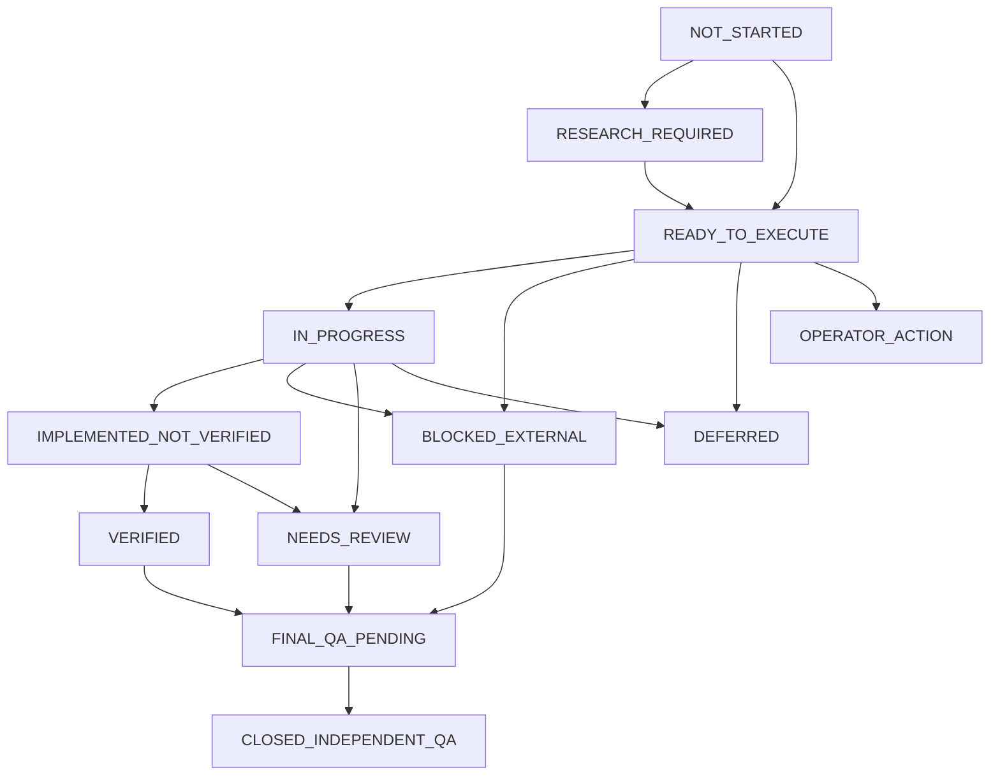
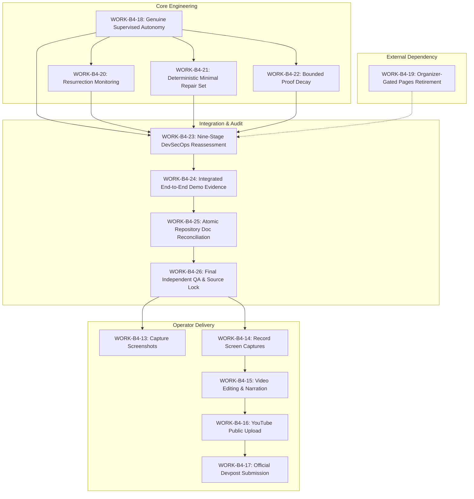
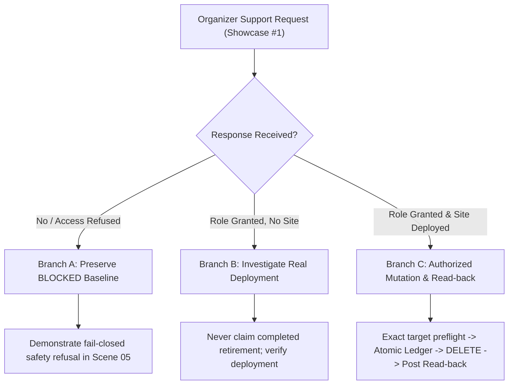
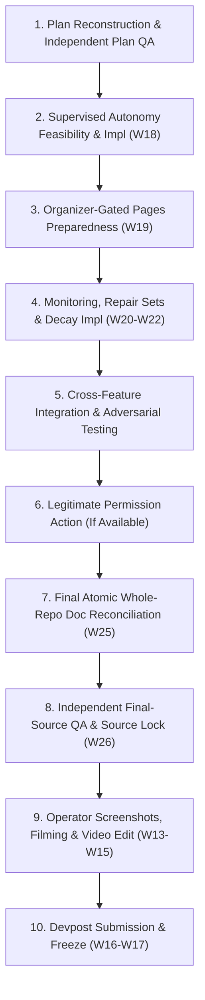
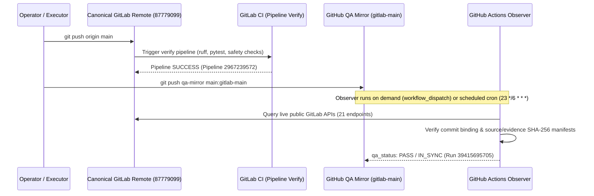

# Termivance — Canonical Competition Master Execution Plan, Award-Readiness Closure & Video/Submission Runbook

**Document Identity:** `plans/TERMIVANCE_MASTER_EXECUTION_PLAN.md`  
**Classification:** Canonical Project Execution Plan (Single Source of Truth)  
**Competition:** GitLab Transcend October 2026 — Life After Code  
**Selected Participation:** Path A / Start Fresh / Supervised (Compliance Status: `NEEDS_REVIEW` / Defensible with Documented Handoff Limitation; Target of `WORK-B4-18`)  
**Primary Award Objective:** Best Supervised Agent  
**Secondary Award Goal:** Credible Eligibility for Most Stages Covered (Without Inflated Claims)  
**Product Thesis:** A Proof-Bounded Software Retirement Protocol  
**Tagline:** Software retirement, proven within bounds.  
**Canonical Contest Repository:** [GitLab Project 87779099](https://gitlab.com/gitlab-ai-hackathon/transcend-october-2026/39306908/termivance)  
**Canonical Branch:** `main`  
**Non-Canonical QA Mirror:** [GitHub `zyganali-glitch/termivance-qa-mirror`](https://github.com/zyganali-glitch/termivance-qa-mirror) (branch `gitlab-main`)  
**Official Deadline:** October 27, 2026, 13:00 UTC / 16:00 Türkiye  
**Target Internal Submission Window:** October 26, 2026, 18:00–22:00 Türkiye  
**Incremental Personal Spend Target:** **$0.00**  
**Core Authority Contract:** Exactly one genuine GitLab Duo Custom Flow agent proposes; deterministic Python code governs. Model text cannot grant permissions, mutate providers, or award verdicts.

---

## 1. Frozen Product and Architecture

### 1.1 Product Thesis and Differentiating Concepts
Termivance is a software retirement protocol that replaces informal decommissioning checklists and unverified deletion actions with an auditable, deterministic lifecycle:

$$\text{DISCOVER} \longrightarrow \text{ANALYZE} \longrightarrow \text{AUTHORIZE} \longrightarrow \text{RETIRE} \longrightarrow \text{PROVE} \longrightarrow \text{WATCH}$$

It establishes three foundational innovations:

1. **Retirement Obligation Graph (ROG):** Software retirement modeled as an auditable directed acyclic dependency and obligation graph. Every prerequisite (target identity, provider observations, open work items, redeployment paths, required permissions, and operator approvals) must evaluate to satisfied before retirement can proceed.
2. **Bounded Absence:** Absence is treated as negative evidence bound strictly to an explicit target, checked observation surfaces, exact timestamps, and an empirical freshness window ($TTL \le 900\,\text{s}$). Termivance proves a verified state transition; it refuses universal or perpetual absence claims.
3. **Retirement Reversal (Resurrection Control):** Neutralizing an active service does not guarantee it will remain absent. If a target repository maintains automated CI/CD jobs, schedules, or triggers, software can be resurrected. Termivance analyzes surviving deployment mechanisms (e.g. `create-pages` with `pages: true`) and distinguishes transient absence from proven resurrection control.

### 1.2 Three Independent Claims
Termivance strictly segregates three questions. They are never conflated into a single monolithic status:

* **`SAFE_TO_RETIRE`:** Deterministic eligibility verdict based on provider facts, scope boundaries, and satisfied obligations.
* **`OBSERVED_ABSENT`:** Empirical post-mutation verification across independent provider surfaces (API + served URL) proving a true pre-to-post state transition.
* **`RESURRECTION_CONTROLLED`:** Proven neutralization or active tripwire monitoring of surviving redeployment mechanisms.

### 1.3 One Genuine GitLab Duo Custom Flow Agent
Termivance deploys exactly **one real GitLab Duo Custom Flow agent** ([Catalog Item `1018562`](https://gitlab.com/gitlab-ai-hackathon/transcend-october-2026/39306908/termivance)):
* Component: `AgentComponent` using official GitLab Duo Workflow schema.
* Trigger: Mention on canonical issues / work items.
* Role: Autonomous context inspection, file analysis (`get_repository_file`, `list_repository_tree`), and candidate obligation formulation.
* **Authority Limitation:** Advisory and non-authoritative. AI text cannot mutate resources, bypass policy, or alter deterministic verdicts.

### 1.4 Deterministic Python Authority Core
The core Python engine owns all provider mutations, obligation evaluations, and verdict determinations:
* Read-only client (`gitlab_client.py`): GET-only transport with fail-closed assertions.
* Graph evaluator (`engine.py`): Typed evaluation of retirement prerequisites.
* Bounded mutation executor (`pages.py`, `retirement.py`): Endpoint-restricted mutation (`DELETE /projects/:id/pages` only) under strict authorization preflights.
* Single-use durable ledger (`ledger.py`): Atomic, $fsync$-backed sealed reservation preventing double-spending or replay attacks.

### 1.5 Real Pages-Only Mutation Scope and Protected Project Identities
* **Sole Approved Destructive Demonstration Target:** Newly created, isolated disposable GitLab Pages project ID **`87785099`** (`.../termivance-b3-disposable-pages-demo`).
* **Strictly Protected From Mutation or Deletion:**
  * Canonical Termivance Repository: Project ID **`87779099`** (`PROTECTED`)
  * Organizer Showcase: Project ID **`87777871`** (`PROTECTED`)
  * Diagnostic Project: Project ID **`87786164`** (`PROTECTED / NON-TARGET`)
  * All other namespace projects and shared infrastructure.
* **Prohibited Actions:** No project deletion (`DELETE /projects/:id`), no user or namespace mutations, no fallback environment-stop substitutions for Pages unpublishing.

---

## 2. Verified Current State and Evidence Baseline

| Dimension | Baseline Fact / Evidence Record | Verification Mode |
|---|---|---|
| **GitLab Commit SHA (Last Verified Baseline)** | **`8fd656725929b9d790d4d79f5cff2659af650de5`** (Historical baselines: repair commit `6e808b33a4974fc9232ec9b3ca79bdc4b9281d24`; master plan baseline `b4431ec0b2bcba5f94a5636598b9b2ac32967ea5`) | `INDEPENDENTLY_VERIFIED` (GitLab API & remote HEAD) |
| **GitHub Mirror SHA (Baseline)** | **`8fd656725929b9d790d4d79f5cff2659af650de5`** on `gitlab-main` (Historical baselines: `6e808b3` and `b4431ec`) | `INDEPENDENTLY_VERIFIED` (`PASS / IN_SYNC`) |
| **GitLab CI Pipeline (Baseline)** | Verified Pipeline ID **`2967239572`**, Job ID **`17313891889`** (`stage: verify`, `status: success`); Historical baselines: Pipeline `2967141211` (Job `17313164853`), Pipeline `2966976920` (Job `17311100994`) | `INDEPENDENTLY_VERIFIED` (`status: success`) |
| **GitHub Observer Run (Baseline)** | Verified Run [**`39415695705`**](https://github.com/zyganali-glitch/termivance-qa-mirror/actions/runs/39415695705) (`PASS / IN_SYNC`); Historical baselines: Run [`39412372280`](https://github.com/zyganali-glitch/termivance-qa-mirror/actions/runs/39412372280), Run [`39406813557`](https://github.com/zyganali-glitch/termivance-qa-mirror/actions/runs/39406813557) | `INDEPENDENTLY_VERIFIED` (`PASS / IN_SYNC`) |
| **Git Commit & Future CI Identity Paradox** | Post-push verification for any new commit is dynamically bound and verified by GitLab CI and GitHub QA observer upon push; this plan records known verified baselines without fabricating future identifiers (Section 4.4) | Immutable Git Provenance Contract |
| **GitLab API Coverage** | **21 / 29** endpoints observed live; 8 endpoints access-limited (`401`/`403`/`404`) | `INDEPENDENTLY_VERIFIED` (Observer artifacts) |
| **License Attribution** | MIT License visible in GitLab Project Information & header | `INDEPENDENTLY_VERIFIED` (Public Project API) |
| **Local Test Suite** | **381 passed**, 0 failed; Ruff clean; 0 warnings | `EXECUTOR_REPORTED` (`pytest -q`) & CI verified |
| **CI Safety Assertions** | **40 / 40 passed** network-free (`ci_safety_assertions.py`); Note: raw CI job log traces return HTTP 401 unauthenticated, pipeline SUCCESS independently observed | `EXECUTOR_REPORTED` & CI Job verified |
| **Incremental Personal Spend** | **$0.00** across all batches (B1–B4) | `OPERATOR_CONFIRMED` |
| **Autonomy Compliance Status** | **`NEEDS_REVIEW`** (Defensible Supervised with documented handoff boundary; genuine Duo research + live Python review; event daemon not implemented; targeted by `WORK-B4-18`) | System Truth State |
| **Primary Duo Discovery** | Session `9710085`, Issue #5, Agent Note `4045401991` | `RECORDED_HISTORICAL` & Live API readable |
| **Historical Contextual Duo** | Session `9671626` (Issue #3, Agent Note `4040776241`) and Session `9704855` (Issue #4, Agent Note `4044819187`) remain separate historical records | `RECORDED_HISTORICAL` |
| **Approved Disposable Target** | Project `87785099`, commit `54fcc9ff2bfde1038a8192216178a5a8b6a6ee1d` | `RECORDED_HISTORICAL` (Target CI has `create-pages`) |
| **Target Pages Permissions** | Developer role returns HTTP 403 on `GET/DELETE /projects/:id/pages` | `INDEPENDENTLY_VERIFIED` (Live GitLab Provider 403) |
| **Current Deterministic Verdict** | **`BLOCKED`** (permissions insufficient, redeployment active) | `EXECUTOR_REPORTED` & Replayable Live |
| **Actual Pages Unpublication** | **`NOT_RUN`** (safely blocked by permissions) | `EXECUTOR_REPORTED` |
| **Observed Absence** | **`NOT_CLAIMED`** | System Truth State |
| **Resurrection Controlled** | **`NOT_CLAIMED`** | System Truth State |
| **DevSecOps Stage Selections** | **4 Defensible Core YES** (Plan, Verify, Secure, Govern); **1 Explicit Gated NO** (Release); **4 Qualified NEEDS_REVIEW** (Create, Package, Configure, Monitor) | Honest Lifecycle Audit (Sec 7) |

---

## 3. Independent Audit Recommendations, Operator Decisions & Implementation Ledger

This ledger reconciles all independent model and auditor findings, operator determinations, executor repairs, and current source/test evidence. Every finding is tracked with explicit status, rationale, implementation references, and acceptance criteria.

```
+----------------------------------------------------------------------------------------------------+
|                      AUDIT RECOMMENDATIONS & OPERATOR IMPLEMENTATION LEDGER                         |
+----+-----------------------+-----------+---------------------------------------+--------------------+
| ID | Finding & Area        | Decision  | Implemented Technical Resolution      | Evidence & Status  |
+----+-----------------------+-----------+---------------------------------------+--------------------+
| 01 | Supervised Continuity | ACCEPTED  | 7-step read-only pipeline with honest | Commit 8f3ef4f     |
|    | vs Event Daemon       | IN SCOPE  | EXECUTED_NOW and handoff boundaries;  | 381 tests PASS     |
|    |                       |           | P0 autonomy expansion in WORK-B4-18   | NEEDS_REVIEW       |
+----+-----------------------+-----------+---------------------------------------+--------------------+
| 02 | Neutral Target Risk   | ACCEPTED  | Issue #5 / Session 9710085 neutral    | Commit cd51e52     |
|    | Discovery (Issue #5)  |           | intake ingested without priming       | Live Issue #5 Note |
+----+-----------------------+-----------+---------------------------------------+--------------------+
| 03 | Authentic Duo Note    | ACCEPTED  | ProviderObservations binding and      | Commit 2282da8     |
|    | Provenance & Commit   |           | exact commit SHA binding              | test_b4_regression |
+----+-----------------------+-----------+---------------------------------------+--------------------+
| 04 | Cryptographic Binding | ACCEPTED  | HMAC operator approval, SHA-256       | Commit 0022a21     |
|    | in Proof Capsule      | IN SCOPE  | manifest, fail-closed verify-receipt  | ci_safety 40/40    |
+----+-----------------------+-----------+---------------------------------------+--------------------+
| 05 | Resurrection Witness  | ACCEPTED  | witness.py analyzes target's own CI   | Commit 0022a21     |
|    | & Counterexamples     |           | commit; proves redeployment mechanism | test_b4_duo_witness|
+----+-----------------------+-----------+---------------------------------------+--------------------+
| 06 | Real Pages 403 Gate   | ACCEPTED  | Fail-closed BLOCKED maintained;       | docs/HANDOFF.md    |
|    | & Organizer Dep       |           | branch tracking without fake bypass   | Showcase #1 track  |
+----+-----------------------+-----------+---------------------------------------+--------------------+
| 07 | 9-Stage Automation    | ACCEPTED  | Honest stage mapping; refuse inflated | MASTER_PLAN.md     |
|    | Integrity Audit       |           | checkbox claims for unautomated steps | Stage Audit table  |
+----+-----------------------+-----------+---------------------------------------+--------------------+
| 08 | Minimal Repair Set    | BOUNDED   | Speculative algorithms deferred;      | Bounded scope in   |
|    | & Proof Decay Scope   | APPROVED  | Bounded ROG repair in WORK-B4-21 and  | WORK-B4-21 &       |
|    |                       |           | contractual 900s decay in WORK-B4-22  | WORK-B4-22         |
+----+-----------------------+-----------+---------------------------------------+--------------------+
| 09 | Evidence Integrity &  | ACCEPTED  | 6-dim receipt classification, real    | Commits a6835f0,   |
|    | UI Privacy Repairs    |           | publisher contract, path sanitization | 55c9364 (all PASS) |
+----+-----------------------+-----------+---------------------------------------+--------------------+
| 10 | DevSecOps & Supervised| ACCEPTED  | Re-audited 9 stages (4 YES, 1 NO, 4   | Commit b4431ec /   |
|    | Truth Repair          |           | REVIEW); qualified Supervised status;  | 6e808b3 (PASS)     |
|    |                       |           | sanitized public paths; safe launchers| 381 tests PASS     |
+----+-----------------------+-----------+---------------------------------------+--------------------+
| 11 | Final Submission-Truth| ACCEPTED  | Launcher preflight bug fix; QA trigger| Commit 8fd6567     |
|    | Surgical Closure      |           | precision; SC-03/SC-08 truth repair;  | GitLab 2967239572  |
|    |                       |           | verified baseline CI/observer updates | Observer 39415695705|
+----+-----------------------+-----------+---------------------------------------+--------------------+
```

### Detailed Itemized Disposition of Audit Areas

#### 1. Supervised Workflow Continuity vs. Operator/CI Handoff
* **Original Finding:** Static review records assembled on disk do not prove end-to-end Supervised workflow autonomy. Hackathon Supervised expectations emphasize agents executing multi-step workflows with human review of outcomes.
* **Risk & Competition Impact:** High risk of losing "Best Supervised Agent" if handoff is viewed as a disconnected manual CLI invocation.
* **Decision:** **ACCEPTED FOR EXPANSION.** Implement runnable 7-step review pipeline with honest boundaries; specify technical feasibility study and native continuation in `WORK-B4-18`.
* **Rationale:** Preserves $0 spend and security boundaries while evaluating supported GitLab-native execution pathways.
* **Exact Scope:** `src/termivance/supervised_review.py`, CLI `supervised-review --execute`, and candidate continuation mechanisms.
* **Implementation Reference:** `src/termivance/supervised_review.py:run_supervised_investigation`.
* **Tests:** `tests/test_b4_supervised_workflow.py`, `tests/test_b4_regression_integrity.py`.
* **Provider Evidence:** Canonical Issue #5 Notes `4045401991` and `4045409264`.
* **Independent QA Evidence:** Verified baseline `8fd6567`, pipeline `2967239572`.
* **Unresolved Limitation:** Autonomous handoff between Duo note publication and Python execution is currently operator/CI-initiated; background daemon not demonstrated.
* **Next Action:** Execute feasibility investigation under `WORK-B4-18`.
* **Blocking Dependency:** GitLab Custom Flow execution runtime boundaries and permissions.
* **Status:** `STILL_OPEN` (Tracked under `WORK-B4-18`).
* **Future Acceptance Criterion:** Demonstrated continuous or automatically triggered chain from Duo investigation to deterministic Python conclusion with zero intermediate operator copy-paste.

#### 2. Neutral Target-Risk Discovery Using Issue #5
* **Original Finding:** Historical Duo sessions (9671626, 9704855) used targeted prompts. Duo must prove discovery from an unprimed, neutral retirement request.
* **Risk & Competition Impact:** Risk of jury perceiving Duo agent as primed with pre-existing hints.
* **Decision:** **ACCEPTED & CLOSED.**
* **Rationale:** Neutral Issue #5 prompt proves Duo autonomously inspects disposable target `87785099` repository.
* **Exact Scope:** Issue #5, Duo Session `9710085`.
* **Implementation Reference:** `src/termivance/supervised_review.py:DUO_SESSION_ID_NEUTRAL`.
* **Tests:** `tests/test_b4_supervised_workflow.py:test_run_supervised_investigation_with_neutral_discovery`.
* **Provider Evidence:** Issue #5 Note `4045401991`.
* **Independent QA Evidence:** Verified baseline `8fd6567`.
* **Unresolved Limitation:** Session URL returns HTTP 404 anonymously; verified via Control Room recorded readback.
* **Next Action:** None required for discovery proof; maintained in demo runbook.
* **Blocking Dependency:** None.
* **Status:** `CLOSED`.
* **Future Acceptance Criterion:** Discovery dataset remains bound to Session `9710085`.

#### 3. Authentic Duo-Note Provenance and Exact Commit Binding
* **Original Finding:** Duo candidate claims could be spoofed or decoupled from target's actual Git commit SHA.
* **Risk & Competition Impact:** Adversarial claims could corrupt obligation evaluation.
* **Decision:** **ACCEPTED & CLOSED.**
* **Rationale:** Require structural parsing and exact commit SHA matching against target repository facts.
* **Exact Scope:** `src/termivance/supervised_review.py:parse_duo_note`, `corroborate_candidate_claims`.
* **Implementation Reference:** `src/termivance/supervised_review.py`.
* **Tests:** `tests/test_b4_regression_integrity.py`.
* **Provider Evidence:** Provider commit `54fcc9ff2bfde1038a8192216178a5a8b6a6ee1d`.
* **Independent QA Evidence:** Verified baseline `8fd6567`.
* **Unresolved Limitation:** None.
* **Next Action:** Maintain regression assertions.
* **Blocking Dependency:** None.
* **Status:** `CLOSED`.
* **Future Acceptance Criterion:** Contradicted claims evaluate to `CONTRADICTED`; unobservable configurations evaluate to `UNRESOLVED`.

#### 4. Cryptographic Binding in Proof Capsule
* **Original Finding:** End-to-end cryptographic link recommended between Duo notes, deterministic decisions, and proof capsule.
* **Risk & Competition Impact:** Risk of tampering or replaying stale authorization tokens.
* **Decision:** **ACCEPTED IN SCOPE, WITH HONEST LIMITATIONS.**
* **Rationale:** Implement HMAC verification on operator approvals and SHA-256 manifests on proof capsules; do not claim asymmetric Duo signatures because GitLab Duo provides no signing keys to flow agents.
* **Exact Scope:** `src/termivance/ledger.py`, `src/termivance/capsule.py`, `src/termivance/approval_source.py`.
* **Implementation Reference:** `src/termivance/capsule.py:build_capsule`.
* **Tests:** `tests/test_b4_capabilities.py`, `scripts/ci_safety_assertions.py`.
* **Provider Evidence:** `evidence/b4/proof_capsule.json`.
* **Independent QA Evidence:** 40/40 network-free safety assertions.
* **Unresolved Limitation:** Duo notes remain authenticated via provider read-back, not cryptographic agent signatures.
* **Next Action:** Maintain tamper-evident checks.
* **Blocking Dependency:** None.
* **Status:** `CLOSED`.
* **Future Acceptance Criterion:** Tampered capsules fail closed under `capsule-verify`.

#### 5. Resurrection Witness and Redeployment Counterexamples
* **Original Finding:** Retiring a service does not guarantee absence if CI/CD configuration can resurrect it.
* **Risk & Competition Impact:** High SRE risk; failure to detect redeployment paths undermines protocol credibility.
* **Decision:** **ACCEPTED & CLOSED.**
* **Rationale:** Analyze target's own `.gitlab-ci.yml` at the exact observed commit for `create-pages` (`pages: true`).
* **Exact Scope:** `src/termivance/witness.py`.
* **Implementation Reference:** `src/termivance/witness.py:build_resurrection_witness`.
* **Tests:** `tests/test_b4_duo_witness.py`.
* **Provider Evidence:** `evidence/b4/witness_87785099.json`.
* **Independent QA Evidence:** Verified baseline `8fd6567`.
* **Unresolved Limitation:** Static witness analyzes repository configuration; continuous runtime resurrection monitoring is planned in `WORK-B4-20`.
* **Next Action:** Implement `WORK-B4-20`.
* **Blocking Dependency:** None.
* **Status:** `CLOSED` (Static witness); continuous monitoring tracked under `WORK-B4-20`.
* **Future Acceptance Criterion:** Static witness continues to flag `MECHANISM_PRESENT_IN_OBSERVED_CONFIG`.

#### 6. Real Pages 403 Gate and External Organizer Dependency
* **Original Finding:** Target `87785099` returns HTTP 403 on Pages API for Developer role. Bypassing this via mock or environment stop is unacceptable.
* **Risk & Competition Impact:** Destructive unpublishing is blocked without Maintainer role.
* **Decision:** **ACCEPTED & EXTERNALLY BLOCKED.**
* **Rationale:** Track organizer request on Showcase #1; maintain fail-closed `BLOCKED` baseline; never attempt unauthorized mutations.
* **Exact Scope:** `docs/HANDOFF.md`, Showcase Work Item #1, `WORK-B4-19`.
* **Implementation Reference:** `src/termivance/retirement.py`, `evidence/b4/decision.json`.
* **Tests:** `tests/test_retirement.py:test_developer_only_permission_cannot_be_safe_to_retire`.
* **Provider Evidence:** Live provider HTTP 403 responses recorded in `evidence/b4/portfolio.json`.
* **Independent QA Evidence:** Verified baseline `8fd6567`.
* **Unresolved Limitation:** Mutation cannot execute live until organizer grants Maintainer permissions.
* **Next Action:** Monitor Showcase #1; execute `WORK-B4-19` branch protocols.
* **Blocking Dependency:** Hackathon organizer grant of Maintainer role on project `87785099`.
* **Status:** `EXTERNALLY_BLOCKED`.
* **Future Acceptance Criterion:** Maintain `BLOCKED` under Branch A; execute genuine mutation and dual-channel read-back only under Branch C.

#### 7. Nine-Stage Automation Integrity Audit
* **Original Finding:** Overconfident claims of checking 8 or 9 DevSecOps stages without demonstrable automation in each stage.
* **Risk & Competition Impact:** Disqualification or judge skepticism due to inflated category claims.
* **Decision:** **ACCEPTED & CLOSED FOR CURRENT AUDIT; REASSESSMENT IN WORK-B4-23.**
* **Rationale:** Restrict default Devpost recommendations to 4 Defensible Core stages (Plan, Verify, Secure, Govern), strictly gate Release (NO), and classify remaining 4 as `NEEDS_REVIEW`.
* **Exact Scope:** Section 7 of Master Plan, `WORK-B4-23`.
* **Implementation Reference:** Section 7 DevSecOps Matrix.
* **Tests:** Static document consistency assertions.
* **Provider Evidence:** Live CI history and Duo flow sessions.
* **Independent QA Evidence:** Verified baseline `8fd6567`.
* **Unresolved Limitation:** Automation in Create, Package, Configure, Monitor requires honest qualification.
* **Next Action:** Execute final evidence reassessment under `WORK-B4-23` after engineering outcomes are settled.
* **Blocking Dependency:** Completion of `WORK-B4-18` through `WORK-B4-20`.
* **Status:** `CLOSED` for baseline; `STILL_OPEN` for final reassessment in `WORK-B4-23`.
* **Future Acceptance Criterion:** Devpost selections strictly mirror verified evidence without exaggeration.

#### 8. Bounded Minimal Repair Set & Proof Decay Scope (Reconciliation of Deferred Item)
* **Original Finding:** Speculative graph repair algorithms and continuous temporal decay curves were proposed.
* **Risk & Competition Impact:** High algorithmic complexity risked regressions and missed deadlines with minimal differentiation.
* **Historical Decision (2026-10-19):** **DEFERRED** as open-ended speculative research (DEC-20261019-03).
* **Updated Disposition (2026-10-20):** **RECONCILED & APPROVED AS BOUNDED SCOPE.**
  * *Speculative Global Graph Optimization:* Remains **DEFERRED**.
  * *Bounded Candidate Repair Sets (`WORK-B4-21`):* **APPROVED.** Bounded deterministic prerequisite-remediation guidance derived strictly from the actual Retirement Obligation Graph.
  * *Contractual Freshness Decay (`WORK-B4-22`):* **APPROVED.** Deterministic evidence state machine enforcing contractual $TTL \le 900\,\text{s}$ freshness, timestamp validation, and fail-closed revalidation.
* **Rationale:** Delivers concrete product value and auditability within strict bounded scope without introducing speculative prediction engines or infinite-horizon models.
* **Exact Scope:** `WORK-B4-21`, `WORK-B4-22`.
* **Implementation Reference:** To be implemented in `src/termivance/repair.py` and `src/termivance/decay.py`.
* **Tests:** Planned property-oriented and boundary tests in `tests/test_b4_repair_sets.py` and `tests/test_b4_proof_decay.py`.
* **Provider Evidence:** Existing provider observation timestamps and graph obligations.
* **Independent QA Evidence:** To be independently verified in `WORK-B4-26`.
* **Unresolved Limitation:** Repair guidance is advisory and never authorizes mutations; decay does not predict future provider state.
* **Next Action:** Implement bounded features in `WORK-B4-21` and `WORK-B4-22`.
* **Blocking Dependency:** None.
* **Status:** `READY_TO_EXECUTE` (Bounded scope approved).
* **Future Acceptance Criterion:** Deterministic candidate repair sets generated without expanding authority; evidence states expire cleanly at TTL boundaries.

#### 9. Evidence Integrity & UI Privacy Repairs
* **Original Finding:** Material defects in receipt provenance, publisher contracts, and Windows path leaks in UI data.
* **Risk & Competition Impact:** Inconsistent evidence presentation and privacy leaks in public submission artifacts.
* **Decision:** **ACCEPTED & CLOSED.**
* **Rationale:** 6-dimensional receipt classifier, typed `PublishResult`, and recursive path sanitizer in Control Room builder.
* **Exact Scope:** `scripts/build_control_room.py`, `src/termivance/publisher.py`, `control_room/data.js`.
* **Implementation Reference:** Commits `a6835f0`, `55c9364`.
* **Tests:** `tests/test_b4_repair_closure.py`, `tests/test_control_room_render.py`.
* **Provider Evidence:** Rebuilt `control_room/data.js` with sanitized paths.
* **Independent QA Evidence:** Verified baseline `8fd6567`.
* **Unresolved Limitation:** None.
* **Next Action:** Maintain sanitization in future Control Room rebuilds.
* **Blocking Dependency:** None.
* **Status:** `CLOSED`.
* **Future Acceptance Criterion:** Zero absolute developer machine paths in public artifacts; receipt provenance strictly separated.

#### 10. Consolidated Master Plan Truth Repair
* **Original Finding:** Earlier plan drafts contained self-referential commit SHAs, overconfident DevSecOps claims, and unhardened launcher scripts.
* **Risk & Competition Impact:** Auditor rejection for internal contradictions.
* **Decision:** **ACCEPTED & CLOSED.**
* **Rationale:** Harmonize plan with verified baseline facts, qualify Supervised autonomy, and harden launchers.
* **Exact Scope:** Master plan, launcher scripts.
* **Implementation Reference:** Commit `6e808b3`.
* **Tests:** Launcher preflight checks live verified.
* **Provider Evidence:** Pipeline `2967141211`, Observer Run `39412372280`.
* **Independent QA Evidence:** Verified baseline `8fd6567`.
* **Unresolved Limitation:** None.
* **Next Action:** Enforce atomic document synchronization in `WORK-B4-25`.
* **Blocking Dependency:** None.
* **Status:** `CLOSED`.
* **Future Acceptance Criterion:** Zero self-referential SHA contradictions.

#### 11. Final Submission-Truth Surgical Closure
* **Original Finding:** Unreachable code in Windows launcher preflight, inaccurate GitHub Actions trigger description, and anonymous access boundary in Scene SC-03.
* **Risk & Competition Impact:** Script execution failure on Windows; inaccurate depiction of QA bridge triggers.
* **Decision:** **ACCEPTED & CLOSED.**
* **Rationale:** Fix preflight assertions, accurately document on-demand (`workflow_dispatch`) and 6-hour cron triggers, and document Scene SC-03 public access boundary.
* **Exact Scope:** `scripts/run_supervised_review.bat`, Master Plan.
* **Implementation Reference:** Commit `8fd6567`.
* **Tests:** 381 pytest tests PASS, 40 safety assertions PASS.
* **Provider Evidence:** GitLab Pipeline `2967239572`, GitHub Observer Run `39415695705`.
* **Independent QA Evidence:** Verified baseline `8fd656725929b9d790d4d79f5cff2659af650de5`.
* **Unresolved Limitation:** None.
* **Next Action:** Reconcile historical `WORK-B4-12` in work register.
* **Blocking Dependency:** None.
* **Status:** `CLOSED`.
* **Future Acceptance Criterion:** Verified pipeline `2967239572` and observer run `39415695705` formally recorded as baseline.

---

## 4. Atomic Work Completion, Evidence and Document Consistency Contract & Remaining Work Register

### 4.1 One Coherent Change Unit Contract
Every future engineering work package in Termivance must be executed, committed, and verified as **one coherent change unit**. An engineering task is not complete merely because its code compiles or its local unit tests pass.

Each atomic change unit must atomically include all directly impacted:
1. **Implementation files** (source modules under `src/termivance/` or relevant tooling);
2. **Automated regression and adversarial tests** (under `tests/` covering positive, negative, and edge cases);
3. **Relevant configuration** (under `config/` or environment settings);
4. **Legitimate recorded evidence** (under `evidence/b4/`, with verified provenance labels);
5. **Evidence schema and manifest updates** (where data contracts or cryptographic digests change);
6. **Control Room generation and UI files** (`control_room/index.html` and rebuilt `control_room/data.js` where UI is impacted);
7. **Canonical Master Execution Plan state** (`plans/TERMIVANCE_MASTER_EXECUTION_PLAN.md` work register and evidence baseline);
8. **README operational instructions and metrics** (`README.md` test totals, CLI syntax, and operational caveats);
9. **Evidence Matrix claims and logs** (`docs/EVIDENCE_MATRIX.md`);
10. **Active Handoff critical facts** (`docs/HANDOFF.md`);
11. **Relevant demo scripts and Devpost materials** (`docs/DEMO_SCRIPT.md` and submission packets);
12. **Directly impacted supporting documentation** (preventing multi-document drift).

> **Enforcement Rule:** Implementation and documentation must never be decoupled into separate micro-batches. Changes to documentation directly affected by an engineering change must land in the same commit as the code and tests.

### 4.2 Exact Work Lifecycle and State Transition Invariants
Every work package in the Termivance register moves through an explicit, strictly governed lifecycle:



#### Lifecycle State Definitions:
* **`NOT_STARTED`:** Initial recorded state; dependencies and scope documented, work not commenced.
* **`RESEARCH_REQUIRED`:** Technical feasibility, GitLab platform capabilities, or permissions must be investigated before implementation design can be finalized.
* **`READY_TO_EXECUTE`:** Prerequisites, dependencies, and technical specifications are fully established; work is authorized for execution within the active macro-batch.
* **`IN_PROGRESS`:** Implementation, testing, or evidence collection is actively underway.
* **`IMPLEMENTED_NOT_VERIFIED`:** Code and tests are written, but independent local test suite, linting, safety assertions, or CI pipelines have not yet completed.
* **`VERIFIED`:** Implementation, tests, configuration, evidence, and directly affected documents have been completed and verified locally and via passing CI.
* **`BLOCKED_EXTERNAL`:** Work is halted due to an external dependency, missing provider permission, or hackathon organizer action (e.g. Maintainer access on project `87785099`).
* **`NEEDS_REVIEW`:** Implementation is functional with documented limitations, but platform boundaries or policy ambiguities require operator or judge qualification.
* **`DEFERRED`:** Formally postponed by recorded operator decision to maintain schedule, zero personal spend, or deadline integrity.
* **`OPERATOR_ACTION`:** Non-delegable human responsibility (e.g. video narration, screen recording, YouTube upload, Devpost submission).
* **`FINAL_QA_PENDING`:** All engineering and documentation units are complete and pushed; awaiting independent whole-batch QA audit.
* **`CLOSED_INDEPENDENT_QA`:** Independently audited, verified against canonical remote and mirror, and accepted by external QA.

#### Invariants:
1. A feature is **never** `VERIFIED` merely because code has been written.
2. An executor **cannot self-award** `CLOSED_INDEPENDENT_QA` or independent QA PASS.
3. `NOT_RUN`, `NOT_OBSERVED`, `NOT_CLAIMED`, `BLOCKED`, and `INCONCLUSIVE` must remain strictly distinct across all states and records.

### 4.3 Evidence Required for Every State Transition (17-Field Transition Schema)
Every recorded state transition in the work register must be supported by an authentic transition record containing:

1. **Work Item ID:** Stable identifier (e.g. `WORK-B4-18`).
2. **Prior Status:** Exact prior lifecycle state.
3. **New Status:** Exact target lifecycle state.
4. **Implementation Commit SHA:** Exact Git commit SHA introducing the change.
5. **Changed-File Inventory:** Explicit list of files modified, added, or deleted.
6. **Tests Added or Changed:** Test modules and specific test cases added or updated.
7. **Test Results and Failures:** Exact execution counts (passed, failed, skipped) from pytest.
8. **Security Contract Assertions:** Results from `scripts/ci_safety_assertions.py` (e.g. 40/40 PASS).
9. **Source Commit Identity:** Commit SHA of the target repository or source baseline evaluated.
10. **Applicable Provider Project & Resource IDs:** Specific GitLab project IDs (e.g. `87785099`, `87779099`).
11. **Observation Timestamp (UTC):** ISO 8601 UTC timestamp of provider checks.
12. **API Endpoint & HTTP Status:** Exact HTTP method, path, and returned status code.
13. **Evidence Classification:** Labeled provenance (`LIVE_GITLAB_OBSERVED`, `RECORDED_HISTORICAL`, `FIXTURE`, `NOT_OBSERVED`).
14. **Resulting GitLab CI Pipeline & Job ID:** Official pipeline and verification job IDs.
15. **GitHub Independent Observer Run ID & Parity:** Actions run ID and drift verdict (`IN_SYNC` / `DRIFT_DETECTED`).
16. **Exact Remaining Limitation:** Truthful disclosure of any unresolved edge or boundary.
17. **Responsible Party & Independent QA Verdict:** Assigned entity and independent auditor confirmation.

### 4.4 Git Commit and Future CI Identity Paradox Resolution
A Git commit cannot include its own future CI pipeline ID, GitLab job ID, or GitHub observer run ID because computing those values requires the commit to exist, be pushed, and be scheduled by external systems.

To eliminate circular dependencies and prevent fictional SHA fabrication, Termivance establishes the following permanent protocol:

1. **Commit Stage:** The implementation commit records its own source code, tests, local evidence, and references to *known prior verified baselines* as historical benchmarks. Post-push CI fields are explicitly marked `PENDING_REMOTE_PIPELINE`.
2. **Remote Execution Stage:** Pushing the commit triggers the canonical GitLab CI verification pipeline (`verification` job) and subsequently the external GitHub QA observer (`gitlab-qa.yml`).
3. **Observation Stage:** Authentic CI pipeline IDs and GitHub Actions run IDs are generated and permanently stored by the external provider platforms.
4. **Reconciliation Stage:** In the *subsequent legitimate engineering or planning update*, those external IDs are reconciled into the living Master Plan baseline without initiating an infinite cycle of documentation-only commits.
5. **Integrity Rule:** An earlier pipeline or run ID must never be misrepresented as the current commit's verification record.

### 4.5 Independent Acceptance and Anti-Self-Certification Gate
* The implementation executor is strictly prohibited from awarding itself an independent QA PASS or transitioning items to `CLOSED_INDEPENDENT_QA`.
* Only an independent auditor or external verification agent may examine the commit, remote HEAD, CI logs, observer artifacts, and document consistency to declare a work item closed.
* Any claim of capability without an observable, reproducible artifact is immediately classified as `BLOCKED` or `INCONCLUSIVE`.

---

### 4.6 Remaining Work Register (B4 Scope)

| Stable ID | Objective & Significance | Priority | Status | Dependency | Responsibility | Target Date | Affects | Acceptance Criteria Summary |
|---|---|---|---|---|---|---|---|---|
| `WORK-B4-01` | Establish Canonical Master Execution Plan | P0 | **DONE** | None | Executor | 2026-10-20 | Eligibility / Quality | Single canonical plan covering all 17 sections |
| `WORK-B4-02` | Reconcile Master Plan & Handoff | P0 | **DONE** | `WORK-B4-01` | Executor | 2026-10-20 | Quality | Zero contradictory statuses across repo |
| `WORK-B4-03` | Add Media Working Directories to `.gitignore` | P1 | **DONE** | None | Executor | 2026-10-20 | Security / Cleanliness | `submission_media/` ignored; clean git status |
| `WORK-B4-04` | Safe Reproducible CLI Launcher (Scene 05) | P0 | **DONE** | None | Executor | 2026-10-20 | Demo / Filming | Preflight checks; truthful exit status; `--no-pause` |
| `WORK-B4-05` | Track Organizer Pages Support Request | P0 | **WAITING_EXTERNAL** | Hackathon Organizers | Operator | 2026-10-24 | Demo / Release Stage | Maintainer access granted OR formal alternative |
| `WORK-B4-06` | Enterprise Control Room Usability Audit | P1 | **DONE** | `control_room/` | Executor | 2026-10-20 | Demo / Presentation | 5 tabs verified at 100% zoom, 1920x1080 |
| `WORK-B4-07` | Baseline Remote Push & Verification (`b4431ec`) | P0 | **DONE** | `WORK-B4-01`–`06` | Executor | 2026-10-20 | Eligibility / CI | Remote SHA `b4431ec`; Pipeline `2966976920` success |
| `WORK-B4-08` | Baseline GitHub QA Mirror Sync (`b4431ec`) | P0 | **DONE** | `WORK-B4-07` | Executor | 2026-10-20 | QA Bridge | Mirror branch identical to remote GitLab SHA `b4431ec` |
| `WORK-B4-09` | Baseline Independent Observer Run (`b4431ec`) | P0 | **DONE** | `WORK-B4-08` | Executor | 2026-10-20 | QA Bridge | Run `39406813557` `PASS`, `drift: IN_SYNC` |
| `WORK-B4-10` | Supervised Autonomy Continuous-Handoff Evaluation | P0 | **NEEDS_REVIEW** | Platform Boundary | Operator / Executor | 2026-10-24 | Contest Category Claim | Operational boundary documented; target of `WORK-B4-18` |
| `WORK-B4-11` | Consolidated B4 Repair Push & Verification (`6e808b3`) | P0 | **DONE** | `WORK-B4-01`–`10` | Executor | 2026-10-20 | Eligibility / Verification | Remote SHA `6e808b3`; Pipeline `2967141211`; Run `39412372280` |
| `WORK-B4-12` | Final Submission-Truth Surgical Closure & Post-Push Observer | P0 | **CLOSED_INDEPENDENT_QA** | `WORK-B4-11` | Executor / Auditor | 2026-10-20 | Eligibility / Verification | Verified SHA `8fd6567`; Pipeline `2967239572`; Run `39415695705` |
| `WORK-B4-18` | Genuine Supervised Autonomy Integration | P0 | **READY_TO_EXECUTE** | `WORK-B4-12` | Executor | 2026-10-22 | Best Supervised Agent | Feasibility study complete; continuous supported handoff chain |
| `WORK-B4-19` | Organizer-Gated Real Pages Retirement | P0 | **BLOCKED_EXTERNAL** | Showcase #1 / Organizers | Operator / Executor | 2026-10-24 | Release Stage / Bounded Absence | Authorized unpublish + dual read-back under Branch C; fail-closed under A |
| `WORK-B4-20` | Resurrection Monitoring & Current-Truth Downgrade | P1 | **READY_TO_EXECUTE** | `WORK-B4-18` | Executor | 2026-10-23 | Product Differentiator | Read-only target monitoring, CI schedule feasibility, truth downgrade |
| `WORK-B4-21` | Deterministic Minimal Repair Set | P1 | **READY_TO_EXECUTE** | `WORK-B4-18` | Executor | 2026-10-23 | SRE Innovation | Bounded candidate repair guidance from ROG; no authority expansion |
| `WORK-B4-22` | Bounded Proof Decay and Freshness Revalidation | P1 | **READY_TO_EXECUTE** | `WORK-B4-18` | Executor | 2026-10-23 | Auditability | 6-state decay machine, 900s TTL enforcement, fail-closed revalidation |
| `WORK-B4-23` | Nine-Stage DevSecOps Evidence Reassessment | P0 | **READY_TO_EXECUTE** | `WORK-B4-18`–`22` | Executor | 2026-10-24 | Most Stages Covered | Rigorous post-engineering audit across all 9 stages; Devpost sync |
| `WORK-B4-24` | Integrated End-to-End Demo and Evidence Binding | P0 | **READY_TO_EXECUTE** | `WORK-B4-18`–`23` | Executor | 2026-10-24 | Judge Presentation | Unified reproducible evidence chain, Control Room alignment |
| `WORK-B4-25` | Atomic Repository-Wide Documentation Reconciliation | P0 | **READY_TO_EXECUTE** | `WORK-B4-18`–`24` | Executor | 2026-10-25 | Submission Integrity | Whole-repository contradiction audit (DOC-01 to DOC-10) closed atomically |
| `WORK-B4-26` | Final Independent QA, Source Lock and Submission Readiness | P0 | **FINAL_QA_PENDING** | `WORK-B4-25` | Auditor / Operator | 2026-10-25 | Submission Freeze | All gates pass; final commit locked; ready for filming & Devpost |
| `WORK-B4-13` | Capture Demonstration Media & Screenshots | P0 | **OPERATOR_ACTION** | `WORK-B4-26` | Operator | 2026-10-25 | Presentation / Devpost | 5 sanitized PNGs captured at 1920x1080 per register (DOC-09) |
| `WORK-B4-14` | Record Video Screen Captures (Scenes 01–09) | P0 | **OPERATOR_ACTION** | `WORK-B4-26` | Operator | 2026-10-25 | Submission Video | Raw MP4 captures for all 9 scenes per Section 11 Runbook |
| `WORK-B4-15` | Video Editing, English Voice-Over & Narration | P0 | **OPERATOR_ACTION** | `WORK-B4-14` | Operator | 2026-10-25 | Submission Video | Final MP4 (< 180s, target 174s), clear voice-over, readable text |
| `WORK-B4-16` | Upload Video to YouTube as Public | P0 | **OPERATOR_ACTION** | `WORK-B4-15` | Operator | 2026-10-26 | Devpost Submission | Public YouTube URL accessible to judges |
| `WORK-B4-17` | Complete Official Devpost Submission | P0 | **OPERATOR_ACTION** | `WORK-B4-16` | Operator | 2026-10-26 | Contest Eligibility | All fields completed, URL linked, submitted before 22:00 Türkiye |

---

### 4.7 Detailed Technical Implementation Specifications for Remaining Engineering Work



#### 4.7.1 WORK-B4-18 — Genuine Supervised Autonomy Integration
* **Priority:** P0 / Highest Award-Critical Engineering Concern.
* **Objective:** Close the operational handoff gap between genuine Duo Custom Flow investigation and deterministic Python review to deliver defensible end-to-end Supervised autonomy without violating the $0.00 personal spend policy or least-privilege security boundaries.
* **Current Deficiency:** Currently, a genuine Duo session analyzes a retirement request, and the deterministic Python review performs real provider-backed work. However, the handoff between the Duo result and Python execution is operator/CI-initiated. A manually stitched historical Duo record followed by a separately launched CLI command is not proof of autonomous end-to-end execution. This cannot be resolved by changing wording alone.
* **Target Operational Contract:**
  $$\text{ONE HUMAN INITIAL REQUEST} \longrightarrow \text{ONE GENUINE DUO SESSION} \longrightarrow \text{TARGET INVESTIGATION} \longrightarrow \text{STRUCTURED CANDIDATES} \longrightarrow \text{AUTOMATIC DETERMINISTIC PYTHON EVALUATION} \longrightarrow \text{EVIDENCE-BOUND RESULT} \longrightarrow \text{ONE HUMAN OUTCOME REVIEW}$$
  * Zero intermediate manual action, operator copy/paste, or intermediate human approval between agent investigation and read-only deterministic conclusion.
  * Human approval remains mandatory for any destructive mutation.
  * Exactly one real Duo Custom Flow agent is deployed.
* **Mandatory Technical Feasibility Investigation:**
  The executor must investigate and evaluate, against current official GitLab documentation and the deployed flow configuration (`flows/termivance_retirement_analyst.yaml`):
  1. *Existing `AgentComponent`:* Capabilities and limitations of Catalog Item `1018562`.
  2. *`coding_environment`:* Behavior and permission constraints of `coding_environment: none` versus `full`.
  3. *GitLab Flow CI/CD Runtime:* Setup configuration, supported base images, repository checkout mechanisms.
  4. *Deterministic Invocation:* Whether the GitLab-hosted agent can invoke deterministic repository code via documented tools (`run_command`, `run_tests`).
  5. *Tool Restrictions:* Availability and isolation boundaries of agent execution tools.
  6. *`agent-config.yml`:* Capabilities for executing pre-run or verification setup scripts.
  7. *Native Event Triggers:* Webhooks, issue mention triggers (`eventTypes: [0]`), and human-trigger restrictions.
  8. *GitLab CI Continuation:* Whether a GitLab CI pipeline job can execute downstream of a Duo flow execution without manual triggers.
  9. *`CI_JOB_TOKEN` Limitations:* Read permissions on issues and issue notes (`GET /projects/:id/issues/:iid/notes`).
  10. *Service-Account Boundaries:* Composite identity permissions and protected repository barriers.
  11. *Billing Boundaries:* Credit attribution to flow service accounts, namespace limits, on-demand billing risks.
  12. *Architecture Compatibility:* Compliance with the frozen one-agent, deterministic authority architecture.
* **Required Architecture Choice:**
  * *Preferred Path:* A single genuine GitLab Custom Flow execution that conducts both agent investigation and safely invokes deterministic Python review, if documented runtime support and permissions genuinely permit it.
  * *Alternative Path:* A GitLab-native automatic CI continuation demonstrably bound to the same initial human request, with zero intermediate manual steps.
  * *Fallback Rule:* If neither path can satisfy full autonomy under current permissions and $0.00 spend: preserve `NEEDS_REVIEW` or `BLOCKED_EXTERNAL`, document the exact missing platform capability, maintain the strongest legitimate runnable fallback (`supervised-review --execute`), and never falsely mark the full-autonomy requirement `VERIFIED`.
* **Mandatory Test and Evidence Specification:**
  * *Tests:* Single initial trigger; target identity binding; structured candidate provenance; automatic Python execution; wrong-target refusal; spoofed/malformed Duo note refusal; stale commit SHA refusal; provider HTTP 401/403/404 handling; duplicate invocation idempotency; zero unauthorized mutation; human review boundary enforcement; no credential leakage.
  * *Evidence:* Authentic GitLab Duo session URL, execution trace/log, deterministic result artifact, causal bindings, and published outcome note. Local mock simulations cannot close this work.

#### 4.7.2 WORK-B4-19 — Organizer-Gated Real Pages Retirement
* **Priority:** P0 / Externally Gated Dependency.
* **Objective:** Establish rigorous, fail-closed execution protocols for disposable project `87785099` Pages unpublishing, tracking organizer support on Showcase Work Item #1.
* **Sole Mutation Target:** Project ID `87785099` (`.../termivance-b3-disposable-pages-demo`).
* **Protected Resources:** Canonical `87779099`, Showcase `87777871`, Diagnostic `87786164`, and all other namespace assets are strictly protected.
* **Required Operation:** `DELETE /projects/87785099/pages` (GitLab API requires Maintainer or Owner role).
* **Decision Branches:**
  * **Branch A (Access Not Granted / Refused):**
    * Maintain `BLOCKED` status.
    * No destructive attempt is dispatched.
    * Video and documentation highlight fail-closed safety refusal as an intentional security feature.
    * External limitation recorded in Evidence Matrix.
  * **Branch B (Role Granted, but Pages Site Not Published):**
    * Verify role via authenticated API read.
    * Query `project.pagesDeployments` and `/pages` endpoint.
    * If site was never published, do not claim a retirement transition.
    * Preserve `NOT_RUN` and `NOT_CLAIMED`.
  * **Branch C (Maintainer Granted and Publication Verified):**
    * Require all 12 prerequisites before mutation dispatch:
      1. Exact disposable project ID `87785099` and full path binding.
      2. Fresh target commit SHA verified.
      3. Live Pages deployment independently proven.
      4. Exact served URL and unique marker (`TERMIVANCE-B3-DISPOSABLE-PAGES-MARKER-7f3c9a`) observed.
      5. Maintainer/Owner authority proven via provider API.
      6. Explicit operator approval for the exact action.
      7. Verified operator trust policy and HMAC signature.
      8. Sealed single-use ledger reservation (`RESERVED_BEFORE_MUTATION`).
      9. All Retirement Obligation Graph prerequisites satisfied.
      10. Surviving `create-pages` redeployment mechanism neutralized or controlled.
      11. Independent pre-state observations recorded.
      12. Immediately refreshed `SAFE_TO_RETIRE` decision.
    * Execute `DELETE /projects/87785099/pages`.
    * Perform independent post-action readback on Pages API AND served URL.
    * Generate bounded absence receipt ($TTL \le 900\,\text{s}$).
* **Failure and Reversibility Handling:**
  * Explicit handling for HTTP 401/403/404, delayed CDN convergence, marker mismatch, inconclusive URL reads, target drift, and re-appearance.
  * If permissions arrive before video lock, execute atomic refresh across code, tests, evidence, UI, plan, README, and Devpost.
  * An organizer response alone is never authorization to mutate: explicit operator approval is mandatory.

#### 4.7.3 WORK-B4-20 — Resurrection Monitoring and Current-Truth Downgrade
* **Priority:** P1 / Strong Product Differentiator.
* **Objective:** Expand the static resurrection witness into an active, read-only target monitoring capability that detects surviving redeployment mechanisms, detects source drift, and downgrades current truth when new facts contradict prior receipts.
* **Technical Design:**
  * Read-only exact-target monitor querying: default branch commit SHA, `.gitlab-ci.yml` CI/CD configuration, active pipeline schedules, trigger tokens, and Pages deployment state.
  * Distinguish live provider observations from inaccessible surfaces (fail closed on HTTP 401/403).
  * State Downgrade Protocol: If a target previously awarded `OBSERVED_ABSENT` is subsequently observed with an active deployment, running Pages job, or republished URL, the current truth is downgraded to `RESURRECTED_NOT_ABSENT` or `BLOCKED`, while preserving historical transition receipts as immutable audit records.
* **GitLab-Native Execution Preference:**
  * Investigate running a scheduled, read-only GitLab CI pipeline within the canonical project (`.gitlab-ci.yml`) using existing shared runner minutes ($0.00 spend).
  * Document Developer permission requirements, schedule ownership, runner minute consumption, cancellation rules, and secret hygiene.
  * Note: The existing 6-hour GitHub Actions observer proves source/pipeline parity between remotes; it does not monitor target Pages lifecycle.
  * A recurring schedule may be enabled only after confirming zero personal spend and operator authorization.
* **Test Matrix:**
  * No change baseline; newly added Pages CI job; modified publishing job; removed mechanism; in-repo commit drift; inaccessible API (403); stale evidence expiry; duplicate observation idempotency; state downgrade on reappearance; failed scheduled run; refusal of false perpetual control claims.
  * `RESURRECTION_CONTROLLED` is awarded only upon verified neutralization or active tripwire control.

#### 4.7.4 WORK-B4-21 — Deterministic Minimal Repair Set (Bounded Candidate Repair Sets)
* **Priority:** P1 / Strictly Bounded SRE Innovation.
* **Objective:** Calculate actionable prerequisite-remediation guidance directly from the Retirement Obligation Graph without expanding mutation authority or relying on language-model text generation.
* **Remediation Model:**
  * For every violated or unresolved obligation in the graph, identify:
    * Exact obligation ID (e.g. `RETIREMENT_PERMISSION`, `REDEPLOYMENT_PATH`).
    * Supporting evidence reference and observed provider status.
    * Specific failing condition.
    * Dependent obligations blocked downstream.
    * Required authority level (Operator, Hackathon Organizer, Maintainer).
    * Remediation category (`AUTOMATIC_CONFIG`, `OPERATOR_APPROVAL`, `ORGANIZER_PERMISSION`, `MANUAL_CI_REPAIR`).
    * Exact fresh evidence required to satisfy closure.
    * Proof boundary: the remediation proposal never alters any current verdict.
  * Candidate repair actions for disposable target `87785099`:
    1. Obtain Maintainer role on Project `87785099` (satisfies `RETIREMENT_PERMISSION`).
    2. Prove Pages publication with deployment and served marker (satisfies `PAGES_PUBLISHED`).
    3. Neutralize `create-pages` job in `.gitlab-ci.yml` or provide signed attestation (satisfies `REDEPLOYMENT_PATH`).
    4. Provide valid operator approval token with HMAC (satisfies `TARGET_AUTHORIZED`).
    5. Re-run discovery immediately prior to execution (satisfies `EVIDENCE_FRESHNESS`).
* **Minimality & Selection Algorithm:**
  * Implement bounded candidate selection over graph prerequisites:
    * Dependency ordering via topological sort.
    * Elimination of redundant actions dominated by upstream prerequisites.
    * Stable, deterministic tie-breaking.
    * Refusal on cyclic, malformed, or unverifiable graphs.
  * Formally designated as **Bounded Candidate Repair Sets** to reflect deterministic DAG properties rather than unprovable global mathematical optimality.
* **Security & Proof Invariants:**
  * Repair proposals must never authorize a mutation or dispatch an API call.
  * Proposals must never assume human actions have been completed.
  * AI suggestions are never promoted to graph truth without deterministic verification.
* **Tests:**
  * Unit tests in `tests/test_b4_repair_sets.py`: single violation repair, multi-violation dependency chain, cyclic graph refusal, dominance elimination, tie-breaking stability, and zero-mutation safety assertions.

#### 4.7.5 WORK-B4-22 — Bounded Proof Decay and Freshness Revalidation
* **Priority:** P1 / Bounded Implementation (No Speculative Prediction Engine).
* **Objective:** Enforce temporal boundaries on provider evidence, preventing stale observations from authorizing mutations or supporting expired absence claims.
* **Deterministic Evidence State Machine:**
  * `FRESH`: Observation age $t \le 600\,\text{s}$ ($TTL = 900\,\text{s}$). Valid for graph evaluation.
  * `EXPIRING`: $600\,\text{s} < t \le 900\,\text{s}$. Valid with warning.
  * `EXPIRED`: $t > 900\,\text{s}$. Invalid for mutation authorization; triggers refusal.
  * `REVALIDATION_REQUIRED`: Underlying source commit SHA has changed, or prerequisite evidence has expired.
  * `NOT_OBSERVED`: Evidence was never gathered or endpoint returned an error.
  * `INCONCLUSIVE`: Conflicting observations across provider channels.
* **Core Invariants:**
  1. Evidence expiration can never improve a verdict (cannot turn `BLOCKED` into `SAFE`).
  2. Missing or unparseable timestamps fail closed (`EXPIRED` / `INCONCLUSIVE`).
  3. Local clock skew or negative time intervals fail closed.
  4. Source commit drift immediately invalidates dependent repository observations.
  5. Historical evidence remains recorded in audit archives; expiration affects current truth only.
  6. Static Control Room cannot represent recorded historical observations as live.
  7. Expired approvals or ledger reservations cannot be reused.
  8. Revalidation requires fresh GET requests to provider APIs.
  9. No time-based heuristic can manufacture absence or resurrection control.
* **Tests:**
  * Boundary test cases: $t = 0\,\text{s}$, $t = 899\,\text{s}$, $t = 900\,\text{s}$, $t = 901\,\text{s}$; clock skew detection; malformed ISO timestamps; commit drift invalidation; historical vs. current state preservation.
  * UI presentation: Control Room displays clear freshness indicators without simulated live timers.

#### 4.7.6 WORK-B4-23 — Nine-DevSecOps-Stage Evidence Reassessment
* **Priority:** P0 / Competition Award Eligibility.
* **Objective:** Conduct a rigorous post-engineering evidence audit across all nine official GitLab lifecycle stages to substantiate Devpost claims without exaggeration.
* **Nine-Stage Assessment Matrix:**
  1. **Plan:** Genuine Duo Custom Flow (Catalog Item `1018562`, Session `9710085`) on neutral Issue #5; autonomous repository inspection; structured candidate formulating. Status: **`VERIFIED (Core YES)`**.
  2. **Create:** Structured issue commentary (`GitLabPublisher`) and Duo code reading. Code generation not performed. Status: **`NEEDS_REVIEW (Lean NO / Qualified)`**.
  3. **Verify:** Official GitLab CI pipeline running linting, 381 pytest tests, and 40 network-free safety contract assertions. Status: **`VERIFIED (Core YES)`**.
  4. **Package:** Tamper-evident Proof Capsule with SHA-256 integrity manifest. Application JSON packaging, not GitLab Package Registry. Status: **`NEEDS_REVIEW (Lean NO / Qualified)`**.
  5. **Secure:** Fail-closed preflights, HMAC operator authorization, sealed single-use durable ledger, protected target boundaries. Status: **`VERIFIED (Core YES)`**.
  6. **Release:** Verified Pages unpublishing lifecycle (`DELETE /projects/:id/pages`). Status: **`BLOCKED (Explicit NO)`** under Developer 403; becomes **`VERIFIED (YES)`** only if Branch C is executed.
  7. **Configure:** Read-only GET discovery of environments, deployments, and CI variables. Discovery, not configuration management. Status: **`NEEDS_REVIEW (Lean NO / Qualified)`**.
  8. **Monitor:** External GitHub Actions QA bridge (6-hour cron + dispatch) and client-side tripwire. Status: **`NEEDS_REVIEW (Lean NO / Qualified)`**; can upgrade to **`VERIFIED (YES)`** if native scheduled monitoring is deployed in `WORK-B4-20`.
  9. **Govern:** Protected target registry, deterministic graph authority, fail-closed policy engine, immutable audit trail. Status: **`VERIFIED (Core YES)`**.
* **Audit Timing:** Reassessment is finalized *after* `WORK-B4-18` (Autonomy), `WORK-B4-19` (Pages), and `WORK-B4-20` (Monitoring) are concluded.
* **Devpost Rule:** Defensible default is 4 Core Stages (Plan, Verify, Secure, Govern). Release remains UNCHECKED unless Branch C executes.

#### 4.7.7 WORK-B4-24 — Integrated End-to-End Judge Evidence
* **Priority:** P0 / Judge Presentation.
* **Objective:** Deliver one unified, reproducible, target-bound demonstration proving what Termivance genuinely does, aligning the Control Room, CLI, and filming storyboard.
* **End-to-End Evidence Chain:**
  1. Human neutral retirement request on Issue #5.
  2. Genuine GitLab Duo Custom Flow (Session `9710085`) inspecting target repository.
  3. Non-authoritative candidate findings posted to issue.
  4. Deterministic Python corroboration against authoritative provider facts.
  5. Retirement Obligation Graph evaluation yielding fail-closed `BLOCKED`.
  6. Resurrection witness exposing surviving `create-pages` redeployment path.
  7. Bounded candidate repair sets explaining resolution requirements.
  8. Proof freshness and decay boundaries displayed.
  9. Outcome note published back to GitLab for human review.
  10. Canonical GitLab CI pipeline and independent GitHub Actions QA bridge verification.
* **Control Room Integrity:**
  * Preserve 5-tab architecture (Overview, Portfolio, Obligation Graph, What-if, Evidence & Audit).
  * Ensure the first 15 seconds communicate why retirement is blocked and what engineering risk was neutralized.
  * Static guarantee: zero network fetches at view time, runs locally from `file://`.
* **Video Readiness Gate:**
  * Filming is not authorized until: engineering evidence is frozen; organizer dependency outcome is known; canonical remote SHA is settled; and the narration script matches exact UI cards.
  * Video must remain strictly under 180 seconds (target 174 seconds).

#### 4.7.8 WORK-B4-25 — Atomic Repository-Wide Documentation Reconciliation
* **Priority:** P0 / Mandatory Completion Contract.
* **Objective:** Perform a whole-repository contradiction audit and atomically synchronize all documentation, configuration, and evidence files with the verified engineering state.
* **Mandatory Defect Repairs (DOC-01 through DOC-10):**
  * **DOC-01 (README Test Count):** Synchronize test counts across README, HANDOFF, and Master Plan to current verified baseline (381 passed).
  * **DOC-02 (README Pages Status):** Reconcile demo narrative to clearly state that real Pages retirement is currently `BLOCKED` and actual unpublishing is `NOT_RUN`, separating intended lifecycle from current truth.
  * **DOC-03 (README CLI Mutation Command):** Reconcile README statement claiming the CLI has no mutation command with the actual existence of bounded `retire-pages --execute` and its security preflights.
  * **DOC-04 (Python Version Mismatch):** Align `pyproject.toml` (`>=3.12`), README (`3.12+`), and launcher scripts (`sys.version_info >= (3, 10)` vs `3.12`) to a single verified runtime specification.
  * **DOC-05 (Stale Evidence Matrix):** Rewrite current-state summary in `docs/EVIDENCE_MATRIX.md`, removing starter boilerplate and clearly distinguishing primary Session `9710085` from contextual sessions.
  * **DOC-06 (Outdated Secondary Demo Script):** Reconcile `docs/DEMO_SCRIPT.md` with the canonical 174-second video runbook, updating test baselines (381), primary Duo session references, and scene durations.
  * **DOC-07 (Inaccurate QA Trigger Diagram):** Reconcile sequence diagram and text in Master Plan to truthfully reflect GitHub observer triggers: on-demand (`workflow_dispatch`) and scheduled 6-hour cron (`23 */6 * * *`).
  * **DOC-08 (Stale Completion Register):** Reconcile historical `WORK-B4-12` in work register from `ACTIVE` to `CLOSED_INDEPENDENT_QA` using verified commit `8fd6567`, pipeline `2967239572`, and observer run `39415695705`.
  * **DOC-09 (Uncaptured Media):** Register the 5 planned screenshot PNGs in `assets/demo/screenshots/` as pending `OPERATOR_ACTION`, never counting them as existing evidence until captured.
  * **DOC-10 (Historic Handoff Instructions):** Reconcile `AGENTS.md`, `plans/MASTER_PLAN.md`, and `docs/HANDOFF.md` to eliminate stale batch directives or conflicting guidance while preserving historical records.
* **Automated Contradiction Checks:**
  * Design future deterministic static checkers validating: test count consistency, CLI subcommand syntax, pipeline and run ID bindings, protected project boundaries, and Devpost checkbox claims.

#### 4.7.9 WORK-B4-26 — Final Independent QA, Source Lock and Submission Readiness
* **Priority:** P0 / Submission Freeze.
* **Objective:** Establish the final readiness gate certifying that all engineering, documentation, evidence, and video assets are complete, consistent, and frozen for Devpost submission.
* **Readiness Gate Dimensions:**
  1. Technical implementation complete and verified clean.
  2. Genuine Supervised evidence established with transparent boundary disclosures.
  3. Pages unpublish outcome honestly recorded (BLOCKED under Branch A, or verified under Branch C).
  4. Resurrection witness and monitoring verified.
  5. Bounded repair guidance and proof decay contracts verified.
  6. 100% test pass rate (381+ tests, Ruff clean, 40/40 safety assertions).
  7. Exact source parity between canonical GitLab `main` and GitHub `gitlab-main`.
  8. Repository-wide documentation synchronized without contradictions.
  9. Control Room static contract and data consistency verified.
  10. DevSecOps stage selections justified by observable evidence.
  11. Public YouTube video uploaded (< 180s) and verified accessible.
  12. Zero personal spend ($0.00) confirmed.
  13. Zero secrets or credentials leaked.
  14. Operator acceptance confirmed.
* **Gate Classifications:**
  * `ENGINEERING_VERIFIED`
  * `EXTERNALLY_BLOCKED_WITH_HONEST_FALLBACK`
  * `INDEPENDENT_QA_PENDING`
  * `READY_FOR_FILMING`
  * `READY_FOR_SUBMISSION`
  * `SUBMITTED_FROZEN`
* **Freeze Invariant:** Zero commits to canonical GitLab `main` once Devpost submission is complete.

---

## 5. Formal Decision Register

```
+----------------------------------------------------------------------------------------------------+
|                                    FORMAL DECISION REGISTER                                        |
+-------------------+----------------------+---------------------------------------------------------+
| Decision ID       | Date & Status        | Summary & Operator Rationale                            |
+-------------------+----------------------+---------------------------------------------------------+
| DEC-20261018-01   | 2026-10-18 [FROZEN]  | Path A / Start Fresh / Supervised route confirmed.      |
|                   |                      | Provenance clean; new codebase started after 2026-10-05 |
+-------------------+----------------------+---------------------------------------------------------+
| DEC-20261018-02   | 2026-10-18 [FROZEN]  | Zero incremental personal spend policy ($0.00).         |
|                   |                      | No paid tiers, credit cards, or billable credits.       |
+-------------------+----------------------+---------------------------------------------------------+
| DEC-20261018-03   | 2026-10-18 [FROZEN]  | Disposable Pages target 87785099 sole mutation target.  |
|                   |                      | Canonical 87779099 and showcase 87777871 protected.    |
+-------------------+----------------------+---------------------------------------------------------+
| DEC-20261019-01   | 2026-10-19 [FROZEN]  | GitLab is CANONICAL; GitHub is QA-ONLY mirror.          |
|                   |                      | Never reverse-sync; never export credentials to GitHub. |
+-------------------+----------------------+---------------------------------------------------------+
| DEC-20261019-02   | 2026-10-19 [FROZEN]  | Static zero-network Control Room architecture.          |
|                   |                      | Runs from file://; no web server or live fetch needed.  |
+-------------------+----------------------+---------------------------------------------------------+
| DEC-20261019-03   | 2026-10-19 [FROZEN]  | Defer speculative Minimal Repair Set & complex decay.   |
|                   |                      | Focus on rock-solid B4 delivery and honest evidence.    |
+-------------------+----------------------+---------------------------------------------------------+
| DEC-20261020-01   | 2026-10-20 [FROZEN]  | Issue #5 / Session 9710085 frozen as primary discovery. |
|                   |                      | Contextual Session 9671626 retained as historical.      |
+-------------------+----------------------+---------------------------------------------------------+
| DEC-20261020-02   | 2026-10-20 [FROZEN]  | Operator personal responsibility for video & Devpost.   |
|                   |                      | AI assists with runbooks; human records and submits.    |
+-------------------+----------------------+---------------------------------------------------------+
| DEC-20261020-03   | 2026-10-20 [FROZEN]  | Strict post-deadline repository and materials freeze.   |
|                   |                      | Zero commits to canonical main after deadline.          |
+-------------------+----------------------+---------------------------------------------------------+
| DEC-20261020-04   | 2026-10-20 [FROZEN]  | Genuine Supervised Autonomy architecture boundary.      |
|                   |                      | Retain single Duo agent; evaluate supported continuation|
+-------------------+----------------------+---------------------------------------------------------+
| DEC-20261020-05   | 2026-10-20 [FROZEN]  | Approve bounded Candidate Repair Sets & 900s decay.     |
|                   |                      | Reconciles DEC-20261019-03; strictly bounded scope.     |
+-------------------+----------------------+---------------------------------------------------------+
| DEC-20261020-06   | 2026-10-20 [FROZEN]  | Strict organizer Pages gating & branch protocol.        |
|                   |                      | Enforce Branch A baseline; require operator approval.   |
+-------------------+----------------------+---------------------------------------------------------+
| DEC-20261020-07   | 2026-10-20 [FROZEN]  | Stop-loss policy: protect October 26 submission.        |
|                   |                      | Never sacrifice deadline for speculative infrastructure.|
+-------------------+----------------------+---------------------------------------------------------+
```

---

## 6. Official Competition Requirements & Eligibility Matrix

Termivance is evaluated under the official October 2026 GitLab Transcend (*Life After Code*) rules and schedule. Official references:
* Competition Portal: `https://gitlab-transcend.devpost.com/`
* Dates & Schedule: `https://gitlab-transcend.devpost.com/details/dates`
* Official GitLab Duo Agent Platform Documentation: `https://docs.gitlab.com/user/duo_agent_platform/`

> **Authoritative Precedence Note:** The current October 2026 Devpost overview and schedule take precedence over stale June 2026 rules that may appear at `/rules`.

| Official Competition Requirement | Required Verification Standard | Termivance Compliance Status | Evidence Reference |
|---|---|---|---|
| **Path A: Start Fresh** | Entire project created after October 5, 2026; clean-room code | **ELIGIBLE & SATISFIED** | First commit `ebfae41` dated 2026-10-18 |
| **GitLab Duo Platform Use** | Genuine GitLab Duo Custom Flow agent deployed and executed | **ELIGIBLE & SATISFIED** | Catalog Item `1018562`; Session `9710085` live execution |
| **Autonomy Level** | Selected autonomy level: Supervised (Path A) | **NEEDS_REVIEW** (Defensible Supervised with Documented Boundary) | Duo autonomously analyzes target from neutral Issue #5; deterministic Python review executes live; human review required; target of `WORK-B4-18` |
| **Public Canonical Repository** | Hosted on GitLab hackathon namespace, public access | **ELIGIBLE & SATISFIED** | Project `87779099`, public visibility verified |
| **Open Source License** | Open-source license (MIT) visible in project | **ELIGIBLE & SATISFIED** | MIT License detected by GitLab API |
| **Reproducibility Instructions** | Clear build, test, and execution instructions in README | **ELIGIBLE & SATISFIED** | Python `pip install -e .[dev]`, CLI documented |
| **Visible GitLab CI/CD** | Passing CI pipeline history on default branch | **ELIGIBLE & SATISFIED** | Verified baseline Pipeline `2967239572` `SUCCESS` |
| **Public Video Submission** | Original video < 3 minutes (180s) hosted on YouTube | **PENDING OPERATOR** | Storyboard targeted at 174s; filming runbook ready |
| **Actual Automation Shown** | Live automation demonstrated, not slides or static UI | **READY FOR OPERATOR** | Scene 05 executes `termivance supervised-review --execute` live |
| **Devpost Form Completion** | All required fields, links, and declarations completed | **PENDING OPERATOR** | Complete Devpost copy and fill-in packet prepared (Sec 13) |
| **Post-Deadline Freeze** | Repository and submission materials remain frozen | **SCHEDULED** | Freeze scheduled for October 26, 2026, 22:00 Türkiye |

---

## 7. Nine DevSecOps Lifecycle Stages Honest Mapping

A rigorous re-audit distinguishes genuine lifecycle automation by the GitLab Duo Agent Platform and GitLab CI from generic supporting Python code, local developer tooling, static JSON artifacts, or external GitHub observer infrastructure.

```
+----------------------------------------------------------------------------------------------------+
|                         NINE DEVSECOPS LIFECYCLE STAGES RE-AUDIT MATRIX                            |
+----+-----------+-----------------------------------+--------------------+---------------+----------+
| No | Stage     | Implemented Automation Summary    | Duo / Platform Role| Recommendation|Confidence|
+----+-----------+-----------------------------------+--------------------+---------------+----------+
| 1  | Plan      | Duo analyzes retirement issue     | Genuine Duo Flow   | YES (Core)    | HIGH     |
| 2  | Create    | Issue notes & repository reads    | Duo reads code     | NEEDS_REVIEW  | MEDIUM   |
| 3  | Verify    | 381 tests; 40 CI safety contracts | GitLab CI pipeline | YES (Core)    | HIGHEST  |
| 4  | Package   | Tamper-evident JSON Proof Capsule | App-level JSON     | NEEDS_REVIEW  | HIGH     |
| 5  | Secure    | Sealed single-use ledger & HMAC   | Deterministic core | YES (Core)    | HIGH     |
| 6  | Release   | Pages unpublishing (gated by 403) | Safely BLOCKED     | NO (Gated)    | HIGHEST  |
| 7  | Configure | GET-only environment discovery    | REST API reads     | NEEDS_REVIEW  | HIGH     |
| 8  | Monitor   | GitHub QA observer & tripwire     | External CI bridge | NEEDS_REVIEW  | HIGH     |
| 9  | Govern    | Fail-closed engine & protected reg| Deterministic gate | YES (Core)    | HIGHEST  |
+----+-----------+-----------------------------------+--------------------+---------------+----------+
```

> **Operator Guidance:** Do NOT select all nine stages on Devpost by default. Only check the **4 Defensible Core Stages (Plan, Verify, Secure, Govern)** unless the operator explicitly decides to include supporting stages with disclosed qualifications. **Release MUST remain UNCHECKED** unless Maintainer access is granted and Branch C is executed under `WORK-B4-19`.

### Detailed Per-Stage Breakdown

#### 1. Plan
* **Action Executed:** Issue #5 created with neutral decommissioning request; Duo Custom Flow invoked; autonomous repository inspection executed; candidate retirement obligations posted.
* **GitLab Duo Contribution:** Genuine Duo Custom Flow (Catalog Item `1018562`, Session `9710085`) autonomously analyzed the retirement request, inspected repository structure (`list_repository_tree`, `get_repository_file`), and formulated candidate claims.
* **Deterministic Code / CI Contribution:** `src/termivance/supervised_review.py` ingests Duo candidate claims, extracts target commit SHA, binds candidate claims to target identity, and computes counterfactual analysis.
* **Source Evidence:** `src/termivance/supervised_review.py`, canonical Issue #5 description and Note `4045401991`.
* **Live Execution Evidence:** GitLab Issue #5 Note `4045401991`; Duo Session `9710085` URL recorded and live.
* **Stage Interpretation:** Directly satisfies Plan stage (AI agent planning, context inspection, and obligation analysis).
* **Final Recommendation:** **YES (Defensible Core)** | Confidence: **HIGH**.

#### 2. Create
* **Action Executed:** Generation and publication of structured markdown candidate obligations notes and outcome notes on GitLab issues (`GitLabPublisher.create_issue_note`). Duo repository file inspection (`get_repository_file`).
* **GitLab Duo Contribution:** Duo generated natural-language candidate obligation text; inspected existing code.
* **Deterministic Code / CI Contribution:** `src/termivance/publisher.py` authenticated note creation via GitLab REST API (Outcome Note `4045409264`).
* **Source Evidence:** `src/termivance/publisher.py`, `src/termivance/supervised_review.py`.
* **Live Execution Evidence:** Issue #5 Notes `4045401991` (Duo) and `4045409264` (Outcome note).
* **Stage Interpretation:** Create typically refers to source code or MR creation. Termivance creates structured issue commentary and analysis artifacts, but does NOT generate application source code or open MRs.
* **Final Recommendation:** **NEEDS_REVIEW (Lean NO / Operator Discretion)** | Confidence: **MEDIUM**.

#### 3. Verify
* **Action Executed:** Automated execution of the full 381-test pytest suite, `ruff check`, and 40 network-free safety contract assertions in GitLab CI on every pushed commit.
* **GitLab Duo Contribution:** None (Duo does not author or run CI tests).
* **Deterministic Code / CI Contribution:** GitLab CI runner executing `.gitlab-ci.yml` `verification` job: `ruff check`, `pytest`, `scripts/ci_safety_assertions.py`.
* **Source Evidence:** `.gitlab-ci.yml`, `scripts/ci_safety_assertions.py`, `tests/` directory (381 tests).
* **Live Execution Evidence:** Official GitLab CI verification pipelines passing on default branch: verified baseline Pipeline `2967239572`, Job `17313891889` `SUCCESS`.
* **Stage Interpretation:** Fully satisfies GitLab Verify stage (automated CI pipeline running linting, test suite, and safety contract assertions).
* **Final Recommendation:** **YES (Defensible Core)** | Confidence: **HIGHEST**.

#### 4. Package
* **Action Executed:** Assembly of a tamper-evident JSON Proof Capsule (`termivance capsule-build`) binding target identity, decision records, evidence receipts, Duo reconciliation records, and resurrection witnesses under a SHA-256 integrity manifest.
* **GitLab Duo Contribution:** None directly (Duo candidate findings are ingested into the capsule dataset).
* **Deterministic Code / CI Contribution:** `src/termivance/capsule.py` structures, validates, and hashes the proof capsule.
* **Source Evidence:** `src/termivance/capsule.py`, `evidence/b4/proof_capsule.json`.
* **Live Execution Evidence:** `proof_capsule.json` in evidence directory, verified by unit and regression tests.
* **Stage Interpretation:** Package typically refers to GitLab Package Registry (npm, PyPI, Container Registry). Proof Capsule is an application data packaging artifact, NOT GitLab Package Registry automation.
* **Final Recommendation:** **NEEDS_REVIEW (Lean NO / Operator Discretion)** | Confidence: **HIGH**.

#### 5. Secure
* **Action Executed:** Fail-closed authorization preflights, HMAC-SHA256 signature verification on operator approval tokens, atomic $fsync$-backed single-use ledger reservations, and protected target boundary enforcement.
* **GitLab Duo Contribution:** None (security is strictly deterministic).
* **Deterministic Code / CI Contribution:** `src/termivance/ledger.py`, `src/termivance/approval_source.py`, `src/termivance/retirement.py`, `scripts/ci_safety_assertions.py` (40 network-free security assertions).
* **Source Evidence:** `src/termivance/ledger.py`, `src/termivance/approval_source.py`, `tests/test_b4_regression_integrity.py`.
* **Live Execution Evidence:** CI job verifies all 40 safety assertions; live CLI enforces single-use ledger and HMAC gating.
* **Stage Interpretation:** Directly satisfies security governance and policy enforcement, using deterministic cryptographic/policy contracts.
* **Final Recommendation:** **YES (Defensible Core)** | Confidence: **HIGH**.

#### 6. Release
* **Action Executed:** Implementation of verified GitLab Pages unpublishing protocol (`DELETE /projects/:id/pages`) with pre-state verification, single-use ledger consumption, and post-mutation readback.
* **GitLab Duo Contribution:** Analyzed target repository for deployment configurations.
* **Deterministic Code / CI Contribution:** `src/termivance/pages.py`, `src/termivance/retirement.py`.
* **Source Evidence:** `src/termivance/pages.py`, `src/termivance/retirement.py`.
* **Live Execution Evidence:** **BLOCKED / NOT_RUN**. Developer role returns HTTP 403 on Pages API. No actual unpublishing mutation was executed against the live provider.
* **Stage Interpretation:** The release unpublishing lifecycle is implemented in code but gated by external platform permissions. Claiming completed Release automation when the mutation was not executed is inaccurate.
* **Final Recommendation:** **NO (Gated / Leave Unchecked)** | Confidence: **HIGHEST**.

#### 7. Configure
* **Action Executed:** Read-only GET discovery of environments, deployments, and target configuration across candidate projects (`termivance discover`, `portfolio.py`).
* **GitLab Duo Contribution:** Inspection of `.gitlab-ci.yml` CI variables and environment configurations.
* **Deterministic Code / CI Contribution:** Python GET requests to GitLab Environments and Deployments APIs.
* **Source Evidence:** `src/termivance/portfolio.py`, `src/termivance/gitlab_client.py`.
* **Live Execution Evidence:** `evidence/b4/portfolio.json` populated with live project observations.
* **Stage Interpretation:** Configure usually refers to infrastructure-as-code, cluster configuration, or Kubernetes agent management. GET-only discovery is inspection, not configuration management.
* **Final Recommendation:** **NEEDS_REVIEW (Lean NO / Operator Discretion)** | Confidence: **HIGH**.

#### 8. Monitor
* **Action Executed:** External GitHub Actions observer workflow runs on demand (`workflow_dispatch`) and on schedule (every six hours), independently checking live GitLab APIs, verifying source SHA parity, and detecting drift. Client-side `tripwire.py` queries target endpoints.
* **GitLab Duo Contribution:** None.
* **Deterministic Code / CI Contribution:** GitHub Actions workflow `.github/workflows/gitlab-qa.yml`, `observer/selftest.py`, `src/termivance/tripwire.py`.
* **Source Evidence:** `observer/`, `.github/workflows/gitlab-qa.yml`, `src/termivance/tripwire.py`.
* **Live Execution Evidence:** GitHub Actions verified baseline Run [`39415695705`](https://github.com/zyganali-glitch/termivance-qa-mirror/actions/runs/39415695705) (`qa_status: PASS`, drift `IN_SYNC`).
* **Stage Interpretation:** Monitor refers to GitLab-native runtime monitoring (metrics, tracing, alerting). The GitHub observer is external CI QA infrastructure, not native GitLab Monitoring. (Target of `WORK-B4-20` for native scheduled CI).
* **Final Recommendation:** **NEEDS_REVIEW (Lean NO / Operator Discretion)** | Confidence: **HIGH**.

#### 9. Govern
* **Action Executed:** Strict governance framework enforcing: protected target registry (`protected.py`), non-authoritative AI boundaries (counterfactual verification), fail-closed deterministic policy evaluation (`engine.py`), and immutable audit trail.
* **GitLab Duo Contribution:** Operates within strict non-authoritative boundary; proposals are subjected to deterministic governance.
* **Deterministic Code / CI Contribution:** `src/termivance/protected.py`, `src/termivance/engine.py`, `src/termivance/counterfactual.py`.
* **Source Evidence:** `src/termivance/protected.py`, `src/termivance/engine.py`, `tests/test_b4_repair_closure.py`.
* **Live Execution Evidence:** Live CLI and CI safety assertions prove protected projects cannot be targeted; counterfactual mathematically verified.
* **Stage Interpretation:** Directly aligns with GitLab Govern stage (compliance, security policies, audit events, access control governance).
* **Final Recommendation:** **YES (Defensible Core)** | Confidence: **HIGHEST**.

---

## 8. Award-Readiness Gap Matrix

| Judging Criterion | Existing Strengths (Backed by Evidence) | Remaining Material Weakness | Competitive Impact | Smallest Legitimate Improvement | Verification Method | Stop-Loss Condition |
|---|---|---|---|---|---|---|
| **Technological Implementation** | Deterministic Python core; 381 passing tests; 40 network-free safety checks; durable sealed ledger; fail-closed engine | Real Pages mutation blocked by Developer 403; fully event-driven daemon not feasible | Risk of judges viewing BLOCKED as incomplete rather than safe | Deliver one-click live supervised review CLI execution (`--execute`) proving live provider reads | Run `supervised-review --execute` live in Scene 05 | Never forge provider success; preserve honest BLOCKED |
| **Design** | Enterprise Control Room with 5 responsive tabs, dark mode, hero hook banner, zero network fetches | Dense technical data; judges have limited attention span | Judge may miss the core "AI proposes, code governs" thesis | Emphasize 15-second Executive Governance Card on Overview tab | Headless Chromium layout verification | No cosmetic redesign loops; preserve current UI |
| **Potential Impact** | Solves critical SRE ghost-service problem; prevents CI redeployment disasters; $0 spend | Abstract concept if not tied to a concrete engineering risk | Judges may perceive retirement as a trivial script | Frame the concrete SRE scenario: CI job resurrects dead Pages site | Clear narration in Scenes 01 & 07 | Avoid fabricated financial or carbon savings metrics |
| **Innovation / Idea** | Three independent claims; Retirement Obligation Graph; Bounded Absence; Resurrection Witness | Judges may conflate Termivance with standard deletion scripts | Novelty overlooked if presented as simple deletion tool | Highlight Counterfactual Analysis proving AI input does not bias verdict | Showcase counterfactual in Control Room & video | Preserve strict separation of the 3 claims |
| **Presentation** | Professional GitHub QA bridge; clean repository structure; comprehensive runbooks | Final execution depends entirely on video narration clarity | Video exceeding 180s results in disqualification | Script storyboard precisely to 174s with word-for-word voice-over | Time recorded audio tracks against cuts | Target 174s; hard cut at 178s |

### Real-World SRE Scenario: CI/CD Resurrection Risk
* **The Problem:** An enterprise platform team deprecates an internal service or documentation portal. An engineer deletes the DNS entry or stops the server. However, the repository's `.gitlab-ci.yml` still contains an automated `create-pages` job triggered on `main`. Weeks later, a dependency bot or unrelated commit triggers the pipeline, automatically redeploying the stale, vulnerable site.
* **The Termivance Solution:** Termivance discovers the surviving `create-pages` mechanism, flags `resurrection_possible=MECHANISM_PRESENT_IN_OBSERVED_CONFIG`, and refuses `SAFE_TO_RETIRE` until the redeployment obligation is neutralized or certified.

---

## 9. Organizer Pages Request (External Dependency Tracking)

**Support Work Item:** [GitLab Showcase Work Item #1](https://gitlab.com/gitlab-ai-hackathon/transcend-october-2026/39306908/showcase/-/work_items/1)  
**Tracking Status:** `WAITING_EXTERNAL — ORGANIZER_PAGES_ACCESS`  
**Request Details:**
* Temporary Maintainer role on disposable project `87785099` to test `DELETE /projects/:id/pages`.
* Confirmation of GitLab Pages deployment support in the allocated subgroup namespace.
* Policy: Do not duplicate support requests. Do not attempt permission bypass.



### Conditional Branch Execution Protocols
* **Branch A (Baseline Preserved — Access Not Granted):**
  * Current verified truth state is maintained.
  * Verdict remains `BLOCKED`. Unpublish remains `NOT_RUN`. Absence remains `NOT_CLAIMED`.
  * The demonstration highlights this as a primary security feature: Termivance refuses to execute when permissions are insufficient.
* **Branch B (Role Granted, but Pages Site Not Deployed):**
  * Check `project.pagesDeployments` and `/pages` endpoint.
  * If deployment is absent, do NOT claim retirement. Role elevation alone is not proof of existence.
* **Branch C (Legitimate Access Granted and Disposable Site Deployed):**
  * Require explicit operator confirmation.
  * Revalidate exact project ID `87785099` and single-use ledger reservation.
  * Execute `DELETE /projects/87785099/pages`.
  * Independently query Pages API and served URL; prove transition.
  * Record bounded absence receipt ($TTL \le 900\,\text{s}$).

---

## 10. Control Room Enterprise UX Usability Guidelines

The Control Room UI ([`control_room/index.html`](control_room/index.html)) is verified and frozen. No cosmetic redesign is permitted.

### Browser Verification Standards
* Viewport: 1920×1080 (16:9 standard).
* Zoom: 100% Chrome / Edge desktop zoom.
* Static Guarantee: Operates directly via `file://` protocol; zero XHR/fetch network requests.
* Layout: Centered 1600px container, high-contrast dark theme, accessible typography.

### Screen-by-Screen Filming Recommendations

```
+----------------------------------------------------------------------------------------------------+
|                         CONTROL ROOM SCREEN & CAMERA FRAMING MATRIX                                |
+----+----------------------+---------------------------+--------------------------------------------+
| No | Tab / View           | Recommended Framing       | Key Evidence to Highlight                  |
+----+----------------------+---------------------------+--------------------------------------------+
| 1  | Overview (Top)       | Centered full width       | Decision Hero (RETIREMENT BLOCKED, target) |
| 2  | Overview (Evidence)  | Focus on 3-stage chain    | Duo -> Corroborated -> Decided chain cards |
| 3  | Overview (Claims)    | Claims & Obligations grid | 3 claims (1 BLOCKED, 2 NOT_CLAIMED), alert |
| 4  | Portfolio Tab        | Split candidate grid      | Disposable target 87785099 vs protected    |
| 5  | Obligation Graph Tab | Centered graph canvas     | CI Redeployment node connected to decision |
| 6  | What-if Simulation   | Focus on factor table     | Surviving CI factor PROJECTED_NOT_OBSERVED |
| 7  | Evidence & Audit     | Subnav & candidate cards  | Session 9710085 candidate corroboration    |
+----+----------------------+---------------------------+--------------------------------------------+
```

---

## 11. Complete Shot-by-Shot Video Runbook

**Target Total Duration:** 174 seconds (Hard limit: 180 seconds).  
**Aspect Ratio:** 16:9 (1920×1080).  
**Audio:** Clear, professionally paced English voice-over; no background music.  
**Platform:** YouTube Public upload.

```
+----------------------------------------------------------------------------------------------------+
|                           174-SECOND SHOT-BY-SHOT VIDEO STORYBOARD                                 |
+-------+-------------+----------+------------------------------------+------------------------------+
| Scene | Time Window | Duration | Visual Interface & Entry Point     | Primary Action & Focus       |
+-------+-------------+----------+------------------------------------+------------------------------+
| SC-01 | 00:00–00:13 | 13 s     | Control Room — Overview Hero       | Problem statement & BLOCKED  |
| SC-02 | 00:13–00:30 | 17 s     | Control Room — Three Claims Card   | Architecture & 3 claims      |
| SC-03 | 00:30–00:52 | 22 s     | GitLab Browser — Issue #5 & Duo    | Genuine Duo Flow inspection  |
| SC-04 | 00:52–01:12 | 20 s     | Control Room — Evidence & Audit    | Candidate corroboration table|
| SC-05 | 01:12–01:44 | 32 s     | Terminal — CLI Supervised Review   | LIVE execution of CLI review |
| SC-06 | 01:44–02:06 | 22 s     | Control Room — Obligation Graph    | Graph node inspection        |
| SC-07 | 02:06–02:24 | 18 s     | Control Room — What-if Simulation  | Redeployment risk simulation |
| SC-08 | 02:24–02:42 | 18 s     | GitLab CI & GitHub Actions Browser | Green pipeline & QA observer |
| SC-09 | 02:42–02:54 | 12 s     | Control Room — Executive Summary   | Conclusion & core thesis     |
+-------+-------------+----------+------------------------------------+------------------------------+
```

### Detailed Scene Specifications

#### SCENE 01: The Real-World Problem (00:00–00:13 | 13 s)
* **Application/URL:** Control Room (`control_room/index.html`), Overview tab.
* **Camera Framing:** Centered 1920×1080, 100% zoom.
* **Action:** Cursor hovers over header and Decision Hero banner showing `RETIREMENT BLOCKED`, target `87785099`, and the intentional safety refusal reason.
* **Execution Mode:** `STATIC PRESENTATION` (historical verified snapshot).
* **Voice-Over (English):**
  > *"Retiring software is not the same as proving it has disappeared. A forgotten deployment job can bring a supposedly retired service back."*
* **On-Screen Subtitle:**
  > *Software retirement without proof is just downtime.*

#### SCENE 02: Protocol Architecture and Three Claims (00:13–00:30 | 17 s)
* **Application/URL:** Control Room (`control_room/index.html`), Overview tab, Independent Retirement Claims card.
* **Action:** Highlight the three discrete claim boxes: `SAFE_TO_RETIRE: BLOCKED`, `OBSERVED_ABSENT: NOT_CLAIMED`, `RESURRECTION_CONTROLLED: NOT_CLAIMED`, and the amber redeployment mechanism detection alert.
* **Execution Mode:** `STATIC PRESENTATION`.
* **Voice-Over (English):**
  > *"Termivance separates three questions: is retirement safe, is absence observed, and can the resource return? Each requires different evidence."*
* **On-Screen Subtitle:**
  > *Three Independent Claims: Safe to Retire · Observed Absent · Resurrection Controlled.*

#### SCENE 03: Genuine GitLab Duo Investigation (00:30–00:52 | 22 s)
* **Application/URL:** GitLab browser window:
  * Canonical Issue #5: `https://gitlab.com/gitlab-ai-hackathon/transcend-october-2026/39306908/termivance/-/issues/5`
  * Duo Session `9710085`: `https://gitlab.com/gitlab-ai-hackathon/transcend-october-2026/39306908/termivance/-/automate/agent-sessions/9710085`
* **Action:** Show Issue #5 description, scroll to Duo Agent Note `4045401991`. Show agent inspecting disposable project `87785099` repository tree and `.gitlab-ci.yml`.
* **Execution Mode:** `RECORDED HISTORICAL EVIDENCE` (genuine previously executed session).
* **Fallback / Anonymous Access Boundary:** Empirical verification demonstrates that unauthenticated HTTP requests to GitLab Issue #5 notes return HTTP 401, and agent session URLs return HTTP 404 to non-members. Public judge verification relies on the static recorded historical evidence in the Enterprise Control Room (`control_room/index.html#proof` and `evidence/b4/duo_session_9710085_readback.json`), where authentic Duo investigation artifacts are fully inspectable without credentials.
* **Voice-Over (English):**
  > *"A genuine GitLab Duo Custom Flow investigated our disposable Pages project. It examined the target repository and identified a surviving deployment path."*
* **On-Screen Subtitle:**
  > *GitLab Duo Custom Flow (Catalog Item 1018562 · Session 9710085).*

#### SCENE 04: Independently Verifying Discovered Risk (00:52–01:12 | 20 s)
* **Application/URL:** Control Room (`control_room/index.html#proof`), Evidence & Audit tab, sub-navigation "Candidate corroboration".
* **Action:** Click into Candidate Corroboration. Highlight primary Session `9710085` reconciliation card: 4 corroborated, 2 unresolved, 1 contextual. Focus on row `duo-9710085-cand-01` showing `create-pages` corroborated against observed commit `54fcc9ff`. Point out that unobservable risks remain `UNRESOLVED`.
* **Execution Mode:** `RECORDED EVIDENCE VIEWER`.
* **Voice-Over (English):**
  > *"Termivance then checks Duo's findings against separate GitLab provider observations. The redeployment mechanism is corroborated; inaccessible risks remain unresolved."*
* **On-Screen Subtitle:**
  > *Corroboration: 4 Corroborated · 2 Unresolved · 1 Contextual. AI claims are never auto-promoted.*

#### SCENE 05: ACTUAL Automation Execution (01:12–01:44 | 32 s)
* **Application/URL:** Clean terminal window (Command Prompt or PowerShell) at project root.
* **Command:** `scripts/run_supervised_review.bat --no-pause` (or `python -m termivance.cli supervised-review --execute --issue 5`).
* **Action:** Run the command live. Display authentic output: preflight checks passed, fresh execution ID (`inv-...`), mode `EXECUTED_NOW`, live provider queries, counterfactual evaluation, and final deterministic verdict `BLOCKED`.
* **Execution Mode:** **`LIVE AUTOMATED EXECUTION`** (genuine provider queries, zero credentials leaked).
* **Voice-Over (English):**
  > *"The deterministic engine independently checks the target, evaluates retirement obligations and refuses unsafe action. AI recommendations cannot authorize deletion or override provider facts."*
* **On-Screen Subtitle:**
  > *Live Deterministic Evaluation: Provider-Backed · Fail-Closed · Zero Destructive Calls.*

#### SCENE 06: Retirement Obligation Graph (01:44–02:06 | 22 s)
* **Application/URL:** Control Room (`control_room/index.html#graph`), Obligation Graph tab.
* **Action:** Click on `resource:ci_redeployment:87785099` node. Edge highlights connect to decision `BLOCKED`. Show node detail pane displaying exact target commit and mechanism.
* **Execution Mode:** `INTERACTIVE RECORD VIEWER`.
* **Voice-Over (English):**
  > *"The Retirement Obligation Graph exposes what still blocks retirement: authorization, provider access and an active path that could republish the site."*
* **On-Screen Subtitle:**
  > *Retirement Obligation Graph: Explicit dependencies block unsafe retirement.*

#### SCENE 07: Why Unpublish Alone Is Insufficient (02:06–02:24 | 18 s)
* **Application/URL:** Control Room (`control_room/index.html#whatif`), What-if tab.
* **Action:** Select disposable Pages target `87785099`. Show hypothetical projection table. Highlight surviving CI redeployment factor labeled `PROJECTED_NOT_OBSERVED`.
* **Execution Mode:** `READ-ONLY SIMULATION VIEWER`.
* **Voice-Over (English):**
  > *"Even a successful unpublish would not neutralize this CI job. The simulation is clearly labeled hypothetical, never passed off as observed absence."*
* **On-Screen Subtitle:**
  > *Retirement Reversal Risk: Unpublishing does not neutralize surviving CI triggers.*

#### SCENE 08: Real CI and Independent QA Observer (02:24–02:42 | 18 s)
* **Application/URL:** 
  * Tab 1: GitLab CI Pipeline overview: verified baseline Pipeline `2967239572` (Job `17313891889` verify `passed`, commit `8fd6567`; historical baselines Pipeline `2967141211` and `2966976920`). Operators display passing pipeline on canonical `origin/main`.
  * Tab 2: GitHub Actions QA Observer run: verified baseline run [`39415695705`](https://github.com/zyganali-glitch/termivance-qa-mirror/actions/runs/39415695705) (`qa_status: PASS`, drift `IN_SYNC`; historical runs `39412372280` and `39406813557`). The QA observer runs on demand (`workflow_dispatch`) and on a scheduled 6-hour cron.
* **Action:** Show GitLab pipeline passed status. Switch to GitHub observer showing commit binding match and 21 live API observations.
* **Execution Mode:** `LIVE CI/CD & INDEPENDENT QA`.
* **Voice-Over (English):**
  > *"Real GitLab CI tests the safety contracts. A separate GitHub Actions observer checks live GitLab APIs and confirms the exact source revision."*
* **On-Screen Subtitle:**
  > *Continuous Assurance: Canonical GitLab CI + Independent GitHub Actions QA Bridge.*

#### SCENE 09: Conclusion and Operator Impact (02:42–02:54 | 12 s)
* **Application/URL:** Control Room (`control_room/index.html`), Overview tab, final centered view.
* **Action:** Slow zoom-in on Termivance title and Decision Hero: `RETIREMENT BLOCKED / SAFE_TO_RETIRE: FALSE`.
* **Execution Mode:** `STATIC PRESENTATION`.
* **Voice-Over (English):**
  > *"Termivance gives platform engineers a defensible retirement decision: software retirement, proven within bounds."*
* **On-Screen Subtitle:**
  > *Termivance — Software retirement, proven within bounds.*
* **Cut/Transition:** Fade to black at 02:54 (safely 6 seconds before 180s limit).

---

## 12. Screenshot and Media Asset Register

### Directory Layout
* Public repository assets: `assets/demo/screenshots/`
* Gitignored working directories (local only):
  * `submission_media/raw/screenshots/`
  * `submission_media/raw/clips/`
  * `submission_media/narration/`
  * `submission_media/subtitles/`
  * `submission_media/exports/`

### Official Submission Screenshot Manifest

| Filename | Resolution | Viewport & Source Screen | Current Status | Caption & Alt Text |
|---|---|---|---|---|
| `01_overview_retirement_blocked.png` | 1920×1080 | Control Room, Overview tab | `OPERATOR_ACTION` (Pending Capture) | *Termivance Control Room: Deterministic BLOCKED verdict, target details, and evidence chain.* |
| `02_duo_issue5_discovery.png` | 1920×1080 | GitLab Web UI, Issue #5 | `OPERATOR_ACTION` (Pending Capture) | *Genuine GitLab Duo Custom Flow (Session 9710085) discovering surviving redeployment path.* |
| `03_candidate_corroboration.png` | 1920×1080 | Control Room, Evidence & Audit tab | `OPERATOR_ACTION` (Pending Capture) | *Evidence-Grounded Corroboration: Reconciling AI candidate claims against provider facts.* |
| `04_obligation_graph_focused.png` | 1920×1080 | Control Room, Graph tab | `OPERATOR_ACTION` (Pending Capture) | *Retirement Obligation Graph: Surviving redeployment mechanism blocking retirement.* |
| `05_real_ci_qa_binding.png` | 1920×1080 | Split browser window (GitLab CI & GitHub QA) | `OPERATOR_ACTION` (Pending Capture) | *Independent Verification: Canonical GitLab CI history bound to external GitHub Actions QA bridge.* |

> **Audit Note (DOC-09):** The 5 screenshot files are currently absent and registered as pending `OPERATOR_ACTION`. They must never be represented as existing deliverables until captured by the operator.

---

## 13. Complete Devpost Submission Packet

### 13.1 Project Title
```
Termivance
```

### 13.2 Short Description (164 / 200 Characters)
```
Termivance uses GitLab Duo and deterministic evidence checks to assess software retirement, detect redeployment risks, and block unverified or unauthorized changes.
```

### 13.3 Full Project Story (English)

#### Inspiration & The Real Problem
In modern cloud and DevOps environments, retiring software is treated as an informal chore rather than an auditable lifecycle. Teams delete DNS records or stop server instances and assume the service is gone. But software retirement without proof is just downtime. 

A decommissioned service often leaves behind surviving infrastructure: scheduled CI/CD pipelines, webhook triggers, orphaned storage buckets, and cached edge routes. Weeks or months later, an automated bot, dependency upgrade, or accidental pipeline trigger resurrects the decommissioned workload—re-exposing vulnerabilities, leaking data, and incurring silent cloud costs. We built **Termivance** to make software retirement an auditable, proof-bounded protocol.

#### What Termivance Does
Termivance is a **Proof-Bounded Software Retirement Protocol** built natively for GitLab. It manages the complete transition lifecycle:
$$\text{DISCOVER} \longrightarrow \text{ANALYZE} \longrightarrow \text{AUTHORIZE} \longrightarrow \text{RETIRE} \longrightarrow \text{PROVE} \longrightarrow \text{WATCH}$$

It enforces a strict separation between three fundamental questions:
1. **Is retirement safe?** (`SAFE_TO_RETIRE` — verified by deterministic obligations).
2. **Has the resource actually disappeared?** (`OBSERVED_ABSENT` — verified by independent post-mutation API and URL observations).
3. **Can it come back?** (`RESURRECTION_CONTROLLED` — verified by neutralizing or monitoring surviving deployment paths).

#### How the GitLab Duo Custom Flow Contributes
Termivance leverages a genuine **GitLab Duo Custom Flow agent** (Catalog Item `1018562`, triggered on issues). When a retirement request is submitted, the Duo flow autonomously investigates the target project:
* It inspects the repository file tree (`list_repository_tree`) and examines configuration files (`get_repository_file`).
* On our disposable test target, Duo autonomously discovered a surviving `.gitlab-ci.yml` file containing a `create-pages` job configured with `pages: true`.
* Duo formulated structured candidate obligations and posted them as non-authoritative findings to GitLab Issue #5.

#### Deterministic Authority & Safety Boundaries
In Termivance, AI proposes, but deterministic Python code governs. Language models cannot award verdicts, mutate infrastructure, or waive security checks.
* **Target Identity Binding:** The deterministic engine reads the target repository at the exact observed commit SHA (`54fcc9ff2bfde1038a8192216178a5a8b6a6ee1d`).
* **Candidate Corroboration:** The engine reconciles Duo's proposals against authoritative GitLab API facts. On Issue #5, 4 claims were corroborated, 2 unobservable vector claims remained unresolved, and 1 contextual claim was classified.
* **Counterfactual Analysis:** Termivance performs an explicit scenario comparison demonstrating that candidate AI suggestions enrich the investigation queue without altering deterministic obligation evaluation: under identical provider facts, the deterministic engine independently evaluates target repository facts, and the verdict is `BLOCKED` whether AI candidates are present or absent.
* **Single-Use Durable Ledger:** Real mutations require an atomic, $fsync$-backed sealed reservation preventing double-spend or replay attacks.

#### Actual Blocked Outcome & Honest Evidence
On our approved disposable target (Project `87785099`), GitLab Pages administration requires the `Maintainer` role. Because our test account holds Developer permissions in this hackathon namespace, the GitLab API returns HTTP 403 on Pages management endpoints. 

Rather than simulating success or resorting to shortcuts like environment deletion, Termivance executes a fail-closed safety refusal:
* Verdict: **`BLOCKED`** (Reasons: `PAGES_ADMINISTRATION_FORBIDDEN_403`, `REDEPLOYMENT_PATH_ACTIVE`).
* Actual Deletion: **`NOT_RUN`**.
* Absence: **`NOT_CLAIMED`**.
* Resurrection Control: **`NOT_CLAIMED`**.

A correctly blocked unsafe retirement is a real security outcome, not a failure.

#### Real CI/CD and Independent QA Observer
Termivance is verified by real, visible automation and an independent dual-platform QA bridge:
* **Canonical GitLab CI:** Official verification pipelines on default branch (verified baseline Pipeline `2967239572`, Job `17313891889` `SUCCESS`) confirm all tests pass on canonical GitLab `origin/main`. Pipeline SUCCESS is independently observable via the public GitLab API; the test suite executes **381 deterministic unit and regression tests** and **40 network-free CI safety assertions** with zero failures (note: raw GitLab CI job log traces return HTTP 401 when accessed unauthenticated, and are thus `NOT_OBSERVED` via anonymous HTTP).
* **External GitHub Actions QA Bridge:** An independent observer workflow (`.github/workflows/gitlab-qa.yml`) on GitHub runs on demand (via `workflow_dispatch`) and on a scheduled 6-hour cron, independently checking 21 live GitLab API endpoints and verifying exact source SHA parity between canonical GitLab `main` and GitHub `gitlab-main` (verified baseline Run [`39415695705`](https://github.com/zyganali-glitch/termivance-qa-mirror/actions/runs/39415695705) `PASS / IN_SYNC`).

#### Real-World Platform Engineering Impact
Termivance gives SREs and platform engineers a defensible, evidence-backed framework for decommissioning services safely:
* Prevents premature decommissioning and flags surviving redeployment mechanisms before services are retired.
* Provides tamper-evident Proof Capsules with SHA-256 manifests for auditable retirement records.
* Enforces fail-closed safety refusals when permissions or prerequisite proofs are incomplete.
* Operates at **$0.00 incremental spend** using existing GitLab-native capabilities without paid APIs or cloud dependencies.

---

### 13.4 Devpost Field-by-Field Submission Guide

```
+----------------------------------------------------------------------------------------------------+
|                               DEVPOST SUBMISSION FIELD GUIDE                                       |
+------------------------------+---------------------------------------------------------------------+
| Field Name                   | Exact Value / Selection                                             |
+------------------------------+---------------------------------------------------------------------+
| Project Title                | Termivance                                                          |
| Short Description            | [Use exact 164-character text from Section 13.2]                    |
| Path Selection               | Path A: Start Fresh                                                 |
| Autonomy Selection           | Supervised                                                          |
| DevSecOps Stages Covered     | Defensible Core: Check Plan, Verify, Secure, Govern.                |
|                              | Qualified: Create, Package, Configure, Monitor (operator review).    |
|                              | Gated: Leave Release UNCHECKED per honest audit.                    |
| Repository URL               | https://gitlab.com/gitlab-ai-hackathon/transcend-october-2026/     |
|                              | 39306908/termivance                                                 |
| Video URL                    | [Insert YouTube Public Video URL]                                   |
| Built With                   | Python, GitLab Duo, GitLab CI/CD, GitLab API, Pytest, HTML5, CSS3    |
| Try It Out / Demo Link       | [Link to canonical repository README reproduction instructions]     |
| Project Story                | [Paste complete Markdown text from Section 13.3]                    |
+------------------------------+---------------------------------------------------------------------+
```

---

## 14. Submission Freeze and Post-Deadline Controls

### 14.1 Freeze Rules
1. **Code Freeze Point:** October 26, 2026, 22:00 Türkiye (19:00 UTC).
2. **Canonical Immutability:** Once Devpost is submitted, zero commits, tags, or branch updates may be pushed to `origin/main`.
3. **Public Video Immutability:** The submitted YouTube video must not be edited, replaced, or set to private.
4. **Devpost Immutability:** Devpost entry fields must remain locked until winner announcements.
5. **Sanity Check:** If post-deadline experimentation is conducted, it must take place on an isolated local branch or non-canonical fork clearly marked as non-submitted.

---

## 15. Execution Calendar & Stop-Loss Policy (October 20–27, 2026)

### 15.1 Ten-Step Execution Sequence



1. **Step 1 (October 20):** Canonical Plan Reconstruction and Independent Plan QA.
2. **Step 2 (October 21):** Award-Critical Supervised Autonomy Feasibility and Implementation (`WORK-B4-18`).
3. **Step 3 (October 22):** Organizer-Gated Pages Preparedness without unauthorized mutation (`WORK-B4-19`).
4. **Step 4 (October 23):** Resurrection Monitoring (`WORK-B4-20`), Deterministic Minimal Repair Sets (`WORK-B4-21`), and Proof Decay (`WORK-B4-22`).
5. **Step 5 (October 24):** Cross-Feature Integration, Nine-Stage DevSecOps Reassessment (`WORK-B4-23`), End-to-End Demo Evidence Binding (`WORK-B4-24`), and Adversarial Testing.
6. **Step 6 (October 24):** Legitimate External Permission-Dependent Final Action (Branch C only if authorized; otherwise Branch A baseline preserved).
7. **Step 7 (October 25):** Final Atomic Whole-Repository Evidence & Document Reconciliation (`WORK-B4-25`).
8. **Step 8 (October 25):** Independent Final-Source QA, Source Lock, and Submission Readiness (`WORK-B4-26`).
9. **Step 9 (October 25–26):** Operator Media Capture, Screen Recordings, English Voice-Over, Video Editing (`WORK-B4-13`–`15`).
10. **Step 10 (October 26):** Video Public Upload (`WORK-B4-16`), Devpost Submission (`WORK-B4-17`), and Repository Freeze by 22:00 Türkiye.

### 15.2 Stop-Loss Policy
> [!IMPORTANT]
> **Strict Submission Protection Rule:** Never sacrifice the October 27 deadline to chase speculative functionality, organizer permissions, or recurring infrastructure. If a proposed engineering path cannot be credibly completed and verified before the media capture window (October 25, 18:00 Türkiye), development must immediately halt, preserving the strongest verified working path and documenting remaining limitations honestly. Working software and an honest public video outrank speculative features.

---

## 16. Permanent GitLab → GitHub QA Bridge Specification

The GitLab repository is the **only canonical source**. The GitHub repository is a **read-only QA mirror**.



### Verification Contracts
1. **One-Way Mirroring:** Exact git commit SHAs mirrored from GitLab `main` to GitHub `gitlab-main`. Never reverse-sync.
2. **Credential Isolation:** Broad GitLab personal access tokens are NEVER stored in GitHub Secrets. The GitHub observer operates using unauthenticated public API reads.
3. **Fail-Closed Drift Detection:** If remote GitLab `main` SHA diverges from GitHub mirror SHA, the observer exits with code 1 (`DRIFT_DETECTED`).
4. **Trigger Precision (DOC-07):** The observer workflow executes on demand via `workflow_dispatch` and on a scheduled 6-hour cron (`23 */6 * * *`). Pushing to `gitlab-main` does not automatically trigger the observer.
5. **Honest Observation Reporting:** Endpoints requiring authenticated tokens (e.g. internal job traces, private notes) are reported as `NOT_OBSERVED` with exact HTTP status codes (401/403), never mocked or promoted.

---

## 17. Document Authority and Sign-Off

This document constitutes the sole canonical execution plan for Termivance. It supersedes all prior micro-plans, scratch notes, and conversation transcripts.

* **Repository Single Source of Truth:** `plans/TERMIVANCE_MASTER_EXECUTION_PLAN.md`
* **Verified Baseline Commit:** `8fd656725929b9d790d4d79f5cff2659af650de5`
* **Verified Pipeline ID:** `2967239572` (Job ID `17313891889`, SUCCESS)
* **Verified Observer Run ID:** `39415695705` (`PASS / IN_SYNC`)
* **Executor Sign-Off:** Reconstructed and strengthened canonical plan complete.
* **Next Action:** Submit reconstructed plan for independent plan QA audit before authorizing engineering execution.
