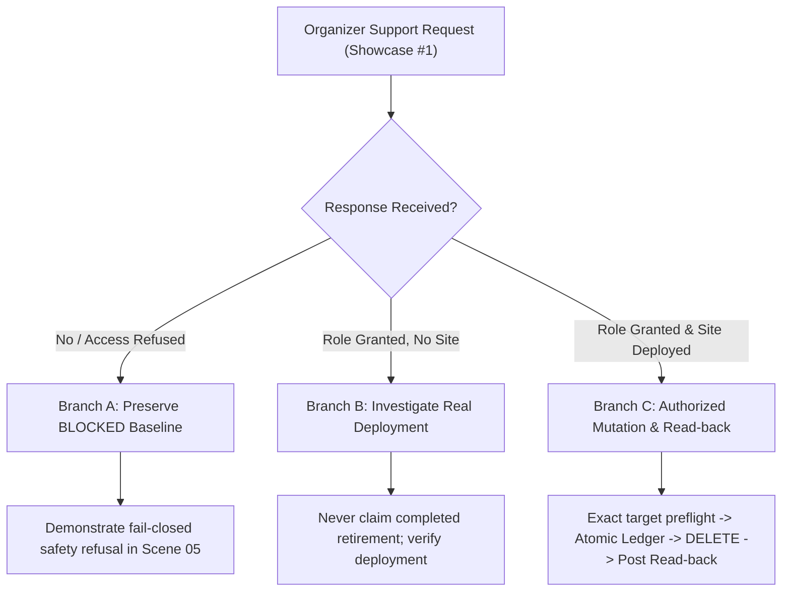
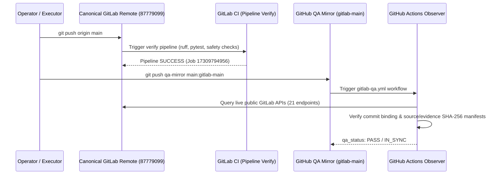

# Termivance — Canonical Competition Master Execution Plan, Award-Readiness Closure & Video/Submission Runbook

**Document Identity:** `plans/TERMIVANCE_MASTER_EXECUTION_PLAN.md`  
**Classification:** Canonical Project Execution Plan (Single Source of Truth)  
**Competition:** GitLab Transcend October 2026 — Life After Code  
**Selected Participation:** Path A / Start Fresh / Supervised (Compliance Status: `NEEDS_REVIEW` / Defensible with Documented Handoff Limitation)  
**Product Thesis:** A Proof-Bounded Software Retirement Protocol  
**Tagline:** Software retirement, proven within bounds.  
**Canonical Contest Repository:** [GitLab Project 87779099](https://gitlab.com/gitlab-ai-hackathon/transcend-october-2026/39306908/termivance)  
**Non-Canonical QA Mirror:** [GitHub `zyganali-glitch/termivance-qa-mirror`](https://github.com/zyganali-glitch/termivance-qa-mirror) (branch `gitlab-main`)  
**Official Deadline:** October 27, 2026, 13:00 UTC / 16:00 Türkiye  
**Target Submission Window:** October 26, 2026, 18:00–22:00 Türkiye  
**Incremental Personal Spend Target:** **$0.00**  
**Core Authority Contract:** AI proposes; deterministic Python code governs. Model text cannot grant permissions, mutate providers, or award verdicts.

---

## 1. Frozen Product and Architecture

### 1.1 Product Thesis and Differentiating Concepts
Termivance is a software retirement protocol that replaces informal decommissioning checklists and unverified deletion actions with an auditable, deterministic lifecycle:

$$\text{DISCOVER} \longrightarrow \text{ANALYZE} \longrightarrow \text{AUTHORIZE} \longrightarrow \text{RETIRE} \longrightarrow \text{PROVE} \longrightarrow \text{WATCH}$$

It establishes three foundational innovations:

1. **Retirement Obligation Graph (ROG):** Software retirement modeled as an auditable directed acyclic dependency and obligation graph. Every prerequisite (target identity, provider observations, open work items, redeployment paths, required permissions, and operator approvals) must evaluate to satisfied before retirement can proceed.
2. **Bounded Absence:** Absence is treated as negative evidence bound strictly to an explicit target, checked observation surfaces, exact timestamps, and an empirical freshness window ($TTL \le 900\,\text{s}$). Termivance proves a verified state transition; it refuses universal or perpetual absence claims.
3. **Retirement Reversal (Resurrection Control):** Neutralizing an active service does not guarantee it will remain absent. If a target repository maintains automated CI/CD jobs, schedules, or triggers, software can be resurrected. Termivance analyzes surviving deployment mechanisms (e.g. `create-pages` with `pages: true`) and distinguishes transient absence from proven resurrection control.

### 1.2 Three Independent Claims
Termivance strictly segregates three questions. They are never conflated into a single monolithic status:

* **`SAFE_TO_RETIRE`:** Deterministic eligibility verdict based on provider facts, scope boundaries, and satisfied obligations.
* **`OBSERVED_ABSENT`:** Empirical post-mutation verification across independent provider surfaces (API + served URL) proving a true pre-to-post state transition.
* **`RESURRECTION_CONTROLLED`:** Proven neutralization or active tripwire monitoring of surviving redeployment mechanisms.

### 1.3 One Genuine GitLab Duo Custom Flow Agent
Termivance deploys exactly **one real GitLab Duo Custom Flow agent** ([Catalog Item `1018562`](https://gitlab.com/gitlab-ai-hackathon/transcend-october-2026/39306908/termivance)):
* Component: `AgentComponent` using official GitLab Duo Workflow schema.
* Trigger: Mention on canonical issues / work items.
* Role: Autonomous context inspection, file analysis (`get_repository_file`, `list_repository_tree`), and candidate obligation formulation.
* **Authority Limitation:** Advisory and non-authoritative. AI text cannot mutate resources, bypass policy, or alter deterministic verdicts.

### 1.4 Deterministic Python Authority Core
The core Python engine owns all provider mutations, obligation evaluations, and verdict determinations:
* Read-only client (`gitlab_client.py`): GET-only transport with fail-closed assertions.
* Graph evaluator (`engine.py`): Typed evaluation of retirement prerequisites.
* Bounded mutation executor (`pages.py`, `retirement.py`): Endpoint-restricted mutation (`DELETE /projects/:id/pages` only) under strict authorization preflights.
* Single-use durable ledger (`ledger.py`): Atomic, $fsync$-backed sealed reservation preventing double-spending or replay attacks.

### 1.5 Real Pages-Only Mutation Scope and Protected Project Identities
* **Sole Approved Destructive Demonstration Target:** Newly created, isolated disposable GitLab Pages project ID **`87785099`** (`.../termivance-b3-disposable-pages-demo`).
* **Strictly Protected From Mutation or Deletion:**
  * Canonical Termivance Repository: Project ID **`87779099`** (`PROTECTED`)
  * Organizer Showcase: Project ID **`87777871`** (`PROTECTED`)
  * Diagnostic Project: Project ID **`87786164`** (`PROTECTED / NON-TARGET`)
  * All other namespace projects and shared infrastructure.
* **Prohibited Actions:** No project deletion (`DELETE /projects/:id`), no user or namespace mutations, no fallback environment-stop substitutions for Pages unpublishing.

---

## 2. Verified Current State and Evidence Baseline

| Dimension | Baseline Fact / Evidence Record | Verification Mode |
|---|---|---|
| **GitLab Commit SHA (Baseline)** | `b4431ec0b2bcba5f94a5636598b9b2ac32967ea5` (Master Plan baseline; prior baseline `55c9364`) | `INDEPENDENTLY_VERIFIED` (GitLab API & remote HEAD) |
| **GitHub Mirror SHA (Baseline)** | `b4431ec0b2bcba5f94a5636598b9b2ac32967ea5` on `gitlab-main` | `INDEPENDENTLY_VERIFIED` (`PASS / IN_SYNC`) |
| **GitLab CI Pipeline (Baseline)** | Pipeline ID `2966976920`, Job ID `17311100994` (`stage: verify`) | `INDEPENDENTLY_VERIFIED` (`status: success`) |
| **GitHub Observer Run (Baseline)** | [Run `39406813557`](https://github.com/zyganali-glitch/termivance-qa-mirror/actions/runs/39406813557) | `INDEPENDENTLY_VERIFIED` (`PASS / IN_SYNC`) |
| **Final Commit Provenance Note** | Post-repair commit revision is dynamically bound and verified by GitHub QA observer upon push; plan avoids self-referential future SHA fabrication | Immutable Git Provenance Contract |
| **GitLab API Coverage** | 21 / 29 endpoints observed live; 8 endpoints access-limited | `INDEPENDENTLY_VERIFIED` (Observer artifacts) |
| **License Attribution** | MIT License visible in GitLab Project Information & header | `INDEPENDENTLY_VERIFIED` (Public Project API) |
| **Local Test Suite** | **381 passed**, 0 failed; Ruff clean; 0 warnings | `EXECUTOR_REPORTED` (`pytest -q`) |
| **CI Safety Assertions** | **40 / 40 passed** network-free (`ci_safety_assertions.py`) | `EXECUTOR_REPORTED` & CI Job verified |
| **Incremental Personal Spend** | **$0.00** across all batches (B1–B4) | `OPERATOR_CONFIRMED` |
| **Autonomy Compliance Status** | **`NEEDS_REVIEW`** (Defensible Supervised with documented handoff boundary; genuine Duo research + live Python review; event daemon not implemented) | System Truth State |
| **Primary Duo Discovery** | Session `9710085`, Issue #5, Agent Note `4045401991` | `RECORDED_HISTORICAL` & Live API readable |
| **Historical Contextual Duo** | Session `9671626`, Issue #3, Agent Note `4040776241` | `RECORDED_HISTORICAL` |
| **Approved Disposable Target** | Project `87785099`, commit `54fcc9ff2bfde1038a8192216178a5a8b6a6ee1d` | `RECORDED_HISTORICAL` (Target CI has `create-pages`) |
| **Target Pages Permissions** | Developer role returns HTTP 403 on `GET/DELETE /projects/:id/pages` | `INDEPENDENTLY_VERIFIED` (Live GitLab Provider 403) |
| **Current Deterministic Verdict** | **`BLOCKED`** (permissions insufficient, redeployment active) | `EXECUTOR_REPORTED` & Replayable Live |
| **Actual Pages Unpublication** | **`NOT_RUN`** (safely blocked by permissions) | `EXECUTOR_REPORTED` |
| **Observed Absence** | **`NOT_CLAIMED`** | System Truth State |
| **Resurrection Controlled** | **`NOT_CLAIMED`** | System Truth State |
| **DevSecOps Stage Selections** | **4 Defensible YES** (Plan, Verify, Secure, Govern); **1 Explicit NO** (Release); **4 Qualified NEEDS_REVIEW** (Create, Package, Configure, Monitor) | Honest Lifecycle Audit (Sec 7) |

---

## 3. Independent Audit Recommendations, Operator Decisions & Implementation Ledger

This ledger reconciles all independent model and auditor findings, operator determinations, executor repairs, and current source/test evidence. No ChatGPT conversation memory is required to trace any historical audit finding.

```
+----------------------------------------------------------------------------------------------------+
|                      AUDIT RECOMMENDATIONS & OPERATOR IMPLEMENTATION LEDGER                         |
+----+-----------------------+-----------+---------------------------------------+--------------------+
| ID | Finding & Area        | Decision  | Implemented Technical Resolution      | Evidence & Status  |
+----+-----------------------+-----------+---------------------------------------+--------------------+
| 01 | Supervised Continuity | ACCEPTED  | 7-step read-only pipeline with honest | Commit 8f3ef4f     |
|    | vs Event Daemon       |           | EXECUTED_NOW and handoff boundaries   | 381 tests PASS     |
+----+-----------------------+-----------+---------------------------------------+--------------------+
| 02 | Neutral Target Risk   | ACCEPTED  | Issue #5 / Session 9710085 neutral    | Commit cd51e52     |
|    | Discovery (Issue #5)  |           | intake ingested without priming       | Live Issue #5 Note |
+----+-----------------------+-----------+---------------------------------------+--------------------+
| 03 | Authentic Duo Note    | ACCEPTED  | ProviderObservations binding and      | Commit 2282da8     |
|    | Provenance & Commit   |           | exact commit SHA binding              | test_b4_regression |
+----+-----------------------+-----------+---------------------------------------+--------------------+
| 04 | Cryptographic Binding | ACCEPTED  | HMAC operator approval, SHA-256       | Commit 0022a21     |
|    | in Proof Capsule      | IN SCOPE  | manifest, fail-closed verify-receipt  | ci_safety 40/40    |
+----+-----------------------+-----------+---------------------------------------+--------------------+
| 05 | Resurrection Witness  | ACCEPTED  | witness.py analyzes target's own CI   | Commit 0022a21     |
|    | & Counterexamples     |           | commit; proves redeployment mechanism | test_b4_duo_witness|
+----+-----------------------+-----------+---------------------------------------+--------------------+
| 06 | Real Pages 403 Gate   | ACCEPTED  | Fail-closed BLOCKED maintained;       | docs/HANDOFF.md    |
|    | & Organizer Dep       |           | branch tracking without fake bypass   | Showcase #1 track  |
+----+-----------------------+-----------+---------------------------------------+--------------------+
| 07 | 9-Stage Automation    | ACCEPTED  | Honest stage mapping; refuse inflated | MASTER_PLAN.md     |
|    | Integrity Audit       |           | checkbox claims for unautomated steps | Stage Audit table  |
+----+-----------------------+-----------+---------------------------------------+--------------------+
| 08 | Minimal Repair Set    | DEFERRED  | Optional speculative graph extensions | Decision Reg 2026  |
|    | & Proof Decay Engine  |           | deferred to maintain $0.00 & schedule | Out of B4 scope    |
+----+-----------------------+-----------+---------------------------------------+--------------------+
| 09 | Evidence Integrity &  | ACCEPTED  | 6-dim receipt classification, real    | Commits a6835f0,   |
|    | UI Privacy Repairs    |           | publisher contract, path sanitization | 55c9364 (all PASS) |
+----+-----------------------+-----------+---------------------------------------+--------------------+
| 10 | DevSecOps & Supervised| ACCEPTED  | Re-audited 9 stages (4 YES, 1 NO, 4   | Commit b4431ec /   |
|    | Truth Repair          |           | REVIEW); qualified Supervised status;  | Post-Push Observer |
|    |                       |           | sanitized public paths; safe launchers| 381 tests PASS     |
+----+-----------------------+-----------+---------------------------------------+--------------------+
```

### Detailed Reconciliation of the Ten Explicit Audit Areas

#### 1. Genuine Supervised Duo-to-Python Continuity vs. Operator/CI Handoff
* **Auditor/Model Finding:** Earlier implementations assembled static review records from disk. Auditors noted that claiming "supervised workflow" required either an autonomous continuous daemon or an explicit, honest, runnable supervised pipeline executing live against provider APIs. Official hackathon expectations for Supervised autonomy emphasize agents independently executing multi-step workflows with human review of outcomes.
* **Operator Decision:** **ACCEPTED.** Implement a runnable 7-step supervised review pipeline, but strictly reject fabricating an unauthenticated background daemon, using broad account tokens, or manufacturing an autonomous chain from historical JSON. Mark category compliance honestly as **`NEEDS_REVIEW` (Defensible with Documented Handoff Limitation)**.
* **Implemented Resolution:** `termivance/supervised_review.py` introduces `run_supervised_investigation()` and CLI `supervised-review --execute`. Steps executed live against GitLab are marked `EXECUTED_NOW` and `COMPLETED`. Duo historical sessions remain `RECORDED_HISTORICAL`. The operator handoff boundary is explicitly labeled `OPERATOR_CONFIRMED_HANDOFF`.
* **Exact Operational Boundary & Defensibility Rationale:**
  1. *Genuine Duo Investigation:* OBSERVED and recorded in authentic Session `9710085` on Issue #5.
  2. *Deterministic Python Review:* IMPLEMENTED and runnable live (`python -m termivance.cli supervised-review --execute --issue 5`), making live GET requests to GitLab REST API.
  3. *Fully Automatic Event Daemon:* NOT DEMONSTRATED. Investigated whether authentic GitLab capabilities could safely close the gap. In our namespace, the operator holds Developer permissions (`30`), which cannot register GitLab webhooks (`Settings -> Webhooks` requires Maintainer). Polling GitLab APIs via a background daemon on external servers would require continuous compute infrastructure and long-lived personal access tokens, violating both the **$0.00 personal spend** policy and least-privilege credential security.
  4. *Human Review:* Human review of the outcome note (Note `4045409264`) is mandatory before any mutation could ever proceed.
  5. *Conclusion:* Path A / Supervised remains the operator's selected competition route. The claim is defensible because multi-step agent analysis and deterministic verification are both fully functional and human supervision is strictly enforced; however, the absence of an autonomous event trigger between Duo's note publication and Python execution is honestly disclosed as a documented limitation.
* **Evidence:** Commit `8f3ef4f`, `a6835f0`, `b4431ec`. `tests/test_b4_supervised_workflow.py`. Live CLI execution verifies 5 deterministic steps executed live with fresh execution ID and zero incremental spend ($0.00).

#### 2. Neutral Target-Risk Discovery Using Issue #5
* **Auditor/Model Finding:** Contextual Session `9671626` (Issue #3) contained historical setup context. Session `9704855` (Issue #4) explored discovery. Auditors recommended proving that GitLab Duo can independently inspect disposable project `87785099` from an unprimed, neutral issue prompt without pre-injected hints.
* **Operator Decision:** **ACCEPTED.** Execute genuine Duo Custom Flow on canonical Issue #5 with neutral prompt; use Issue #5 as the primary target investigation.
* **Implemented Resolution:** Duo Session `9710085` was triggered on Issue #5. The Duo agent inspected target `87785099` repository files, discovered `create-pages` (`pages: true`), identified the marker string, and reported access limitations. Control Room, CLI, and Proof Capsule bind Session `9710085` as the primary discovery dataset.
* **Evidence:** Commit `cd51e52`, `37e0d5a`. Issue #5 Note `4045401991`. Control Room Overview & Evidence tabs bind Session `9710085` with 7 candidate claims (4 corroborated, 2 unresolved, 1 contextual).

#### 3. Authentic Duo-Note Provenance and Exact Source/Commit Binding
* **Auditor/Model Finding:** Duo candidate claims could be spoofed or decoupled from the target repository's actual commit state.
* **Operator Decision:** **ACCEPTED.** Bind candidate intake to target project ID and default branch commit SHA (`54fcc9ff2bfde1038a8192216178a5a8b6a6ee1d`).
* **Implemented Resolution:** `parse_duo_note()` extracts target project ID and commit SHA. `supervised_review.py` validates that candidate claims match the actual observed target commit before corroboration. Contradicted claims fail to `CONTRADICTED`; unobservable surfaces fail to `UNRESOLVED`.
* **Evidence:** Commit `2282da8`, `cd51e52`. `tests/test_b4_regression_integrity.py`.

#### 4. Cryptographic Binding Between Duo Investigation, Deterministic Engine, and Proof Capsule
* **Auditor/Model Finding:** Recommended end-to-end cryptographic signatures linking Duo notes, deterministic decisions, and proof capsules.
* **Operator Decision:** **ACCEPTED IN SCOPE, WITH HONEST LIMITATIONS.** Implement cryptographic integrity where verifiable (HMAC operator authorization, SHA-256 capsule manifests, atomic ledger digests). Refuse to claim that unauthenticated GitLab issue notes carry asymmetric agent signatures, as GitLab Duo does not provide cryptographic signing keys to workflow agents.
* **Implemented Resolution:** 
  * Operator approval enforces HMAC verification (`TERMIVANCE_APPROVAL_HMAC_KEY`).
  * Sealed reservation ledger writes SHA-256 digest of operator approval and endpoint binding.
  * Proof Capsule computes SHA-256 manifest over decision, receipt, Duo reconciliation, and witness.
  * Unauthenticated Duo notes are verified via provider read-back and labeled `OPERATOR_CONFIRMED_NOTE_INPUT`.
* **Evidence:** Commit `0022a21`, `97263f6`. `scripts/ci_safety_assertions.py` assertions 2, 3, 11, 12, 13, 14, 30, 31.

#### 5. Retirement Obligation Graph, Bounded Absence, and Resurrection Witness
* **Auditor/Model Finding:** Static policies could declare retirement without proving absence. A retired Pages site could be silently resurrected by CI.
* **Operator Decision:** **ACCEPTED.** Retirement must be graph-bound, bounded absence must prove an actual pre-to-post transition, and resurrection risks must be exposed via a dedicated witness.
* **Implemented Resolution:**
  * `retirement.py` executes fresh discovery and refuses mutation unless the graph is `SAFE_TO_RETIRE`.
  * `absence.py` requires live pre-state deployment, accepted deletion, and post-mutation API + served-URL checks.
  * `witness.py` analyzes the target repository CI configuration at the observed commit and detects `create-pages` (`pages: true`), classifying resurrection risk as `MECHANISM_PRESENT_IN_OBSERVED_CONFIG`.
* **Evidence:** Commit `0022a21`. `tests/test_b4_duo_witness.py`. `evidence/b4/witness_87785099.json`.

#### 6. Real Pages Authorization / 403 Limitations and Pending Organizer Dependency
* **Auditor/Model Finding:** Disposable project `87785099` returns HTTP 403 on Pages management for the Developer role. Auditors warned against bypassing this via simulated success, using environment stop, or deleting projects.
* **Operator Decision:** **ACCEPTED.** Strictly maintain `BLOCKED`. Track organizer support request on Showcase work item #1 as `WAITING_EXTERNAL`. Demonstrate safety refusal as a primary product strength.
* **Implemented Resolution:** Deterministic decision evaluates to `BLOCKED` with reason `PAGES_ADMINISTRATION_FORBIDDEN_403`. Zero destructive calls are made. Demo plan provides conditional branches for access resolution while preserving the blocked baseline.
* **Evidence:** `docs/HANDOFF.md`, `evidence/b4/decision.json`. Showcase work item [Showcase #1](https://gitlab.com/gitlab-ai-hackathon/transcend-october-2026/39306908/showcase/-/work_items/1).

#### 7. Rejection of Superficial Nine-Stage Automation or Unsupported Checkbox Claims
* **Auditor/Model Finding:** Teams often inflate DevSecOps lifecycle stage checkboxes (e.g. checking all 9 stages based on static YAML or hypothetical future features). An earlier draft recommended eight YES selections, which independent QA challenged as overly confident.
* **Operator Decision:** **ACCEPTED.** Retract the premature eight-stage claim. Conduct a rigorous re-audit of all 9 stages distinguishing genuine GitLab Duo Agent Platform lifecycle automation from generic supporting Python code, local tooling, static artifacts, or external GitHub observer infrastructure.
* **Implemented Resolution:** Section 7 of this plan establishes a rigorous, evidence-backed evaluation:
  * **4 Defensible Core Stages (YES):** Plan (genuine Duo flow on Issue #5), Verify (native GitLab CI 381 tests + 40 safety assertions), Secure (fail-closed preflight + sealed ledger + HMAC authorization), Govern (protected target registry + deterministic graph authority).
  * **1 Explicit Gated Stage (NO):** Release (Pages unpublishing is intentionally BLOCKED by HTTP 403 on Developer permissions; no deletion mutation occurred).
  * **4 Qualified / Challenged Stages (NEEDS_REVIEW / LEAN NO):** Create (issue notes != code generation), Package (JSON Proof Capsule != GitLab Package Registry), Configure (GET discovery != configuration management), Monitor (external GitHub QA observer & tripwire != native GitLab runtime monitoring). Default to unchecked on Devpost unless confirmed by operator.
* **Evidence:** Section 7 itemized stage breakdown and verification records.

#### 8. Deferred Minimal Repair Set, Proof Decay, and Optional Extensions
* **Auditor/Model Finding:** Proposals to implement an automated graph repair algorithm ("Minimal Repair Set") and continuous temporal proof decay curves.
* **Operator Decision:** **DEFERRED.** High architectural complexity with minimal jury differentiation. Exceeds B4 preparation scope and risks introducing regressions before the October 27 deadline.
* **Implemented Resolution:** Formally recorded in the Decision Register as `DEFERRED`. Proof Capsule enforces static $TTL \le 900\,\text{s}$ freshness rather than complex temporal decay curves.
* **Evidence:** Section 5 Decision Register (DEC-20261019-03).

#### 9. Material Evidence-Integrity Findings and Verified Repair Outcomes
* **Auditor/Model Finding:** Independent QA identified material defects across B4:
  * *Defect A:* Receipt proof promotion (static JSON could claim ledger validation).
  * *Defect B:* Static review assembler without live execution.
  * *Defect 1:* Publisher contract mismatch with CLI.
  * *Defect 2:* Candidate corroboration using keyword heuristics rather than provider facts.
  * *UI Quality:* Session misattribution (9710085 vs 9671626) and Windows local path leaks in `data.js`.
* **Operator Decision:** **ACCEPTED.** Execute comprehensive consolidated repairs for all items.
* **Implemented Resolution:**
  * 6-dimensional receipt classifier (`classify_receipt`) separating ledger validation from claimed verdicts.
  * Runnable `run_supervised_investigation()` pipeline.
  * Publisher contract adopting `GitLabPublisher.create_issue_note` returning `PublishResult`.
  * Evidence-grounded candidate corroboration (`ProviderObservations`).
  * Complete separation of Session 9710085 and Session 9671626 with sanitized public paths in `data.js`.
* **Evidence:** Commits `a6835f0`, `2282da8`, `cd51e52`, `97263f6`, `37e0d5a`, `55c9364`. Test suite: **381 passed**, Ruff clean, CI safety assertions **40/40 PASS**.

#### 10. Consolidated Master Plan Truth Repair, Path Sanitization & Safe Filming Launchers
* **Auditor/Model Finding:** Independent QA verified master plan baseline `b4431ec` (GitLab CI `2966976920`, GitHub observer `39406813557`), but identified: (a) local Windows absolute developer path leak in Section 10; (b) launcher scripts reporting execution complete regardless of exit code; (c) filming runbook referencing obsolete UI cards; (d) self-referential commit SHA references; (e) overconfident 8-stage DevSecOps claims; and (f) unverified Supervised autonomy status.
* **Operator Decision:** **ACCEPTED.** Execute ONE consolidated B4 repair covering all points without restarting development or introducing new product features.
* **Implemented Resolution:**
  * Replaced all local developer machine paths with portable repository-relative links (`control_room/index.html`).
  * Hardened `scripts/run_supervised_review.bat` and `.sh` with repository root location, Python 3.10+ and `termivance` preflight assertions, actionable troubleshooting text, and authentic exit-code propagation distinguishing successful program execution yielding BLOCKED from script crashes. Tested live with `--no-pause`.
  * Reconciled the 9-scene filming runbook with the actual 5-tab Control Room UI.
  * Preserved Git commit SHA provenance: plan distinguishes historically verified baseline `b4431ec` from post-push remote revisions dynamically verified by the external GitHub observer.
  * Qualified Supervised autonomy status as `NEEDS_REVIEW` with an explicit operational boundary and work-register entry.
* **Evidence:** Commit `b4431ec` (baseline), post-repair commit, 381 passed pytest tests, 40/40 network-free safety checks, live launcher test.

---

## 4. Remaining Work Register

| Stable ID | Objective & Significance | Status | Dependency | Responsibility | Implementation Ref | Acceptance Criteria | Target Date | Affects | Fallback / Contingency |
|---|---|---|---|---|---|---|---|---|---|
| `WORK-B4-01` | Establish Canonical Master Execution Plan | **DONE** | None | Executor | `plans/TERMIVANCE_MASTER_EXECUTION_PLAN.md` | Single canonical plan covering all 17 sections | 2026-10-20 | Eligibility / Quality | N/A |
| `WORK-B4-02` | Reconcile Master Plan & Handoff | **DONE** | `WORK-B4-01` | Executor | `plans/MASTER_PLAN.md`, `docs/HANDOFF.md` | Zero contradictory statuses across repo | 2026-10-20 | Quality | Update pointers |
| `WORK-B4-03` | Add Media Working Directories to `.gitignore` | **DONE** | None | Executor | `.gitignore`, `submission_media/` | `submission_media/` ignored; clean git status | 2026-10-20 | Security / Cleanliness | Manual exclusion |
| `WORK-B4-04` | Safe Reproducible CLI Launcher (Scene 05) | **DONE** | None | Executor | `scripts/run_supervised_review.bat`, `.sh` | Preflight checks; truthful exit status; `--no-pause` support | 2026-10-20 | Demo / Filming | Manual CLI command |
| `WORK-B4-05` | Track Organizer Pages Support Request | **WAITING_EXTERNAL** | Hackathon Organizers | Operator | Showcase Work Item #1 | Maintainer access granted OR formal alternative | 2026-10-24 | Demo / Release Stage | Branch A (Preserve BLOCKED) |
| `WORK-B4-06` | Enterprise Control Room Final Usability Audit | **DONE** | `control_room/` | Executor | `control_room/index.html`, `data.js` | 5 tabs verified at 100% zoom, 1920x1080 | 2026-10-20 | Demo / Presentation | Rebuild via script |
| `WORK-B4-07` | Baseline Remote Push & Verification (`b4431ec`) | **DONE** | `WORK-B4-01`–`06` | Executor | Remote `origin/main` | Remote SHA `b4431ec`; GitLab CI Pipeline `2966976920` verify `success` | 2026-10-20 | Eligibility / CI | Repair immediately |
| `WORK-B4-08` | Baseline GitHub QA Mirror Sync (`b4431ec`) | **DONE** | `WORK-B4-07` | Executor | GitHub `gitlab-main` | Mirror branch identical to remote GitLab SHA `b4431ec` | 2026-10-20 | QA Bridge | Git push mirror |
| `WORK-B4-09` | Baseline Independent Observer Run (`b4431ec`) | **DONE** | `WORK-B4-08` | Executor | GitHub Actions `gitlab-qa.yml` | Run `39406813557` `qa_status: PASS`, `drift: IN_SYNC` | 2026-10-20 | QA Bridge | Selftest offline check |
| `WORK-B4-10` | Supervised Autonomy Continuous-Handoff Evaluation | **NEEDS_REVIEW** | Hackathon Platform Boundary | Operator / Executor | `src/termivance/supervised_review.py`, Sec 6 | Documented limitation and operational boundary why unauthenticated daemon is withheld ($0.00 spend preserved) | 2026-10-24 | Contest Category Claim | Defend Supervised as human-reviewed multi-step workflow with CLI/CI trigger |
| `WORK-B4-11` | Commit, Push & Verify Final Consolidated B4 Repair | **ACTIVE** | `WORK-B4-01`–`10` | Executor | Remote `origin/main` & `qa-mirror` | Final push triggers GitLab CI, GitHub mirror sync, and GitHub Observer reporting PASS / IN_SYNC | 2026-10-20 | Eligibility / Verification | Push & monitor observer |
| `WORK-B4-12` | Capture Demonstration Media & Screenshots | **OPERATOR_ACTION** | Locked SHA | Operator | `assets/demo/screenshots/` | 5 sanitized PNGs captured at 1920x1080 per register | 2026-10-24 | Presentation / Devpost | Use headless captures |
| `WORK-B4-13` | Record Video Screen Captures (Scenes 01–09) | **OPERATOR_ACTION** | Video Runbook | Operator | Section 11 Video Runbook | Raw MP4 captures for all 9 scenes | 2026-10-25 | Submission Video | Follow Scene Runbook |
| `WORK-B4-14` | Video Editing, English Voice-Over & Narration | **OPERATOR_ACTION** | `WORK-B4-13` | Operator | Final MP4 (< 180s, target 174s) | Crisp narration, readable text, < 180s | 2026-10-25 | Submission Video | Cut non-critical pause |
| `WORK-B4-15` | Upload Video to YouTube as Public | **OPERATOR_ACTION** | `WORK-B4-14` | Operator | YouTube Public Video URL | Public URL accessible to judges | 2026-10-26 | Devpost Submission | Unlisted with link |
| `WORK-B4-16` | Complete Official Devpost Submission | **OPERATOR_ACTION** | Devpost Packet | Operator | Devpost Transcend Portal | All fields filled, URL linked, submitted | 2026-10-26 | Contest Eligibility | Submit before 13:00 UTC |

---

## 5. Formal Decision Register

```
+----------------------------------------------------------------------------------------------------+
|                                    FORMAL DECISION REGISTER                                        |
+-------------------+----------------------+---------------------------------------------------------+
| Decision ID       | Date & Status        | Summary & Operator Rationale                            |
+-------------------+----------------------+---------------------------------------------------------+
| DEC-20261018-01   | 2026-10-18 [FROZEN]  | Path A / Start Fresh / Supervised route confirmed.      |
|                   |                      | Provenance clean; new codebase started after 2026-10-05 |
+-------------------+----------------------+---------------------------------------------------------+
| DEC-20261018-02   | 2026-10-18 [FROZEN]  | Zero incremental personal spend policy ($0.00).         |
|                   |                      | No paid tiers, credit cards, or billable credits.       |
+-------------------+----------------------+---------------------------------------------------------+
| DEC-20261018-03   | 2026-10-18 [FROZEN]  | Disposable Pages target 87785099 sole mutation target.  |
|                   |                      | Canonical 87779099 and showcase 87777871 protected.    |
+-------------------+----------------------+---------------------------------------------------------+
| DEC-20261019-01   | 2026-10-19 [FROZEN]  | GitLab is CANONICAL; GitHub is QA-ONLY mirror.          |
|                   |                      | Never reverse-sync; never export credentials to GitHub. |
+-------------------+----------------------+---------------------------------------------------------+
| DEC-20261019-02   | 2026-10-19 [FROZEN]  | Static zero-network Control Room architecture.          |
|                   |                      | Runs from file://; no web server or live fetch needed.  |
+-------------------+----------------------+---------------------------------------------------------+
| DEC-20261019-03   | 2026-10-19 [FROZEN]  | Defer Minimal Repair Set and complex Proof Decay.       |
|                   |                      | Focus on rock-solid B4 delivery and honest evidence.    |
+-------------------+----------------------+---------------------------------------------------------+
| DEC-20261020-01   | 2026-10-20 [FROZEN]  | Issue #5 / Session 9710085 frozen as primary discovery. |
|                   |                      | Contextual Session 9671626 retained as historical.      |
+-------------------+----------------------+---------------------------------------------------------+
| DEC-20261020-02   | 2026-10-20 [FROZEN]  | Operator personal responsibility for video & Devpost.   |
|                   |                      | AI assists with runbooks; human records and submits.    |
+-------------------+----------------------+---------------------------------------------------------+
| DEC-20261020-03   | 2026-10-20 [FROZEN]  | Strict post-deadline repository and materials freeze.   |
|                   |                      | Zero commits to canonical main after deadline.          |
+-------------------+----------------------+---------------------------------------------------------+
```

---

## 6. Official Competition Requirements & Eligibility Matrix

Termivance is evaluated under the official October 2026 GitLab Transcend (*Life After Code*) rules and schedule:

| Official Competition Requirement | Required Verification Standard | Termivance Compliance Status | Evidence Reference |
|---|---|---|---|
| **Path A: Start Fresh** | Entire project created after October 5, 2026; original work | **ELIGIBLE & SATISFIED** | First commit `ebfae41` dated 2026-10-18; clean-room code |
| **GitLab Duo Platform Use** | Genuine GitLab Duo Custom Flow agent utilized | **ELIGIBLE & SATISFIED** | Catalog Item `1018562`; Session `9710085` live execution |
| **Autonomy Level** | Selected autonomy level: Supervised (Path A) | **NEEDS_REVIEW** (Defensible Supervised with Documented Handoff Boundary) | Duo autonomously analyzes target from neutral Issue #5; deterministic Python review executes live; human review required; handoff between Duo and Python is operator/CI-initiated rather than continuous daemon; tracked under WORK-B4-10 |
| **Public Canonical Repository** | Hosted on GitLab hackathon namespace, public access | **ELIGIBLE & SATISFIED** | Project `87779099`, public visibility verified live |
| **Open Source License** | Open-source license (MIT) visible in project | **ELIGIBLE & SATISFIED** | MIT License detected by GitLab API and displayed on home |
| **Reproducibility Instructions** | Clear build, test, and execution instructions in README | **ELIGIBLE & SATISFIED** | Python `pip install -e .[dev]`, CLI subcommands documented |
| **Visible GitLab CI/CD** | Passing CI pipeline history on default branch | **ELIGIBLE & SATISFIED** | Pipeline `2966705916`, Job `17309794956` `SUCCESS` |
| **Public Video Submission** | Original video < 3 minutes (180s) hosted on YouTube | **PENDING OPERATOR** | Storyboard targeted at 174s; filming runbook ready |
| **Actual Automation Shown** | Live automation demonstrated, not slides or static UI | **READY FOR OPERATOR** | Scene 05 executes `termivance supervised-review --execute` live |
| **Devpost Form Completion** | All required fields, links, and declarations completed | **PENDING OPERATOR** | Complete Devpost copy and fill-in packet prepared (Sec 13) |
| **Post-Deadline Freeze** | Repository and submission materials remain frozen | **SCHEDULED** | Freeze scheduled for October 26, 2026, 22:00 Türkiye |

---

## 7. Nine DevSecOps Lifecycle Stages Honest Mapping

Independent QA challenged the earlier draft's eight-stage YES recommendation as overly confident. A rigorous re-audit distinguishes genuine lifecycle automation by the GitLab Duo Agent Platform and GitLab CI from generic supporting Python code, local developer tooling, static JSON artifacts, or external GitHub observer infrastructure.

```
+----------------------------------------------------------------------------------------------------+
|                         NINE DEVSECOPS LIFECYCLE STAGES RE-AUDIT MATRIX                            |
+----+-----------+-----------------------------------+--------------------+---------------+----------+
| No | Stage     | Implemented Automation Summary    | Duo / Platform Role| Recommendation|Confidence|
+----+-----------+-----------------------------------+--------------------+---------------+----------+
| 1  | Plan      | Duo analyzes retirement issue     | Genuine Duo Flow   | YES (Core)    | HIGH     |
| 2  | Create    | Issue notes & repository reads    | Duo reads code     | NEEDS_REVIEW  | MEDIUM   |
| 3  | Verify    | 381 tests; 40 CI safety contracts | GitLab CI pipeline | YES (Core)    | HIGHEST  |
| 4  | Package   | Tamper-evident JSON Proof Capsule | App-level JSON     | NEEDS_REVIEW  | HIGH     |
| 5  | Secure    | Sealed single-use ledger & HMAC   | Deterministic core | YES (Core)    | HIGH     |
| 6  | Release   | Pages unpublishing (gated by 403) | Safely BLOCKED     | NO (Gated)    | HIGHEST  |
| 7  | Configure | GET-only environment discovery    | REST API reads     | NEEDS_REVIEW  | HIGH     |
| 8  | Monitor   | GitHub QA observer & tripwire     | External CI bridge | NEEDS_REVIEW  | HIGH     |
| 9  | Govern    | Fail-closed engine & protected reg| Deterministic gate | YES (Core)    | HIGHEST  |
+----+-----------+-----------------------------------+--------------------+---------------+----------+
```

> **Operator Guidance:** Do NOT select eight stages on Devpost by default. Only check the **4 Defensible Core Stages (Plan, Verify, Secure, Govern)** unless the operator explicitly decides to include supporting stages with disclosed qualifications. **Release MUST remain UNCHECKED.**

---

### Detailed Per-Stage Breakdown (Eight-Field Standard)

#### 1. Plan
* **Exact action actually executed:** Issue #5 created with neutral decommissioning request; GitLab Duo Custom Flow invoked; autonomous repository inspection executed; candidate retirement obligations posted.
* **GitLab Duo's actual contribution:** Genuine Duo Custom Flow (Catalog Item `1018562`, Session `9710085`) autonomously analyzed the retirement request, inspected repository structure (`list_repository_tree`, `get_repository_file`), and formulated candidate claims.
* **Deterministic code or CI contribution:** `src/termivance/supervised_review.py` ingests Duo candidate claims, extracts target commit SHA, binds candidate claims to target identity, and computes counterfactual analysis.
* **Source evidence:** `src/termivance/supervised_review.py`, canonical Issue #5 description and Note `4045401991`.
* **Live execution evidence:** GitLab Issue #5 Note `4045401991`; Duo Session `9710085` URL recorded and live.
* **Competition category interpretation:** Directly satisfies the Plan stage (AI agent planning, context inspection, and requirement analysis for decommissioning).
* **Final recommendation:** **YES (Defensible Core)**
* **Confidence and remaining uncertainty:** **HIGH**. Duo autonomously planned candidate obligations from an unprimed prompt.

#### 2. Create
* **Exact action actually executed:** Generation and publication of structured markdown candidate obligations notes and outcome notes on GitLab issues (`GitLabPublisher.create_issue_note`). Duo repository file inspection (`get_repository_file`).
* **GitLab Duo's actual contribution:** Duo generated natural-language candidate obligation text; inspected existing code.
* **Deterministic code or CI contribution:** `src/termivance/publisher.py` authenticated note creation via GitLab REST API (Outcome Note `4045409264`).
* **Source evidence:** `src/termivance/publisher.py`, `src/termivance/supervised_review.py`.
* **Live execution evidence:** Issue #5 Notes `4045401991` (Duo) and `4045409264` (Outcome note).
* **Competition category interpretation:** Devpost Create stage typically refers to code generation, merge request creation, or repository modification. Termivance creates structured issue commentary and analysis artifacts, but does NOT generate application source code or open merge requests.
* **Final recommendation:** **NEEDS_REVIEW (Lean NO / Operator Discretion)**
* **Confidence and remaining uncertainty:** **MEDIUM**. Issue commentary creation is automated, but claiming Create stage without code generation or MR creation risks auditor challenge.

#### 3. Verify
* **Exact action actually executed:** Automated execution of the full 381-test pytest suite, `ruff check`, and 40 network-free safety contract assertions in GitLab CI on every pushed commit.
* **GitLab Duo's actual contribution:** None (Duo does not author or run CI tests).
* **Deterministic code or CI contribution:** GitLab CI runner executing `.gitlab-ci.yml` `verification` job: `ruff check`, `pytest`, `scripts/ci_safety_assertions.py`.
* **Source evidence:** `.gitlab-ci.yml`, `scripts/ci_safety_assertions.py`, `tests/` directory (381 tests).
* **Live execution evidence:** GitLab CI Pipeline `2966976920`, Job `17311100994` (`stage: verify`) `SUCCESS`.
* **Competition category interpretation:** Fully satisfies GitLab Verify stage (automated CI pipeline running linting, full test suite, and safety contract assertions).
* **Final recommendation:** **YES (Defensible Core)**
* **Confidence and remaining uncertainty:** **HIGHEST**. Verified live by official GitLab CI runner on default branch.

#### 4. Package
* **Exact action actually executed:** Assembly of a tamper-evident JSON Proof Capsule (`termivance capsule-build`) binding target identity, decision records, evidence receipts, Duo reconciliation records, and resurrection witnesses under a SHA-256 integrity manifest.
* **GitLab Duo's actual contribution:** None directly (Duo candidate findings are ingested into the capsule dataset).
* **Deterministic code or CI contribution:** `src/termivance/capsule.py` structures, validates, and hashes the proof capsule.
* **Source evidence:** `src/termivance/capsule.py`, `evidence/b4/proof_capsule.json`.
* **Live execution evidence:** `proof_capsule.json` in evidence directory, verified by unit and regression tests.
* **Competition category interpretation:** Devpost Package stage typically refers to GitLab Package Registry (npm, PyPI, Maven), Container Registry, or release binary packages. Proof Capsule is an application-level data packaging artifact, NOT a GitLab Package Registry workflow.
* **Final recommendation:** **NEEDS_REVIEW (Lean NO / Operator Discretion)**
* **Confidence and remaining uncertainty:** **HIGH**. JSON artifact packaging is vital for Termivance auditability, but conflating application JSON export with GitLab Package stage automation is technically inaccurate.

#### 5. Secure
* **Exact action actually executed:** Fail-closed authorization preflights, HMAC-SHA256 signature verification on operator approval tokens, atomic $fsync$-backed single-use ledger reservations, and protected target boundary enforcement.
* **GitLab Duo's actual contribution:** None (security is strictly deterministic).
* **Deterministic code or CI contribution:** `src/termivance/ledger.py`, `src/termivance/approval_source.py`, `src/termivance/retirement.py`, `scripts/ci_safety_assertions.py` (40 network-free security assertions).
* **Source evidence:** `src/termivance/ledger.py`, `src/termivance/approval_source.py`, `tests/test_b4_regression_integrity.py`.
* **Live execution evidence:** CI job verifies all 40 safety assertions; live CLI enforces single-use ledger and HMAC gating.
* **Competition category interpretation:** Directly satisfies security governance and policy enforcement, although it uses custom cryptographic/policy contracts rather than GitLab native SAST/DAST scanner pipelines.
* **Final recommendation:** **YES (Defensible Core)**
* **Confidence and remaining uncertainty:** **HIGH**. Policy enforcement, single-use ledger, and cryptographic approval gating are deeply implemented and tested.

#### 6. Release
* **Exact action actually executed:** Implementation of verified GitLab Pages unpublishing protocol (`DELETE /projects/:id/pages`) with pre-state verification, single-use ledger consumption, and post-mutation readback.
* **GitLab Duo's actual contribution:** Analyzed target repository for deployment configurations.
* **Deterministic code or CI contribution:** `src/termivance/pages.py`, `src/termivance/retirement.py`.
* **Source evidence:** `src/termivance/pages.py`, `src/termivance/retirement.py`.
* **Live execution evidence:** **BLOCKED / NOT_RUN**. Developer role returns HTTP 403 on Pages API. No actual unpublishing mutation was executed against the live provider.
* **Competition category interpretation:** The release unpublishing lifecycle is implemented in code but gated by external platform permissions. Claiming completed Release automation when the mutation was not executed is inaccurate.
* **Final recommendation:** **NO (Gated / Leave Unchecked)**
* **Confidence and remaining uncertainty:** **HIGHEST**. Must remain unchecked on Devpost unless Maintainer access is granted before submission.

#### 7. Configure
* **Exact action actually executed:** Read-only GET discovery of environments, deployments, and target configuration across candidate projects (`termivance discover`, `portfolio.py`).
* **GitLab Duo's actual contribution:** Inspection of `.gitlab-ci.yml` CI variables and environment configurations.
* **Deterministic code or CI contribution:** Python GET requests to GitLab Environments and Deployments APIs.
* **Source evidence:** `src/termivance/portfolio.py`, `src/termivance/gitlab_client.py`.
* **Live execution evidence:** `evidence/b4/portfolio.json` populated with live project observations.
* **Competition category interpretation:** Devpost Configure stage usually refers to infrastructure-as-code, cluster configuration, or Kubernetes agent management. GET-only discovery of environments is discovery, not configuration automation or configuration management.
* **Final recommendation:** **NEEDS_REVIEW (Lean NO / Operator Discretion)**
* **Confidence and remaining uncertainty:** **HIGH**. Read-only configuration inspection does not constitute configuration management.

#### 8. Monitor
* **Exact action actually executed:** External GitHub Actions observer runs on every commit, polling live GitLab APIs, verifying commit bindings and drift. `tripwire.py` queries target endpoints to detect unauthorized resurrection.
* **GitLab Duo's actual contribution:** None.
* **Deterministic code or CI contribution:** GitHub Actions workflow `.github/workflows/gitlab-qa.yml`, `observer/selftest.py`, `src/termivance/tripwire.py`.
* **Source evidence:** `observer/`, `.github/workflows/gitlab-qa.yml`, `src/termivance/tripwire.py`.
* **Live execution evidence:** GitHub Actions run `39406813557` (PASS / IN_SYNC).
* **Competition category interpretation:** Devpost Monitor stage refers to GitLab-native runtime monitoring (metrics, tracing, incident management, alerting). Our GitHub observer is external CI QA infrastructure, and `tripwire.py` is a client-side probe, not native GitLab Monitoring.
* **Final recommendation:** **NEEDS_REVIEW (Lean NO / Operator Discretion)**
* **Confidence and remaining uncertainty:** **HIGH**. External QA bridge is not GitLab Monitor stage automation.

#### 9. Govern
* **Exact action actually executed:** Strict governance framework enforcing: protected target registry (`protected.py`), non-authoritative AI boundaries (counterfactual verification), fail-closed deterministic policy evaluation (`engine.py`), and immutable audit trail.
* **GitLab Duo's actual contribution:** Operates within strict non-authoritative boundary; proposals are subjected to deterministic governance.
* **Deterministic code or CI contribution:** `src/termivance/protected.py`, `src/termivance/engine.py`, `src/termivance/counterfactual.py`.
* **Source evidence:** `src/termivance/protected.py`, `src/termivance/engine.py`, `tests/test_b4_repair_closure.py`.
* **Live execution evidence:** Live CLI and CI safety assertions prove protected projects cannot be targeted; counterfactual mathematically verified.
* **Competition category interpretation:** Directly aligns with GitLab Govern stage (compliance, security policies, audit events, access control governance).
* **Final recommendation:** **YES (Defensible Core)**
* **Confidence and remaining uncertainty:** **HIGHEST**. Core thesis of Termivance is retirement governance.

---

## 8. Award-Readiness Gap Matrix

| Judging Criterion | Existing Strengths (Backed by Evidence) | Remaining Material Weakness | Competitive Impact | Smallest Legitimate Improvement | Verification Method | Stop-Loss Condition |
|---|---|---|---|---|---|---|
| **Technological Implementation** | Deterministic Python core; 381 passing tests; 40 network-free safety checks; durable sealed ledger; fail-closed engine | Real Pages mutation blocked by Developer 403; fully event-driven daemon not feasible | Risk of judges viewing BLOCKED as incomplete rather than safe | Deliver one-click live supervised review CLI execution (`--execute`) proving live provider reads | Run `supervised-review --execute` live in Scene 05 | Never forge provider success; preserve honest BLOCKED |
| **Design** | Enterprise Control Room with 5 responsive tabs, dark mode, hero hook banner, zero network fetches | Dense technical data; judges have limited attention span | Judge may miss the core "AI proposes, code governs" thesis | Emphasize 15-second Executive Governance Card on Overview tab | Headless Chromium layout verification | No cosmetic redesign loops; preserve current UI |
| **Potential Impact** | Solves critical SRE ghost-service problem; prevents CI redeployment disasters; $0 spend | Abstract concept if not tied to a concrete engineering risk | Judges may perceive retirement as a trivial script | Frame the concrete SRE scenario: CI job resurrects dead Pages site | Clear narration in Scenes 01 & 07 | Avoid fabricated financial or carbon savings metrics |
| **Innovation / Idea** | Three independent claims; Retirement Obligation Graph; Bounded Absence; Resurrection Witness | Judges may conflate Termivance with standard deletion scripts | Novelty overlooked if presented as simple deletion tool | Highlight Counterfactual Analysis proving AI input does not bias verdict | Showcase counterfactual in Control Room & video | Preserve strict separation of the 3 claims |
| **Presentation** | Professional GitHub QA bridge; clean repository structure; comprehensive runbooks | Final execution depends entirely on video narration clarity | Video exceeding 180s results in disqualification | Script storyboard precisely to 174s with word-for-word voice-over | Time recorded audio tracks against cuts | Target 174s; hard cut at 178s |

### Real-World SRE Scenario: CI/CD Resurrection Risk
* **The Problem:** An enterprise platform team deprecates a documentation portal. A junior engineer deletes the DNS entry or stops the environment. However, the repository's `.gitlab-ci.yml` still contains an automated `create-pages` job triggered on `main`. Weeks later, a dependency bot or unrelated commit triggers the pipeline, automatically redeploying the stale, vulnerable site.
* **The Termivance Solution:** Termivance discovers the surviving `create-pages` mechanism, flags `resurrection_possible=MECHANISM_PRESENT_IN_OBSERVED_CONFIG`, and refuses `SAFE_TO_RETIRE` until the redeployment obligation is neutralized.

---

## 9. Organizer Pages Request (External Dependency Tracking)

**Support Work Item:** [GitLab Showcase Work Item #1](https://gitlab.com/gitlab-ai-hackathon/transcend-october-2026/39306908/showcase/-/work_items/1)  
**Tracking Status:** `WAITING_EXTERNAL — ORGANIZER_PAGES_ACCESS`  
**Request Details:**
* Temporary Maintainer role on disposable project `87785099` to test `DELETE /projects/:id/pages`.
* Confirmation of GitLab Pages deployment support in the allocated subgroup namespace.
* Policy: Do not duplicate support requests. Do not attempt permission bypass.



### Conditional Branch Execution Protocols

* **Branch A (Baseline Preserved — Access Not Granted):**
  * Current verified truth state is maintained.
  * Verdict remains `BLOCKED`. Unpublish remains `NOT_RUN`. Absence remains `NOT_CLAIMED`.
  * The demonstration highlights this as a primary security feature: Termivance refuses to execute when permissions are insufficient.
* **Branch B (Role Granted, but Pages Site Not Deployed):**
  * Check `project.pagesDeployments` and `/pages` endpoint.
  * If deployment is absent, do NOT claim retirement. Role elevation alone is not proof of existence.
* **Branch C (Legitimate Access Granted and Disposable Site Deployed):**
  * Require explicit operator confirmation.
  * Revalidate exact project ID `87785099` and single-use ledger reservation.
  * Execute `DELETE /projects/87785099/pages`.
  * Independently query Pages API and served URL; prove transition.
  * Record bounded absence receipt ($TTL \le 900\,\text{s}$).

---

## 10. Control Room Enterprise UX Usability Guidelines

The Control Room UI ([`control_room/index.html`](control_room/index.html)) is verified and frozen. No cosmetic redesign is permitted.

### Browser Verification Standards
* Viewport: 1920×1080 (16:9 standard).
* Zoom: 100% Chrome / Edge desktop zoom.
* Static Guarantee: Operates directly via `file://` protocol; zero XHR/fetch network requests.
* Layout: Centered 1600px container, high-contrast dark theme, accessible typography.

### Screen-by-Screen Filming Recommendations

```
+----------------------------------------------------------------------------------------------------+
|                         CONTROL ROOM SCREEN & CAMERA FRAMING MATRIX                                |
+----+----------------------+---------------------------+--------------------------------------------+
| No | Tab / View           | Recommended Framing       | Key Evidence to Highlight                  |
+----+----------------------+---------------------------+--------------------------------------------+
| 1  | Overview (Top)       | Centered full width       | Decision Hero (RETIREMENT BLOCKED, target) |
| 2  | Overview (Evidence)  | Focus on 3-stage chain    | Duo -> Corroborated -> Decided chain cards |
| 3  | Overview (Claims)    | Claims & Obligations grid | 3 claims (1 BLOCKED, 2 NOT_CLAIMED), alert |
| 4  | Portfolio Tab        | Split candidate grid      | Disposable target 87785099 vs protected    |
| 5  | Obligation Graph Tab | Centered graph canvas     | CI Redeployment node connected to decision |
| 6  | What-if Simulation   | Focus on factor table     | Surviving CI factor PROJECTED_NOT_OBSERVED |
| 7  | Evidence & Audit     | Subnav & candidate cards  | Session 9710085 candidate corroboration    |
+----+----------------------+---------------------------+--------------------------------------------+
```

---

## 11. Complete Shot-by-Shot Video Runbook

**Target Total Duration:** 174 seconds (Hard limit: 180 seconds).  
**Aspect Ratio:** 16:9 (1920×1080).  
**Audio:** Clear, professionally paced English voice-over; no background music.  
**Platform:** YouTube Public upload.

```
+----------------------------------------------------------------------------------------------------+
|                           174-SECOND SHOT-BY-SHOT VIDEO STORYBOARD                                 |
+-------+-------------+----------+------------------------------------+------------------------------+
| Scene | Time Window | Duration | Visual Interface & Entry Point     | Primary Action & Focus       |
+-------+-------------+----------+------------------------------------+------------------------------+
| SC-01 | 00:00–00:13 | 13 s     | Control Room — Overview Hero       | Problem statement & BLOCKED  |
| SC-02 | 00:13–00:30 | 17 s     | Control Room — Three Claims Card   | Architecture & 3 claims      |
| SC-03 | 00:30–00:52 | 22 s     | GitLab Browser — Issue #5 & Duo    | Genuine Duo Flow inspection  |
| SC-04 | 00:52–01:12 | 20 s     | Control Room — Evidence & Audit    | Candidate corroboration table|
| SC-05 | 01:12–01:44 | 32 s     | Terminal — CLI Supervised Review   | LIVE execution of CLI review |
| SC-06 | 01:44–02:06 | 22 s     | Control Room — Obligation Graph    | Graph node inspection        |
| SC-07 | 02:06–02:24 | 18 s     | Control Room — What-if Simulation  | Redeployment risk simulation |
| SC-08 | 02:24–02:42 | 18 s     | GitLab CI & GitHub Actions Browser | Green pipeline & QA observer |
| SC-09 | 02:42–02:54 | 12 s     | Control Room — Executive Summary   | Conclusion & core thesis     |
+-------+-------------+----------+------------------------------------+------------------------------+
```

### Detailed Scene Specifications

#### SCENE 01: The Real-World Problem (00:00–00:13 | 13 s)
* **Application/URL:** Control Room (`control_room/index.html`), Overview tab.
* **Camera Framing:** Centered 1920×1080, 100% zoom.
* **Action:** Cursor hovers over header and Decision Hero banner showing `RETIREMENT BLOCKED`, target `87785099`, and the intentional safety refusal reason.
* **Execution Mode:** `STATIC PRESENTATION` (historical verified snapshot).
* **Voice-Over (English):**
  > *"Retiring software is not the same as proving it has disappeared. A forgotten deployment job can bring a supposedly retired service back."*
* **On-Screen Subtitle:**
  > *Software retirement without proof is just downtime.*
* **Cut/Transition:** Cut directly to Independent Retirement Claims card.

#### SCENE 02: Protocol Architecture and Three Claims (00:13–00:30 | 17 s)
* **Application/URL:** Control Room (`control_room/index.html`), Overview tab, Independent Retirement Claims card.
* **Action:** Highlight the three discrete claim boxes: `SAFE_TO_RETIRE: BLOCKED`, `OBSERVED_ABSENT: NOT_CLAIMED`, `RESURRECTION_CONTROLLED: NOT_CLAIMED`, and the amber redeployment mechanism detection alert.
* **Execution Mode:** `STATIC PRESENTATION`.
* **Voice-Over (English):**
  > *"Termivance separates three questions: is retirement safe, is absence observed, and can the resource return? Each requires different evidence."*
* **On-Screen Subtitle:**
  > *Three Independent Claims: Safe to Retire · Observed Absent · Resurrection Controlled.*
* **Cut/Transition:** Smooth cut to GitLab Web UI.

#### SCENE 03: Genuine GitLab Duo Investigation (00:30–00:52 | 22 s)
* **Application/URL:** GitLab browser window:
  * Canonical Issue #5: `https://gitlab.com/gitlab-ai-hackathon/transcend-october-2026/39306908/termivance/-/issues/5`
  * Duo Session `9710085`: `https://gitlab.com/gitlab-ai-hackathon/transcend-october-2026/39306908/termivance/-/automate/agent-sessions/9710085`
* **Action:** Show Issue #5 description, scroll to Duo Agent Note `4045401991`. Show agent inspecting disposable project `87785099` repository tree and `.gitlab-ci.yml`.
* **Execution Mode:** `RECORDED HISTORICAL EVIDENCE` (genuine previously executed session).
* **Fallback / Privacy Check:** If the Duo session URL requires operator authentication when viewed anonymously, Issue #5 Note `4045401991` is fully public, and Control Room Evidence & Audit tab displays the complete verified session read-back (`RECORDED_HISTORICAL`).
* **Voice-Over (English):**
  > *"A genuine GitLab Duo Custom Flow investigated our disposable Pages project. It examined the target repository and identified a surviving deployment path."*
* **On-Screen Subtitle:**
  > *GitLab Duo Custom Flow (Catalog Item 1018562 · Session 9710085).*
* **Cut/Transition:** Cut back to Control Room Evidence & Audit tab.

#### SCENE 04: Independently Verifying Discovered Risk (00:52–01:12 | 20 s)
* **Application/URL:** Control Room (`control_room/index.html#proof`), Evidence & Audit tab, sub-navigation "Candidate corroboration".
* **Action:** Click into Candidate Corroboration. Highlight primary Session `9710085` reconciliation card: 4 corroborated, 2 unresolved, 1 contextual. Focus on row `duo-9710085-cand-01` showing `create-pages` corroborated against observed commit `54fcc9ff`. Point out that unobservable risks remain `UNRESOLVED`.
* **Execution Mode:** `RECORDED EVIDENCE VIEWER`.
* **Voice-Over (English):**
  > *"Termivance then checks Duo's findings against separate GitLab provider observations. The redeployment mechanism is corroborated; inaccessible risks remain unresolved."*
* **On-Screen Subtitle:**
  > *Corroboration: 4 Corroborated · 2 Unresolved · 1 Contextual. AI claims are never auto-promoted.*
* **Cut/Transition:** Cut to terminal window.

#### SCENE 05: ACTUAL Automation Execution (01:12–01:44 | 32 s)
* **Application/URL:** Clean terminal window (Command Prompt or PowerShell) at project root.
* **Command:** `scripts/run_supervised_review.bat --no-pause` (or `python -m termivance.cli supervised-review --execute --issue 5`).
* **Action:** Run the command live. Display authentic output: preflight checks passed, fresh execution ID (`inv-...`), mode `EXECUTED_NOW`, live provider queries, counterfactual evaluation, and final deterministic verdict `BLOCKED`.
* **Execution Mode:** **`LIVE AUTOMATED EXECUTION`** (genuine provider queries, zero credentials leaked).
* **Voice-Over (English):**
  > *"The deterministic engine independently checks the target, evaluates retirement obligations and refuses unsafe action. AI recommendations cannot authorize deletion or override provider facts."*
* **On-Screen Subtitle:**
  > *Live Deterministic Evaluation: Provider-Backed · Fail-Closed · Zero Destructive Calls.*
* **Cut/Transition:** Cut back to Control Room Graph tab.

#### SCENE 06: Retirement Obligation Graph (01:44–02:06 | 22 s)
* **Application/URL:** Control Room (`control_room/index.html#graph`), Obligation Graph tab.
* **Action:** Click on `resource:ci_redeployment:87785099` node. Edge highlights connect to decision `BLOCKED`. Show node detail pane displaying exact target commit and mechanism.
* **Execution Mode:** `INTERACTIVE RECORD VIEWER`.
* **Voice-Over (English):**
  > *"The Retirement Obligation Graph exposes what still blocks retirement: authorization, provider access and an active path that could republish the site."*
* **On-Screen Subtitle:**
  > *Retirement Obligation Graph: Explicit dependencies block unsafe retirement.*
* **Cut/Transition:** Click to What-if Simulation tab.

#### SCENE 07: Why Unpublish Alone Is Insufficient (02:06–02:24 | 18 s)
* **Application/URL:** Control Room (`control_room/index.html#whatif`), What-if tab.
* **Action:** Select disposable Pages target `87785099`. Show hypothetical projection table. Highlight surviving CI redeployment factor labeled `PROJECTED_NOT_OBSERVED`.
* **Execution Mode:** `READ-ONLY SIMULATION VIEWER`.
* **Voice-Over (English):**
  > *"Even a successful unpublish would not neutralize this CI job. The simulation is clearly labeled hypothetical, never passed off as observed absence."*
* **On-Screen Subtitle:**
  > *Retirement Reversal Risk: Unpublishing does not neutralize surviving CI triggers.*
* **Cut/Transition:** Cut to browser showing CI & QA pipelines.

#### SCENE 08: Real CI and Independent QA Observer (02:24–02:42 | 18 s)
* **Application/URL:** 
  * Tab 1: GitLab CI Pipeline overview for baseline `2966976920` (Job `17311100994` verify `passed`, running ruff check, 381 pytest tests, 40 safety assertions).
  * Tab 2: GitHub Actions run `39406813557` (`qa_status: PASS`, drift `IN_SYNC`).
* **Action:** Show GitLab pipeline passed status. Switch to GitHub observer showing commit binding match and 21 live API observations.
* **Execution Mode:** `LIVE CI/CD & INDEPENDENT QA`.
* **Privacy & Access Fallback:** Anonymous access to raw GitLab CI job trace returns HTTP 401; the public pipeline summary and verification badge are visible. The GitHub Actions observer run summary, step logs, and evidence manifests are 100% public without authentication.
* **Voice-Over (English):**
  > *"Real GitLab CI tests the safety contracts. A separate GitHub Actions observer checks live GitLab APIs and confirms the exact source revision."*
* **On-Screen Subtitle:**
  > *Continuous Assurance: Canonical GitLab CI + Independent GitHub Actions QA Bridge.*
* **Cut/Transition:** Return to Control Room Overview for final shot.

#### SCENE 09: Conclusion and Operator Impact (02:42–02:54 | 12 s)
* **Application/URL:** Control Room (`control_room/index.html`), Overview tab, final centered view.
* **Action:** Slow zoom-in on Termivance title and Decision Hero: `RETIREMENT BLOCKED / SAFE_TO_RETIRE: FALSE`.
* **Execution Mode:** `STATIC PRESENTATION`.
* **Voice-Over (English):**
  > *"Termivance gives platform engineers a defensible retirement decision: software retirement, proven within bounds."*
* **On-Screen Subtitle:**
  > *Termivance — Software retirement, proven within bounds.*
* **Cut/Transition:** Fade to black at 02:54 (safely 6 seconds before 180s limit).

---

## 12. Screenshot and Media Asset Register

### Directory Layout
* Public repository assets: `assets/demo/screenshots/`
* Gitignored working directories (local only):
  * `submission_media/raw/screenshots/`
  * `submission_media/raw/clips/`
  * `submission_media/narration/`
  * `submission_media/subtitles/`
  * `submission_media/exports/`

### Official Submission Screenshot Manifest

| Filename | Resolution | Viewport & Source Screen | Click Sequence / Content | Target Destination | Caption & Alt Text |
|---|---|---|---|---|---|
| `01_overview_retirement_blocked.png` | 1920×1080 | Control Room, Overview tab | Centered view showing Decision Hero (RETIREMENT BLOCKED), Snapshot Notice, and 3-stage Evidence Chain | README, Devpost | *Termivance Control Room: Deterministic BLOCKED verdict, target details, and evidence chain.* |
| `02_duo_issue5_discovery.png` | 1920×1080 | GitLab Web UI, Issue #5 | Scroll to Note `4045401991` showing Duo autonomous inspection of target `87785099` | Devpost, Evidence | *Genuine GitLab Duo Custom Flow (Session 9710085) discovering surviving redeployment path.* |
| `03_candidate_corroboration.png` | 1920×1080 | Control Room, Evidence & Audit tab | Sub-nav Candidate Corroboration; highlight primary Session 9710085 card (4 corroborated, 2 unresolved) | README, Devpost | *Evidence-Grounded Corroboration: Reconciling AI candidate claims against provider facts.* |
| `04_obligation_graph_focused.png` | 1920×1080 | Control Room, Graph tab | Click `resource:ci_redeployment:87785099` node; edge highlights active | README, Devpost | *Retirement Obligation Graph: Surviving redeployment mechanism blocking retirement.* |
| `05_real_ci_qa_binding.png` | 1920×1080 | Split browser window | Left: GitLab CI Pipeline `2966976920` (Success); Right: GitHub QA run `39406813557` (IN_SYNC) | Devpost, README | *Independent Verification: Canonical GitLab CI history bound to external GitHub Actions QA bridge.* |

---

## 13. Complete Devpost Submission Packet

### 13.1 Project Title
```
Termivance
```

### 13.2 Short Description (164 / 200 Characters)
```
Termivance uses GitLab Duo and deterministic evidence checks to assess software retirement, detect redeployment risks, and block unverified or unauthorized changes.
```

### 13.3 Full Project Story (English)

#### Inspiration & The Real Problem
In modern cloud and DevOps environments, retiring software is treated as an informal chore rather than an auditable lifecycle. Teams delete DNS records or stop server instances and assume the service is gone. But software retirement without proof is just downtime. 

A decommissioned service often leaves behind surviving infrastructure: scheduled CI/CD pipelines, webhook triggers, orphaned storage buckets, and cached edge routes. Weeks or months later, an automated bot, dependency upgrade, or accidental pipeline trigger resurrects the decommissioned workload—re-exposing vulnerabilities, leaking data, and incurring silent cloud costs. We built **Termivance** to make software retirement an auditable, proof-bounded protocol.

#### What Termivance Does
Termivance is a **Proof-Bounded Software Retirement Protocol** built natively for GitLab. It manages the complete transition lifecycle:
$$\text{DISCOVER} \longrightarrow \text{ANALYZE} \longrightarrow \text{AUTHORIZE} \longrightarrow \text{RETIRE} \longrightarrow \text{PROVE} \longrightarrow \text{WATCH}$$

It enforces a strict separation between three fundamental questions:
1. **Is retirement safe?** (`SAFE_TO_RETIRE` — verified by deterministic obligations).
2. **Has the resource actually disappeared?** (`OBSERVED_ABSENT` — verified by independent post-mutation API and URL observations).
3. **Can it come back?** (`RESURRECTION_CONTROLLED` — verified by neutralizing or monitoring surviving deployment paths).

#### How the GitLab Duo Custom Flow Contributes
Termivance leverages a genuine **GitLab Duo Custom Flow agent** (Catalog Item `1018562`, triggered on issues). When a retirement request is submitted, the Duo flow autonomously investigates the target project:
* It inspects the repository file tree (`list_repository_tree`) and examines configuration files (`get_repository_file`).
* On our disposable test target, Duo autonomously discovered a surviving `.gitlab-ci.yml` file containing a `create-pages` job configured with `pages: true`.
* Duo formulated structured candidate obligations and posted them as non-authoritative findings to GitLab Issue #5.

#### Deterministic Authority & Safety Boundaries
In Termivance, AI proposes, but deterministic Python code governs. Language models cannot award verdicts, mutate infrastructure, or waive security checks.
* **Target Identity Binding:** The deterministic engine reads the target repository at the exact observed commit SHA (`54fcc9ff2bfde1038a8192216178a5a8b6a6ee1d`).
* **Candidate Corroboration:** The engine reconciles Duo's proposals against authoritative GitLab API facts. On Issue #5, 4 claims were corroborated, 2 unobservable vector claims remained unresolved, and 1 contextual claim was classified.
* **Counterfactual Analysis:** Termivance performs an explicit scenario comparison demonstrating that candidate AI suggestions enrich the investigation queue without altering deterministic obligation evaluation: under identical provider facts, the deterministic engine independently evaluates target repository facts, and the verdict is `BLOCKED` whether AI candidates are present or absent.
* **Single-Use Durable Ledger:** Real mutations require an atomic, $fsync$-backed sealed reservation preventing double-spend or replay attacks.

#### Actual Blocked Outcome & Honest Evidence
On our approved disposable target (Project `87785099`), GitLab Pages administration requires the `Maintainer` role. Because our test account holds Developer permissions in this hackathon namespace, the GitLab API returns HTTP 403 on Pages management endpoints. 

Rather than simulating success or resorting to shortcuts like environment deletion, Termivance executes a fail-closed safety refusal:
* Verdict: **`BLOCKED`** (Reasons: `PAGES_ADMINISTRATION_FORBIDDEN_403`, `REDEPLOYMENT_PATH_ACTIVE`).
* Actual Deletion: **`NOT_RUN`**.
* Absence: **`NOT_CLAIMED`**.
* Resurrection Control: **`NOT_CLAIMED`**.

A correctly blocked unsafe retirement is a real security outcome, not a failure.

#### Real CI/CD and Independent QA Observer
Termivance is verified by real, visible automation:
* **Canonical GitLab CI:** Pipeline `2966976920` passed all **381 deterministic tests** and **40 network-free CI safety assertions**.
* **External GitHub Actions QA Bridge:** An independent observer runs on every commit, verifying source SHA parity (`PASS / IN_SYNC`) and checking 21 live GitLab API endpoints (baseline run `39406813557` `PASS / IN_SYNC`).

#### Real-World Platform Engineering Impact
Termivance gives SREs and platform engineers a defensible, evidence-backed framework for decommissioning services safely:
* Prevents premature decommissioning and flags surviving redeployment mechanisms before services are retired.
* Provides tamper-evident Proof Capsules with SHA-256 manifests for auditable retirement records.
* Enforces fail-closed safety refusals when permissions or prerequisite proofs are incomplete.
* Operates at **$0.00 incremental spend** using existing GitLab-native capabilities without paid APIs or cloud dependencies.

---

### 13.4 Devpost Field-by-Field Submission Guide

```
+----------------------------------------------------------------------------------------------------+
|                               DEVPOST SUBMISSION FIELD GUIDE                                       |
+------------------------------+---------------------------------------------------------------------+
| Field Name                   | Exact Value / Selection                                             |
+------------------------------+---------------------------------------------------------------------+
| Project Title                | Termivance                                                          |
| Short Description            | [Use exact 164-character text from Section 13.2]                    |
| Path Selection               | Path A: Start Fresh                                                 |
| Autonomy Selection           | Supervised                                                          |
| DevSecOps Stages Covered     | Defensible Core: Check Plan, Verify, Secure, Govern.                |
|                              | Qualified: Create, Package, Configure, Monitor (operator review).    |
|                              | Gated: Leave Release UNCHECKED per honest audit.                    |
| Repository URL               | https://gitlab.com/gitlab-ai-hackathon/transcend-october-2026/     |
|                              | 39306908/termivance                                                 |
| Video URL                    | [Insert YouTube Public Video URL]                                   |
| Built With                   | Python, GitLab Duo, GitLab CI/CD, GitLab API, Pytest, HTML5, CSS3    |
| Try It Out / Demo Link       | [Link to canonical repository README reproduction instructions]     |
| Project Story                | [Paste complete Markdown text from Section 13.3]                    |
+------------------------------+---------------------------------------------------------------------+
```

---

## 14. Submission Freeze and Post-Deadline Controls

### 14.1 Freeze Rules
1. **Code Freeze Point:** October 26, 2026, 22:00 Türkiye (19:00 UTC).
2. **Canonical Immutability:** Once Devpost is submitted, zero commits, tags, or branch updates may be pushed to `origin/main`.
3. **Public Video Immutability:** The submitted YouTube video must not be edited, replaced, or set to private.
4. **Devpost Immutability:** Devpost entry fields must remain locked until winner announcements.
5. **Sanity Check:** If post-deadline experimentation is conducted, it must take place on an isolated local branch or non-canonical fork clearly marked as non-submitted.

---

## 15. Execution Calendar (October 20–27, 2026)

* **October 20–21 (Current Milestone):**
  * Establish and lock Canonical Master Execution Plan (`plans/TERMIVANCE_MASTER_EXECUTION_PLAN.md`).
  * Verify full test suite (381 tests), Ruff, and 40 safety assertions.
  * Deliver safe CLI launcher (`scripts/run_supervised_review.bat`).
  * Push to canonical GitLab remote and confirm GitHub QA observer `PASS / IN_SYNC`.
* **October 21–23:**
  * Track external organizer Pages support request on Showcase #1.
  * Re-check disposable project permissions if organizer response arrives.
  * Maintain verified baseline; finalize screenshot assets.
* **October 23–24:**
  * Lock source commit and CI verification pipeline.
  * Prepare operator filming environment (browser tabs, resolution 1920×1080).
  * Review video script against exact UI screens.
* **October 24–25 (Filming & Editing):**
  * Operator records screen captures for Scenes 01–09 per Video Runbook.
  * Operator records English voice-over narration and generates subtitles.
  * Edit final MP4 video (< 180s, target 174s).
* **October 26 (Submission Day):**
  * Final independent QA verification run on GitHub QA mirror.
  * Upload edited video to YouTube as Public.
  * Complete Devpost submission form and perform operator review.
  * Submit before 22:00 Türkiye. Record submission confirmation SHA and timestamp.
  * Enforce strict repository freeze.
* **October 27 (Emergency Buffer Only):**
  * Official hard deadline: 13:00 UTC / 16:00 Türkiye.
  * Zero routine development. Emergency contingency only.

---

## 16. Permanent GitLab → GitHub QA Bridge Specification

The GitLab repository is the **only canonical source**. The GitHub repository is a **read-only QA mirror**.



### Verification Contracts
1. **One-Way Mirroring:** Exact git commit SHAs mirrored from GitLab `main` to GitHub `gitlab-main`. Never reverse-sync.
2. **Credential Isolation:** Broad GitLab personal access tokens are NEVER stored in GitHub Secrets. The GitHub observer operates using unauthenticated public API reads.
3. **Fail-Closed Drift Detection:** If remote GitLab `main` SHA diverges from GitHub mirror SHA, the observer exits with code 1 (`DRIFT_DETECTED`).
4. **Honest Observation Reporting:** Endpoints requiring authenticated tokens (e.g. internal job traces, private notes) are reported as `NOT_OBSERVED` with exact HTTP status codes (401/403), never mocked or promoted.

---

## 17. Document Authority and Sign-Off

This document constitutes the sole canonical execution plan for Termivance. It supersedes all prior micro-plans, scratch notes, and conversation transcripts.

* **Repository Single Source of Truth:** `plans/TERMIVANCE_MASTER_EXECUTION_PLAN.md`
* **Executor Baseline Sign-Off:** All code, tests, CI assertions, and runbooks verified clean.
* **Operator Next Step:** Review plan, execute push/bridge verification, and proceed to media capture per Section 11 & 12.
