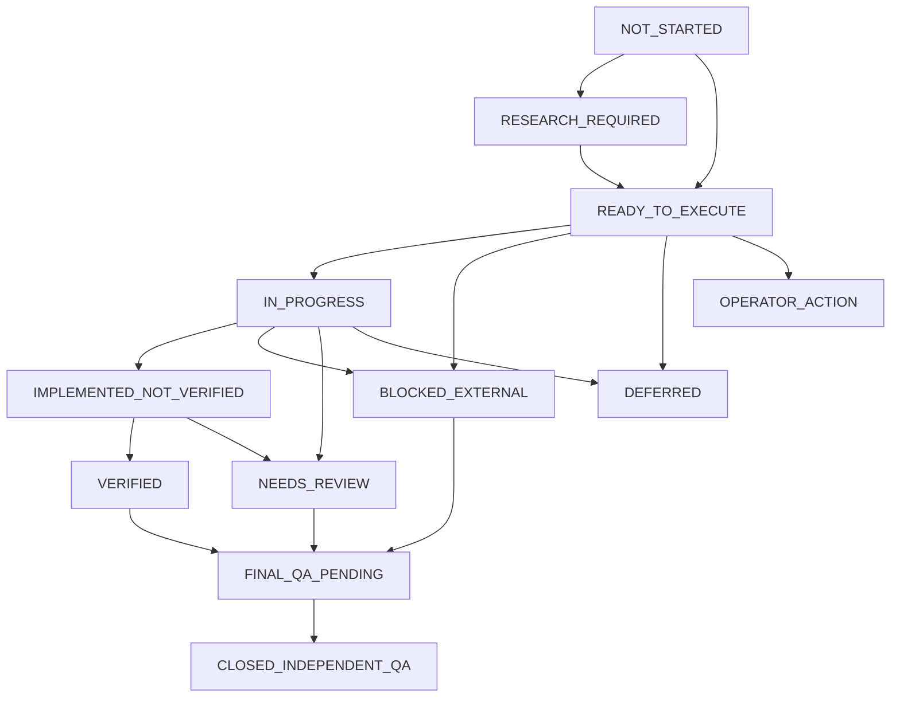
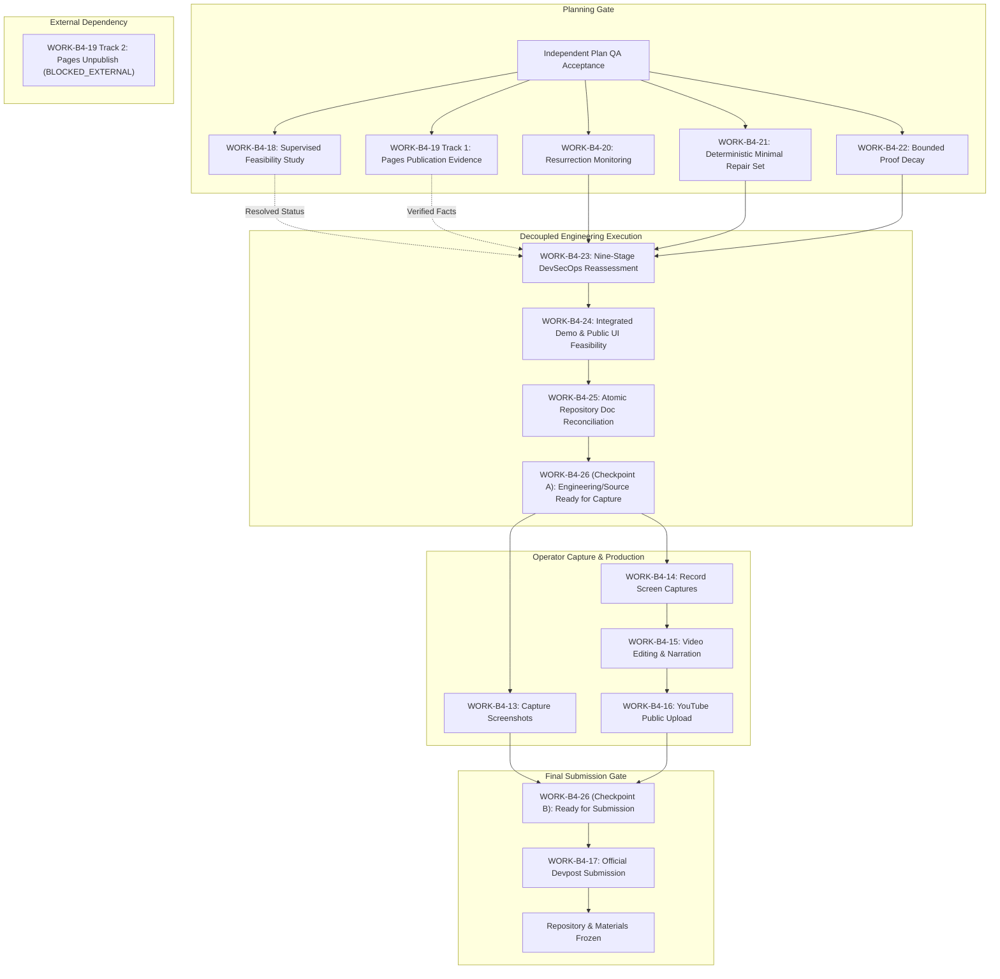
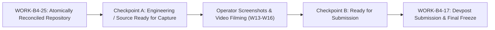
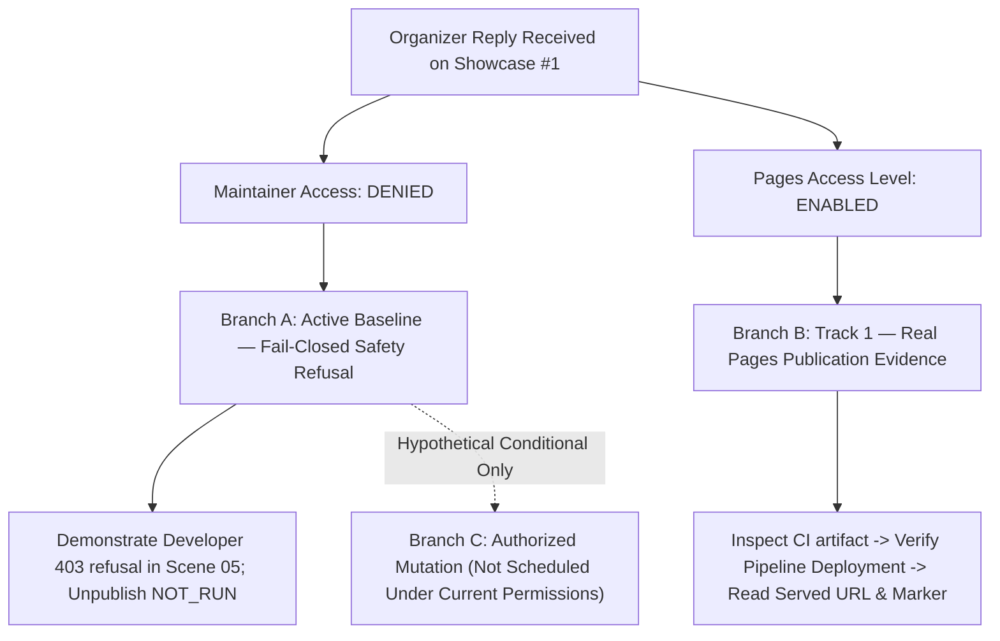
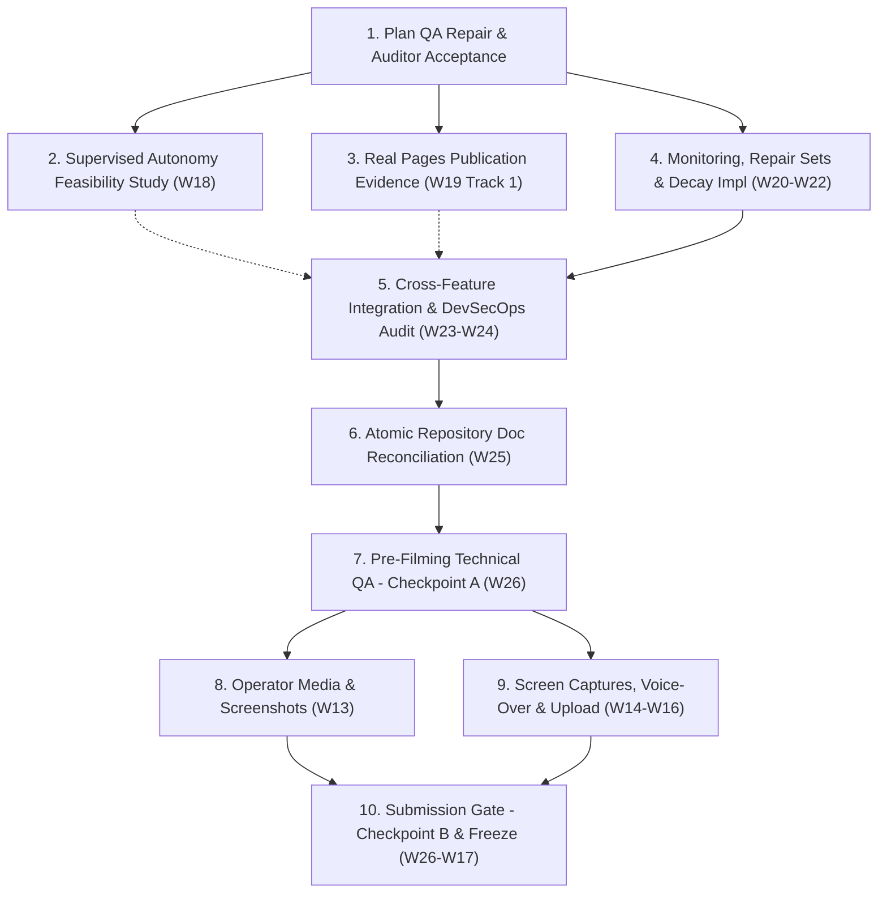

# Termivance — Canonical Competition Master Execution Plan, Award-Readiness Closure & Video/Submission Runbook

**Document Identity:** `plans/TERMIVANCE_MASTER_EXECUTION_PLAN.md`  
**Classification:** Canonical Project Execution Plan (Single Source of Truth)  
**Competition:** GitLab Transcend October 2026 — Life After Code  
**Selected Participation:** Path A / Start Fresh / Supervised (Compliance Status: `NEEDS_REVIEW` / Defensible with Documented Handoff Limitation; Target of `WORK-B4-18`)  
**Primary Award Objective:** Best Supervised Agent  
**Secondary Award Goal:** Credible Eligibility for Most Stages Covered (Without Inflated Claims)  
**Product Thesis:** A Proof-Bounded Software Retirement Protocol  
**Tagline:** Software retirement, proven within bounds.  
**Canonical Contest Repository:** [GitLab Project 87779099](https://gitlab.com/gitlab-ai-hackathon/transcend-october-2026/39306908/termivance)  
**Canonical Branch:** `main`  
**Non-Canonical QA Mirror:** [GitHub `zyganali-glitch/termivance-qa-mirror`](https://github.com/zyganali-glitch/termivance-qa-mirror) (branch `gitlab-main`)  
**Official Deadline:** October 27, 2026, 13:00 UTC / 16:00 Türkiye  
**Target Internal Submission Window:** October 26, 2026, 18:00–22:00 Türkiye  
**Incremental Personal Spend Target:** **$0.00**  
**Core Authority Contract:** Exactly one genuine GitLab Duo Custom Flow agent proposes; deterministic Python code governs. Model text cannot grant permissions, mutate providers, or award verdicts.

---

## 1. Frozen Product and Architecture

### 1.1 Product Thesis and Differentiating Concepts
Termivance is a software retirement protocol that replaces informal decommissioning checklists and unverified deletion actions with an auditable, deterministic lifecycle:

$$\text{DISCOVER} \longrightarrow \text{ANALYZE} \longrightarrow \text{AUTHORIZE} \longrightarrow \text{RETIRE} \longrightarrow \text{PROVE} \longrightarrow \text{WATCH}$$

It establishes three foundational innovations:

1. **Retirement Obligation Graph (ROG):** Software retirement modeled as an auditable directed acyclic dependency and obligation graph. Every prerequisite (target identity, provider observations, open work items, redeployment paths, required permissions, and operator approvals) must evaluate to satisfied before retirement can proceed.
2. **Bounded Absence:** Absence is treated as negative evidence bound strictly to an explicit target, checked observation surfaces, exact timestamps, and an empirical freshness window ($TTL \le 900\,\text{s}$). Termivance proves a verified state transition; it refuses universal or perpetual absence claims.
3. **Retirement Reversal (Resurrection Control):** Neutralizing an active service does not guarantee it will remain absent. If a target repository maintains automated CI/CD jobs, schedules, or triggers, software can be resurrected. Termivance analyzes surviving deployment mechanisms (e.g. `create-pages` with `pages: true`) and distinguishes transient absence from proven resurrection control.

### 1.2 Three Independent Claims
Termivance strictly segregates three questions. They are never conflated into a single monolithic status:

* **`SAFE_TO_RETIRE`:** Deterministic eligibility verdict based on provider facts, scope boundaries, and satisfied obligations.
* **`OBSERVED_ABSENT`:** Empirical post-mutation verification across independent provider surfaces (API + served URL) proving a true pre-to-post state transition.
* **`RESURRECTION_CONTROLLED`:** Proven neutralization or active tripwire monitoring of surviving redeployment mechanisms.

### 1.3 One Genuine GitLab Duo Custom Flow Agent
Termivance deploys exactly **one real GitLab Duo Custom Flow agent** ([Catalog Item `1018562`](https://gitlab.com/gitlab-ai-hackathon/transcend-october-2026/39306908/termivance)):
* Component: `AgentComponent` using official GitLab Duo Workflow schema.
* Trigger: Mention on canonical issues / work items.
* Role: Autonomous context inspection, file analysis (`get_repository_file`, `list_repository_tree`), and candidate obligation formulation.
* **Authority Limitation:** Advisory and non-authoritative. AI text cannot mutate resources, bypass policy, or alter deterministic verdicts.

### 1.4 Deterministic Python Authority Core
The core Python engine owns all provider mutations, obligation evaluations, and verdict determinations:
* Read-only client (`gitlab_client.py`): GET-only transport with fail-closed assertions.
* Graph evaluator (`engine.py`): Typed evaluation of retirement prerequisites.
* Bounded mutation executor (`pages.py`, `retirement.py`): Endpoint-restricted mutation (`DELETE /projects/:id/pages` only) under strict authorization preflights.
* Single-use durable ledger (`ledger.py`): Atomic, $fsync$-backed sealed reservation preventing double-spending or replay attacks.

### 1.5 Real Pages-Only Mutation Scope and Protected Project Identities
* **Sole Approved Destructive Demonstration Target:** Newly created, isolated disposable GitLab Pages project ID **`87785099`** (`.../termivance-b3-disposable-pages-demo`).
* **Strictly Protected From Mutation or Deletion:**
  * Canonical Termivance Repository: Project ID **`87779099`** (`PROTECTED`)
  * Organizer Showcase: Project ID **`87777871`** (`PROTECTED`)
  * Diagnostic Project: Project ID **`87786164`** (`PROTECTED / NON-TARGET`)
  * All other namespace projects and shared infrastructure.
* **Prohibited Actions:** No project deletion (`DELETE /projects/:id`), no user or namespace mutations, no fallback environment-stop substitutions for Pages unpublishing.

### 1.6 Permanent Separation Between Both GitLab Pages Sites
Termivance strictly segregates two distinct project contexts involving GitLab Pages. They must never be confused, merged, or substituted:

1. **Disposable Pages Test Target — Project `87785099` (`termivance-b3-disposable-pages-demo`):**
   * **Purpose:** Real target-side Pages publication, marker verification, and redeployment resurrection-risk demonstration.
   * **Role:** The external resource whose retirement lifecycle Termivance assesses. It is **NOT** the Control Room product.
   * **Invariant:** **Never repurpose project `87785099` as the product UI host.**
   * **Organizer-Reported Setting:** `pages_access_level` changed from `private` to `enabled` on Showcase Work Item #1.
   * **Current Target Deployment:** Pending independent verification via `WORK-B4-19` Track 1.
   * **Target Unpublish:** `NOT_RUN / PERMISSION_BLOCKED` (Developer role returns HTTP 403; Maintainer access denied by organizer).
   * **Target Absence:** `NOT_CLAIMED`.
   * **Target Resurrection Control:** `NOT_CLAIMED`.

2. **Potential Judge-Facing Control Room Hosting — Canonical Project `87779099` (`termivance`):**
   * **Purpose:** Optional public, read-only static demonstration of the Termivance Control Room viewer for hackathon judges.
   * **Role:** Additive static presentation of the product's interface (`control_room/index.html` and `control_room/data.js`), completely separate from target retirement assessment.
   * **Current Deployment Status:** `NOT_RUN / NOT_VERIFIED` unless future provider evidence proves otherwise.
   * **Protected Status:** The canonical repository remains protected against retirement, destructive mutation, and unauthorized scope expansion.
   * **Configuration Isolation:** A potential static Pages publishing CI job in canonical `.gitlab-ci.yml` must not be confused with the disposable project's `create-pages` redeployment risk.
   * **Governance Invariant:** Any future additive deployment must be separately researched, justified, and operator-approved under zero personal spend ($0.00). If public hosting is infeasible, fallback cleanly to the local Control Room (`file://`) and repository reproduction instructions. Deployment is optional for Path A eligibility; public UI hosting failure must not block an honest, on-time submission.

---

## 2. Verified Current State and Evidence Baseline

| Dimension | Baseline Fact / Evidence Record | Verification Mode |
|---|---|---|
| **GitLab Commit SHA (Audited Plan Baseline)** | **`7b32190fde43b4e12a8df41d6aacb2a15b90f615`** (B4 final current-observation freshness correction; Historical baselines: `3d12e24`, `cd51a41`, `b59735f`, `c8dbcc8`, `0d59a37`, `8c28b36`, `3c53ef4`, `8fd6567`, `6e808b3`, `b4431ec`) | `INDEPENDENTLY_VERIFIED` (GitLab API & remote HEAD) |
| **GitHub Mirror SHA (Audited Baseline)** | **`7b32190fde43b4e12a8df41d6aacb2a15b90f615`** on `gitlab-main` (same historical baselines) | `INDEPENDENTLY_VERIFIED` (`PASS / IN_SYNC`) |
| **GitLab CI Pipeline (Audited Baseline)** | Verified Pipeline ID **`2972207180`**, Job ID **`17350597778`** (`stage: verify`, `status: success`) at `7b32190`; Historical baselines: Pipeline `2971929010` (Job `17348430150`) at `cd51a41`, Pipeline `2971888764` (Job `17348108462`) at `b59735f`, Pipeline `2971463550` (Job `17344869001`), Pipeline `2967484742` (Job `17315753763`), Pipeline `2967239572` (Job `17313891889`), Pipeline `2967141211` (Job `17313164853`), Pipeline `2966976920` (Job `17311100994`) | `INDEPENDENTLY_VERIFIED` (`status: success`) |
| **GitHub Observer Run (Audited Baseline)** | Verified Run [**`39609803926`**](https://github.com/zyganali-glitch/termivance-qa-mirror/actions/runs/39609803926) (`PASS / IN_SYNC` at SHA `7b32190`, pipeline `2972207180`, job `17350597778`, 21/29 live observations, source manifest sha256 `358563cc…`, evidence manifest sha256 `f821beee…`); Historical baselines: Runs [`39600568138`](https://github.com/zyganali-glitch/termivance-qa-mirror/actions/runs/39600568138), [`39599023519`](https://github.com/zyganali-glitch/termivance-qa-mirror/actions/runs/39599023519), [`39584994230`](https://github.com/zyganali-glitch/termivance-qa-mirror/actions/runs/39584994230), [`39423997627`](https://github.com/zyganali-glitch/termivance-qa-mirror/actions/runs/39423997627), [`39415695705`](https://github.com/zyganali-glitch/termivance-qa-mirror/actions/runs/39415695705), [`39412372280`](https://github.com/zyganali-glitch/termivance-qa-mirror/actions/runs/39412372280), [`39406813557`](https://github.com/zyganali-glitch/termivance-qa-mirror/actions/runs/39406813557) | `INDEPENDENTLY_VERIFIED` (`PASS / IN_SYNC`) |
| **Git Commit & Future CI Identity Paradox** | Post-push verification for any new commit is dynamically bound and verified by GitLab CI and GitHub QA observer upon push; this plan records known verified baselines without fabricating future identifiers (Section 4.4) | Immutable Git Provenance Contract |
| **GitLab API Coverage** | **21 / 29** endpoints observed live; 8 endpoints access-limited (`401`/`403`/`404`) | `INDEPENDENTLY_VERIFIED` (Observer artifacts) |
| **License Attribution** | MIT License visible in GitLab Project Information & header | `INDEPENDENTLY_VERIFIED` (Public Project API) |
| **Local Test Suite** | **563 passed** (historical milestones: 381 → 437 → 505 → 530 → 540 → 563; adversarial continuation/publication/monitoring/decay paths fully network-free through injected transports); Ruff clean; 0 warnings | `EXECUTOR_REPORTED` (`pytest -q`) & CI verified |
| **CI Safety Assertions** | **40 / 40 passed** network-free (`ci_safety_assertions.py`); Note: raw CI job log traces return HTTP 401 unauthenticated, pipeline SUCCESS independently observed | `EXECUTOR_REPORTED` & CI Job verified |
| **Incremental Personal Spend** | **$0.00** across all batches (B1–B4) | `OPERATOR_CONFIRMED` |
| **Autonomy Compliance Status** | **`NEEDS_REVIEW`** (Defensible Supervised with documented handoff boundary; genuine Duo research + live Python review; event daemon not implemented; target of `WORK-B4-18` feasibility study) | System Truth State |
| **Primary Duo Discovery** | Session `9710085`, Issue #5, Agent Note `4045401991` | `RECORDED_HISTORICAL` & Live API readable |
| **Contextual Duo Sessions** | Session `9671626` (Issue #3, Agent Note `4040776241`) and Session `9704855` (Issue #4, Agent Note `4044819187`) remain separate historical records | `RECORDED_HISTORICAL` |
| **Approved Disposable Target (Project 87785099)** | Project `87785099`, commit `54fcc9ff2bfde1038a8192216178a5a8b6a6ee1d`; assessed target resource only, NEVER product UI host | `RECORDED_HISTORICAL` (Target CI has `create-pages`) |
| **Potential Public UI Hosting (Project 87779099)** | **`NOT_DEPLOYED — PUBLIC_ACCESS_PERMISSION_BLOCKED`** (12-point feasibility completed by `WORK-B4-24`: deployment technically feasible at $0.00, but public visibility requires a Maintainer `pages_access_level` change unavailable to the operator; local `file://` viewer is the verified fallback; see Section 10.3 findings) | `INDEPENDENTLY_VERIFIED` (GitLab docs + live API probes) |
| **Organizer Decision on Showcase #1** | Maintainer role: **`DENIED_BY_ORGANIZER`** (preserving contest equity across participants); Pages access level: **`PAGES_ACCESS_ENABLED_BY_ORGANIZER — ORGANIZER_REPORTED`** (reported changed from `private` to `enabled`) | `ORGANIZER_OFFICIAL_REPLY` (Showcase Work Item #1) |
| **Target Pages Permissions (Provider Fact)** | Developer role returns HTTP 403 on `GET/DELETE /projects/:id/pages` | `INDEPENDENTLY_VERIFIED` (Live GitLab Provider 403) |
| **Pages Deployment Observation** | **`NOT_OBSERVED` at Level 2** (Pages deployments API `GET /projects/87785099/pages/deployments` returns 404 to the observing identity; the ordinary environment Deployments API is a different surface and is never used as a substitute; a successful overall pipeline is never inferred as a Pages deployment) | `INDEPENDENTLY_VERIFIED` (Live read-back, `evidence/b4/disposable_pages_publication.json`) |
| **Pages Served URL Observation** | **`VERIFIED_LIVE_SERVED`** (exact pinned URL `https://termivance-b3-disposable-pages-demo-42a1a9.gitlab.io/` returned HTTP 200 with marker `TERMIVANCE-B3-DISPOSABLE-PAGES-MARKER-7f3c9a` (body digest `fce26f65…`), independently corroborated against repository source at commit `54fcc9ff`; freshness labels are evaluation-time only, never current-live claims) | `INDEPENDENTLY_VERIFIED` (Live read-back, `evidence/b4/disposable_pages_publication.json`) |
| **Current Deterministic Verdict** | **`BLOCKED`** (permissions insufficient, redeployment active, Maintainer access denied by organizer) | `EXECUTOR_REPORTED` & Replayable Live |
| **Actual Pages Unpublication** | **`NOT_RUN / PERMISSION_BLOCKED`** (safely blocked by permissions; Maintainer access denied) | System Truth State |
| **Observed Absence** | **`NOT_CLAIMED`** | System Truth State |
| **Resurrection Controlled** | **`NOT_CLAIMED`** | System Truth State |
| **DevSecOps Stage Selections** | **4 Defensible Core YES** (Plan, Verify, Secure, Govern); **4 Qualified YES with disclosure** (Create, Package, Configure, Monitor — defensible under the official "touching counts" criterion with one-line qualifications); **1 Explicit NO** (Release) | Final Reassessment (Sec 7, `docs/DEVSECOPS_STAGES.md`) |

---

## 3. Independent Audit Recommendations, Operator Decisions & Implementation Ledger

This ledger reconciles all independent model and auditor findings, operator determinations, executor repairs, and current source/test evidence. Every finding is tracked with explicit status, rationale, implementation references, and acceptance criteria.

```
+----------------------------------------------------------------------------------------------------+
|                      AUDIT RECOMMENDATIONS & OPERATOR IMPLEMENTATION LEDGER                         |
+----+-----------------------+-----------+---------------------------------------+--------------------+
| ID | Finding & Area        | Decision  | Implemented Technical Resolution      | Evidence & Status  |
+----+-----------------------+-----------+---------------------------------------+--------------------+
| 01 | Supervised Continuity | ACCEPTED  | 7-step read-only pipeline with honest | Commit 8f3ef4f     |
|    | vs Event Daemon       | IN SCOPE  | EXECUTED_NOW and handoff boundaries;  | 381 tests PASS     |
|    |                       |           | P0 feasibility study in WORK-B4-18    | NEEDS_REVIEW       |
+----+-----------------------+-----------+---------------------------------------+--------------------+
| 02 | Neutral Target Risk   | ACCEPTED  | Issue #5 / Session 9710085 neutral    | Commit cd51e52     |
|    | Discovery (Issue #5)  |           | intake ingested without priming       | Live Issue #5 Note |
+----+-----------------------+-----------+---------------------------------------+--------------------+
| 03 | Authentic Duo Note    | ACCEPTED  | ProviderObservations binding and      | Commit 2282da8     |
|    | Provenance & Commit   |           | exact commit SHA binding              | test_b4_regression |
+----+-----------------------+-----------+---------------------------------------+--------------------+
| 04 | Cryptographic Binding | ACCEPTED  | HMAC operator approval, SHA-256       | Commit 0022a21     |
|    | in Proof Capsule      | IN SCOPE  | manifest, fail-closed verify-receipt  | ci_safety 40/40    |
+----+-----------------------+-----------+---------------------------------------+--------------------+
| 05 | Resurrection Witness  | ACCEPTED  | witness.py analyzes target's own CI   | Commit 0022a21     |
|    | & Counterexamples     |           | commit; proves redeployment mechanism | test_b4_duo_witness|
+----+-----------------------+-----------+---------------------------------------+--------------------+
| 06 | Real Pages 403 Gate   | RESOLVED  | Showcase #1 reply received: Maintainer| Showcase #1 Reply  |
|    | & Organizer Decision  | WITH LIMIT| DENIED; Pages access enabled; WORK-   | DENIED_BY_ORGANIZER|
|    |                       |           | B4-19 split into Track 1 and Track 2  | Track 2 BLOCKED    |
+----+-----------------------+-----------+---------------------------------------+--------------------+
| 07 | 9-Stage Automation    | ACCEPTED  | Honest stage mapping; refuse inflated | MASTER_PLAN.md     |
|    | Integrity Audit       |           | checkbox claims for unautomated steps | Stage Audit table  |
+----+-----------------------+-----------+---------------------------------------+--------------------+
| 08 | Minimal Repair Set    | BOUNDED   | Speculative algorithms deferred;      | Bounded scope in   |
|    | & Proof Decay Scope   | APPROVED  | Bounded ROG repair in WORK-B4-21 and  | WORK-B4-21 &       |
|    |                       |           | contractual 900s decay in WORK-B4-22  | WORK-B4-22         |
+----+-----------------------+-----------+---------------------------------------+--------------------+
| 09 | Evidence Integrity &  | ACCEPTED  | 6-dim receipt classification, real    | Commits a6835f0,   |
|    | UI Privacy Repairs    |           | publisher contract, path sanitization | 55c9364 (all PASS) |
+----+-----------------------+-----------+---------------------------------------+--------------------+
| 10 | Consolidated Master   | ACCEPTED  | Re-audited 9 stages (4 YES, 1 NO, 4   | Commit b4431ec /   |
|    | Plan Truth Repair     |           | REVIEW); qualified Supervised status;  | 6e808b3 (PASS)     |
|    |                       |           | sanitized public paths; safe launchers| 381 tests PASS     |
+----+-----------------------+-----------+---------------------------------------+--------------------+
| 11 | Final Submission-Truth| ACCEPTED  | Launcher preflight bug fix; QA trigger| Commit 8fd6567     |
|    | Surgical Closure      |           | precision; SC-03/SC-08 truth repair;  | GitLab 2967239572  |
|    |                       |           | verified baseline CI/observer updates | Observer 39415695705|
+----+-----------------------+-----------+---------------------------------------+--------------------+
| 12 | Plan QA Repair &      | ACCEPTED  | Organizer decision incorporated; work | Commit 3c53ef4     |
|    | Governance Hardening  | & CLOSED  | state model corrected; dependencies   | GitLab 2967484742  |
|    |                       |           | decoupled; claim boundaries hardened  | Observer 39423997627|
+----+-----------------------+-----------+---------------------------------------+--------------------+
```

### Detailed Itemized Disposition of Audit Areas

#### 1. Supervised Workflow Continuity vs. Operator/CI Handoff
* **Original Finding:** Static review records assembled on disk do not prove end-to-end Supervised workflow autonomy. Hackathon Supervised expectations emphasize agents executing multi-step workflows with human review of outcomes.
* **Risk & Competition Impact:** High risk of losing "Best Supervised Agent" if handoff is viewed as a disconnected manual CLI invocation.
* **Decision:** **ACCEPTED FOR FEASIBILITY & EXPANSION.** Implement runnable 7-step review pipeline with honest boundaries; specify technical feasibility study and native continuation in `WORK-B4-18`.
* **Rationale:** Preserves $0 spend and security boundaries while evaluating supported GitLab-native execution pathways.
* **Exact Scope:** `src/termivance/supervised_review.py`, CLI `supervised-review --execute`, and candidate continuation mechanisms.
* **Implementation Reference:** `src/termivance/supervised_review.py:run_supervised_investigation`.
* **Tests:** `tests/test_b4_supervised_workflow.py`, `tests/test_b4_regression_integrity.py`.
* **Provider Evidence:** Canonical Issue #5 Notes `4045401991` and `4045409264`.
* **Independent QA Evidence:** Verified baseline `3c53ef4`, pipeline `2967484742`.
* **Unresolved Limitation:** Autonomous handoff between Duo note publication and Python execution is currently operator/CI-initiated; background daemon not demonstrated.
* **Next Action:** Execute feasibility investigation under `WORK-B4-18` upon plan QA authorization.
* **Blocking Dependency:** Independent Plan QA Acceptance; GitLab Custom Flow execution runtime boundaries and permissions.
* **Status:** `RESEARCH_REQUIRED` (Tracked under `WORK-B4-18`).
* **Future Acceptance Criterion:** Demonstrated continuous or automatically triggered chain from Duo investigation to deterministic Python conclusion with zero intermediate operator copy-paste.

#### 2. Neutral Target-Risk Discovery Using Issue #5
* **Original Finding:** Historical Duo sessions (9671626, 9704855) used targeted prompts. Duo must prove discovery from an unprimed, neutral retirement request.
* **Risk & Competition Impact:** Risk of jury perceiving Duo agent as primed with pre-existing hints.
* **Decision:** **ACCEPTED & CLOSED.**
* **Rationale:** Neutral Issue #5 prompt proves Duo autonomously inspects disposable target `87785099` repository.
* **Exact Scope:** Issue #5, Duo Session `9710085`.
* **Implementation Reference:** `src/termivance/supervised_review.py:DUO_SESSION_ID_NEUTRAL`.
* **Tests:** `tests/test_b4_supervised_workflow.py:test_run_supervised_investigation_with_neutral_discovery`.
* **Provider Evidence:** Issue #5 Note `4045401991`.
* **Independent QA Evidence:** Verified baseline `3c53ef4`.
* **Unresolved Limitation:** Session URL returns HTTP 404 anonymously; verified via Control Room recorded readback.
* **Next Action:** None required for discovery proof; maintained in demo runbook.
* **Blocking Dependency:** None.
* **Status:** `CLOSED`.
* **Future Acceptance Criterion:** Discovery dataset remains bound to Session `9710085`.

#### 3. Authentic Duo-Note Provenance and Exact Commit Binding
* **Original Finding:** Duo candidate claims could be spoofed or decoupled from target's actual Git commit SHA.
* **Risk & Competition Impact:** Adversarial claims could corrupt obligation evaluation.
* **Decision:** **ACCEPTED & CLOSED.**
* **Rationale:** Require structural parsing and exact commit SHA matching against target repository facts.
* **Exact Scope:** `src/termivance/supervised_review.py:parse_duo_note`, `corroborate_candidate_claims`.
* **Implementation Reference:** `src/termivance/supervised_review.py`.
* **Tests:** `tests/test_b4_regression_integrity.py`.
* **Provider Evidence:** Provider commit `54fcc9ff2bfde1038a8192216178a5a8b6a6ee1d`.
* **Independent QA Evidence:** Verified baseline `3c53ef4`.
* **Unresolved Limitation:** None.
* **Next Action:** Maintain regression assertions.
* **Blocking Dependency:** None.
* **Status:** `CLOSED`.
* **Future Acceptance Criterion:** Contradicted claims evaluate to `CONTRADICTED`; unobservable configurations evaluate to `UNRESOLVED`.

#### 4. Cryptographic Binding in Proof Capsule
* **Original Finding:** End-to-end cryptographic link recommended between Duo notes, deterministic decisions, and proof capsule.
* **Risk & Competition Impact:** Risk of tampering or replaying stale authorization tokens.
* **Decision:** **ACCEPTED IN SCOPE, WITH HONEST LIMITATIONS.**
* **Rationale:** Implement HMAC verification on operator approvals and SHA-256 manifests on proof capsules; do not claim asymmetric Duo signatures because GitLab Duo provides no signing keys to flow agents.
* **Exact Scope:** `src/termivance/ledger.py`, `src/termivance/capsule.py`, `src/termivance/approval_source.py`.
* **Implementation Reference:** `src/termivance/capsule.py:build_capsule`.
* **Tests:** `tests/test_b4_capabilities.py`, `scripts/ci_safety_assertions.py`.
* **Provider Evidence:** `evidence/b4/proof_capsule.json`.
* **Independent QA Evidence:** 40/40 network-free safety assertions.
* **Unresolved Limitation:** Duo notes remain authenticated via provider read-back, not cryptographic agent signatures.
* **Next Action:** Maintain tamper-evident checks.
* **Blocking Dependency:** None.
* **Status:** `CLOSED`.
* **Future Acceptance Criterion:** Tampered capsules fail closed under `capsule-verify`.

#### 5. Resurrection Witness vs. Active Monitoring & Prevention
* **Original Finding:** Retiring a service does not guarantee absence if CI/CD configuration can resurrect it.
* **Risk & Competition Impact:** High SRE risk; failure to detect redeployment paths undermines protocol credibility.
* **Decision:** **ACCEPTED & CLOSED FOR STATIC WITNESS; HARDENED MONITORING IN WORK-B4-20.**
* **Rationale:** Analyze target's own `.gitlab-ci.yml` at the exact observed commit for `create-pages` (`pages: true`). Explicitly clarify that a static witness is not an active monitor, a scheduled monitor is not resurrection prevention, detecting a mechanism is not evidence of prevention, and detecting resurrection is not controlling it.
* **Exact Scope:** `src/termivance/witness.py`, `WORK-B4-20`.
* **Implementation Reference:** `src/termivance/witness.py:build_resurrection_witness`.
* **Tests:** `tests/test_b4_duo_witness.py`.
* **Provider Evidence:** `evidence/b4/witness_87785099.json`.
* **Independent QA Evidence:** Verified baseline `3c53ef4`.
* **Unresolved Limitation:** Static witness analyzes repository configuration; continuous runtime resurrection monitoring is planned in `WORK-B4-20`; `RESURRECTION_CONTROLLED` requires verified provider-backed control evidence, never awarded merely from monitoring.
* **Next Action:** Implement `WORK-B4-20` upon engineering authorization.
* **Blocking Dependency:** Independent Plan QA Acceptance; verified Python authority.
* **Status:** `CLOSED` (Static witness); continuous monitoring tracked under `WORK-B4-20`.
* **Future Acceptance Criterion:** Static witness continues to flag `MECHANISM_PRESENT_IN_OBSERVED_CONFIG`; `RESURRECTION_CONTROLLED` is awarded only upon verified neutralization or active tripwire control.

#### 6. Real Pages 403 Gate & Actual Organizer Decision
* **Original Finding:** Target `87785099` returns HTTP 403 on Pages API for Developer role. Bypassing this via mock or environment stop is unacceptable.
* **Risk & Competition Impact:** Destructive unpublishing is blocked without Maintainer role.
* **Decision:** **RESOLVED WITH PERMANENT COMPETITION LIMITATION.**
* **Rationale:** The hackathon organizers formally replied to Showcase Work Item #1:
  1. *Maintainer Access Request:* **DENIED** to preserve equal competition conditions. Maintainer access is not an achievable routine remediation.
  2. *Pages Access Level:* Reported changed from `private` to `enabled` (`ORGANIZER_REPORTED`, `PENDING_INDEPENDENT_VERIFICATION`).
  3. *Execution Restructuring:* `WORK-B4-19` is split into two tracks:
     * **Track 1 (Publication Verification):** Actionable future engineering to independently verify Pages deployment and served URL.
     * **Track 2 (Pages Unpublishing):** Permanently `BLOCKED_EXTERNAL` under organizer denial; actual mutation remains `NOT_RUN / PERMISSION_BLOCKED`; fail-closed safety refusal demonstrated as a primary security strength.
* **Exact Scope:** `docs/HANDOFF.md`, Showcase Work Item #1, `WORK-B4-19`.
* **Implementation Reference:** `src/termivance/retirement.py`, `evidence/b4/decision.json`.
* **Tests:** `tests/test_retirement.py:test_developer_only_permission_cannot_be_safe_to_retire`.
* **Provider Evidence:** Live provider HTTP 403 responses recorded in `evidence/b4/portfolio.json`; organizer reply on Showcase #1.
* **Independent QA Evidence:** Verified baseline `3c53ef4`.
* **Unresolved Limitation:** Maintainer access cannot be granted under contest rules. Actual unpublishing remains `NOT_RUN / PERMISSION_BLOCKED`.
* **Next Action:** Execute Track 1 (Publication Verification) when authorized; keep Track 2 fail-closed `BLOCKED`.
* **Blocking Dependency:** Independent Plan QA Acceptance.
* **Status:** `DENIED_BY_ORGANIZER / RESOLVED_WITH_LIMITATION`.
* **Future Acceptance Criterion:** Track 1 gathers authentic provider deployment facts without fabricating absence; Track 2 strictly enforces fail-closed refusal.

#### 7. Nine-Stage Automation Integrity Audit
* **Original Finding:** Overconfident claims of checking 8 or 9 DevSecOps stages without demonstrable automation in each stage.
* **Risk & Competition Impact:** Disqualification or judge skepticism due to inflated category claims.
* **Decision:** **ACCEPTED & CLOSED FOR CURRENT AUDIT; REASSESSMENT IN WORK-B4-23.**
* **Rationale:** Restrict default Devpost recommendations to 4 Defensible Core stages (Plan, Verify, Secure, Govern), strictly gate Release (NO), and classify remaining 4 as `NEEDS_REVIEW`. Explicitly separate agentic Duo action from deterministic Python, normal CI, and external QA.
* **Exact Scope:** Section 7 of Master Plan, `WORK-B4-23`.
* **Implementation Reference:** Section 7 DevSecOps Matrix.
* **Tests:** Static document consistency assertions.
* **Provider Evidence:** Live CI history and Duo flow sessions.
* **Independent QA Evidence:** Verified baseline `3c53ef4`.
* **Unresolved Limitation:** Automation in Create, Package, Configure, Monitor requires honest qualification; ordinary CI is not agentic automation.
* **Next Action:** Execute final evidence reassessment under `WORK-B4-23` after engineering outcomes are settled.
* **Blocking Dependency:** Completion of `WORK-B4-18` through `WORK-B4-22`.
* **Status:** `CLOSED` for baseline; `STILL_OPEN` for final reassessment in `WORK-B4-23`.
* **Future Acceptance Criterion:** Devpost selections strictly mirror verified evidence without exaggeration.

#### 8. Bounded Minimal Repair Set & Proof Decay Scope (Reconciliation of Deferred Item)
* **Original Finding:** Speculative graph repair algorithms and continuous temporal decay curves were proposed.
* **Risk & Competition Impact:** High algorithmic complexity risked regressions and missed deadlines with minimal differentiation.
* **Historical Decision (2026-10-19):** **DEFERRED** as open-ended speculative research (DEC-20261019-03).
* **Updated Disposition (2026-10-20):** **RECONCILED & APPROVED AS BOUNDED SCOPE.**
  * *Speculative Global Graph Optimization:* Remains **DEFERRED**.
  * *Bounded Candidate Repair Sets (`WORK-B4-21`):* **APPROVED.** Bounded deterministic prerequisite-remediation guidance derived strictly from the actual Retirement Obligation Graph. Obtaining Maintainer role on project `87785099` is classified as **externally unavailable under contest conditions**, not an actionable routine repair.
  * *Contractual Freshness Decay (`WORK-B4-22`):* **APPROVED.** Deterministic evidence state machine enforcing contractual $TTL \le 900\,\text{s}$ freshness, timestamp validation, and fail-closed revalidation.
* **Rationale:** Delivers concrete product value and auditability within strict bounded scope without introducing speculative prediction engines or infinite-horizon models.
* **Exact Scope:** `WORK-B4-21`, `WORK-B4-22`.
* **Implementation Reference:** To be implemented in `src/termivance/repair.py` and `src/termivance/decay.py`.
* **Tests:** Planned property-oriented and boundary tests in `tests/test_b4_repair_sets.py` and `tests/test_b4_proof_decay.py`.
* **Provider Evidence:** Existing provider observation timestamps and graph obligations.
* **Independent QA Evidence:** To be independently verified in `WORK-B4-26`.
* **Unresolved Limitation:** Repair guidance is advisory and never authorizes mutations; decay does not predict future provider state.
* **Next Action:** Implement bounded features in `WORK-B4-21` and `WORK-B4-22` upon engineering authorization.
* **Blocking Dependency:** Independent Plan QA Acceptance; verified Python authority.
* **Status:** `READY_TO_EXECUTE` (Bounded scope approved; unblocked from `WORK-B4-18`).
* **Future Acceptance Criterion:** Deterministic candidate repair sets generated without expanding authority; evidence states expire cleanly at TTL boundaries.

#### 9. Evidence Integrity & UI Privacy Repairs
* **Original Finding:** Material defects in receipt provenance, publisher contracts, and Windows path leaks in UI data.
* **Risk & Competition Impact:** Inconsistent evidence presentation and privacy leaks in public submission artifacts.
* **Decision:** **ACCEPTED & CLOSED.**
* **Rationale:** 6-dimensional receipt classifier, typed `PublishResult`, and recursive path sanitizer in Control Room builder.
* **Exact Scope:** `scripts/build_control_room.py`, `src/termivance/publisher.py`, `control_room/data.js`.
* **Implementation Reference:** Commits `a6835f0`, `55c9364`.
* **Tests:** `tests/test_b4_repair_closure.py`, `tests/test_control_room_render.py`.
* **Provider Evidence:** Rebuilt `control_room/data.js` with sanitized paths.
* **Independent QA Evidence:** Verified baseline `3c53ef4`.
* **Unresolved Limitation:** None.
* **Next Action:** Maintain sanitization in future Control Room rebuilds.
* **Blocking Dependency:** None.
* **Status:** `CLOSED`.
* **Future Acceptance Criterion:** Zero absolute developer machine paths in public artifacts; receipt provenance strictly separated.

#### 10. Consolidated Master Plan Truth Repair
* **Original Finding:** Earlier plan drafts contained self-referential commit SHAs, overconfident DevSecOps claims, and unhardened launcher scripts.
* **Risk & Competition Impact:** Auditor rejection for internal contradictions.
* **Decision:** **ACCEPTED & CLOSED.**
* **Rationale:** Harmonize plan with verified baseline facts, qualify Supervised autonomy, and harden launchers.
* **Exact Scope:** Master plan, launcher scripts.
* **Implementation Reference:** Commit `6e808b3`.
* **Tests:** Launcher preflight checks live verified.
* **Provider Evidence:** Pipeline `2967141211`, Observer Run `39412372280`.
* **Independent QA Evidence:** Verified baseline `3c53ef4`.
* **Unresolved Limitation:** None.
* **Next Action:** Enforce atomic document synchronization in `WORK-B4-25`.
* **Blocking Dependency:** None.
* **Status:** `CLOSED`.
* **Future Acceptance Criterion:** Zero self-referential SHA contradictions.

#### 11. Final Submission-Truth Surgical Closure
* **Original Finding:** Unreachable code in Windows launcher preflight, inaccurate GitHub Actions trigger description, and anonymous access boundary in Scene SC-03.
* **Risk & Competition Impact:** Script execution failure on Windows; inaccurate depiction of QA bridge triggers.
* **Decision:** **ACCEPTED & CLOSED.**
* **Rationale:** Fix preflight assertions, accurately document on-demand (`workflow_dispatch`) and 6-hour cron triggers, and document Scene SC-03 public access boundary.
* **Exact Scope:** `scripts/run_supervised_review.bat`, Master Plan.
* **Implementation Reference:** Commit `8fd6567`.
* **Tests:** 381 pytest tests PASS, 40 safety assertions PASS.
* **Provider Evidence:** GitLab Pipeline `2967239572`, GitHub Observer Run `39415695705`.
* **Independent QA Evidence:** Verified baseline `3c53ef4`.
* **Unresolved Limitation:** None.
* **Next Action:** Reconcile historical `WORK-B4-12` in work register.
* **Blocking Dependency:** None.
* **Status:** `CLOSED`.
* **Future Acceptance Criterion:** Verified pipeline `2967239572` and observer run `39415695705` formally recorded as baseline.

#### 12. Plan QA Repair & Governance Hardening
* **Original Finding:** Independent plan audit identified 4 material defects: (1) unintegrated organizer reply on Showcase #1; (2) work register using invalid `WAITING_EXTERNAL` state and premature `FINAL_QA_PENDING` on `WORK-B4-26`; (3) false dependency deadlock of `WORK-B4-20`–`22` on `WORK-B4-18`; (4) unhardened claim boundaries regarding resurrection monitoring vs prevention and agentic CI stage credit.
* **Risk & Competition Impact:** Planning rejection; false execution deadlocks; invalid state representations; overstated monitoring/stage claims.
* **Decision:** **ACCEPTED & CLOSED IN PLAN REPAIR.**
* **Rationale:** Incorporate organizer decision; update work state model to strict 12-state vocabulary; decouple deterministic work items; harden claim boundaries; establish two-track `WORK-B4-19`.
* **Exact Scope:** `plans/TERMIVANCE_MASTER_EXECUTION_PLAN.md`.
* **Implementation Reference:** Commit `3c53ef4` and `8c28b36`.
* **Tests:** Local test suite 381 PASS, Ruff clean, 40/40 safety assertions PASS.
* **Provider Evidence:** GitLab CI Pipeline `2967484742`, GitHub Actions Observer Run `39423997627`.
* **Independent QA Evidence:** Verified baseline `8c28b36`.
* **Unresolved Limitation:** Plan QA approval is a prerequisite gate; engineering implementation is not authorized until auditor sign-off.
* **Next Action:** Finalize delivery-gate surgical closure before implementation authorization.
* **Blocking Dependency:** Independent Auditor Review.
* **Status:** `CLOSED` in planning; implementation pending authorization.
* **Future Acceptance Criterion:** Independent auditor awards Plan QA PASS.

#### 13. Final Plan Delivery-Gate Closure: Public UI, Media, Devpost, and Release Consistency
* **Original Finding:** Independent plan audit identified 4 remaining material planning gaps: (1) lack of a concrete public Control Room delivery feasibility decision and fallback on canonical project `87779099`; (2) need for explicit, permanent separation between disposable Pages project `87785099` and canonical project `87779099`; (3) video and Devpost media planning not conditionally bound to real engineering evidence; (4) invalid composite status on `WORK-B4-19` and circular dependency between `WORK-B4-26` and filming/screenshots (`WORK-B4-13`/`14`).
* **Risk & Competition Impact:** Ambiguous UI delivery commitments; risk of conflating disposable target with UI host; video/Devpost drift; governance rejection due to non-standard lifecycle state; circular scheduling deadlock preventing execution.
* **Decision:** **ACCEPTED & CLOSED IN SURGICAL PLAN REPAIR.**
* **Rationale:** Establish 12-point Control Room hosting feasibility research and clean fallback on canonical project `87779099`; lock permanent separation of both Pages sites; define evidence-dependent conditional video storyboard and 6-deliverable Devpost screenshot register; correct `WORK-B4-19` to standard `BLOCKED_EXTERNAL` with capability-specific track qualifiers; resolve filming deadlock via two-checkpoint delivery gate in `WORK-B4-26` (Checkpoint A for pre-filming source/engine QA, Checkpoint B for submission readiness).
* **Exact Scope:** `plans/TERMIVANCE_MASTER_EXECUTION_PLAN.md`.
* **Implementation Reference:** Commit `8c28b36` baseline and current delivery-gate plan repair.
* **Tests:** Local test suite 381 PASS, Ruff clean, 40/40 safety assertions PASS.
* **Provider Evidence:** GitLab CI Pipeline `2967484742`, GitHub Actions Observer Run `39423997627`.
* **Independent QA Evidence:** Awaiting Independent Auditor Acceptance of Plan Delivery-Gate Repair.
* **Unresolved Limitation:** Plan QA approval is a prerequisite gate; engineering implementation is not authorized until auditor sign-off.
* **Next Action:** Submit reconstructed plan for independent plan QA audit before authorizing engineering execution.
* **Blocking Dependency:** Independent Auditor Review.
* **Status:** `CLOSED` in planning; implementation pending authorization.
* **Future Acceptance Criterion:** Independent auditor awards Plan Delivery-Gate QA PASS.

---

## 4. Atomic Work Completion, Evidence and Document Consistency Contract & Remaining Work Register

### 4.1 One Coherent Change Unit Contract
Every future engineering work package in Termivance must be executed, committed, and verified as **one coherent change unit**. An engineering task is not complete merely because its code compiles or its local unit tests pass.

Each atomic change unit must atomically include all directly impacted:
1. **Implementation files** (source modules under `src/termivance/` or relevant tooling);
2. **Automated regression and adversarial tests** (under `tests/` covering positive, negative, and edge cases);
3. **Relevant configuration** (under `config/` or environment settings);
4. **Legitimate recorded evidence** (under `evidence/b4/`, with verified provenance labels);
5. **Evidence schema and manifest updates** (where data contracts or cryptographic digests change);
6. **Control Room generation and UI files** (`control_room/index.html` and rebuilt `control_room/data.js` where UI is impacted);
7. **Canonical Master Execution Plan state** (`plans/TERMIVANCE_MASTER_EXECUTION_PLAN.md` work register and evidence baseline);
8. **README operational instructions and metrics** (`README.md` test totals, CLI syntax, and operational caveats);
9. **Evidence Matrix claims and logs** (`docs/EVIDENCE_MATRIX.md`);
10. **Active Handoff critical facts** (`docs/HANDOFF.md`);
11. **Relevant demo scripts and Devpost materials** (`docs/DEMO_SCRIPT.md` and submission packets);
12. **Directly impacted supporting documentation** (preventing multi-document drift).

> **Enforcement Rule:** Implementation and documentation must never be decoupled into separate micro-batches. Changes to documentation directly affected by an engineering change must land in the same commit as the code and tests.

### 4.2 Exact Work Lifecycle and State Transition Invariants
Every work package in the Termivance register moves through an explicit, strictly governed 12-state lifecycle:



#### Controlled Vocabulary (The 12 Authorized Lifecycle States):
1. **`NOT_STARTED`:** Initial recorded state; dependencies and scope documented, work not commenced.
2. **`RESEARCH_REQUIRED`:** Technical feasibility, GitLab platform capabilities, or permissions must be investigated before implementation design can be finalized (e.g. `WORK-B4-18`).
3. **`READY_TO_EXECUTE`:** Prerequisites, dependencies, and technical specifications are fully established; work is authorized for execution within the active macro-batch.
4. **`IN_PROGRESS`:** Implementation, testing, or evidence collection is actively underway.
5. **`IMPLEMENTED_NOT_VERIFIED`:** Code and tests are written, but independent local test suite, linting, safety assertions, or CI pipelines have not yet completed.
6. **`VERIFIED`:** Implementation, tests, configuration, evidence, and directly affected documents have been completed and verified locally and via passing CI.
7. **`BLOCKED_EXTERNAL`:** Work is halted due to an external dependency, missing provider permission, or hackathon organizer action (e.g. Maintainer access denial on project `87785099`).
8. **`NEEDS_REVIEW`:** Implementation is functional with documented limitations, but platform boundaries or policy ambiguities require operator or judge qualification.
9. **`DEFERRED`:** Formally postponed by recorded operator decision to maintain schedule, zero personal spend, or deadline integrity.
10. **`OPERATOR_ACTION`:** Non-delegable human responsibility (e.g. video narration, screen recording, YouTube upload, Devpost submission).
11. **`FINAL_QA_PENDING`:** All engineering and documentation units are complete and pushed; awaiting independent whole-batch QA audit. (Must not be assigned prematurely).
12. **`CLOSED_INDEPENDENT_QA`:** Independently audited, verified against canonical remote and mirror, and accepted by external QA.

#### Documented Legacy Mapping:
* Historical work items marked `DONE` in legacy tables map to `CLOSED_INDEPENDENT_QA` (if verified by independent QA) or `VERIFIED` (if completed within batch scope). All future and active entries must strictly use the 12 authorized terms.

#### Core Governance Invariants:
1. A feature is **never** `VERIFIED` merely because code has been written.
2. An executor **cannot self-award** `CLOSED_INDEPENDENT_QA` or independent QA PASS.
3. `NOT_RUN`, `NOT_OBSERVED`, `NOT_CLAIMED`, `BLOCKED`, and `INCONCLUSIVE` must remain strictly distinct across all states and records.
4. **Plan QA Acceptance is NOT Implementation Authorization:** Approval of this planning document authorizes planning consistency only; engineering execution remains gated until explicitly instructed.

### 4.3 Evidence Required for Every State Transition (17-Field Transition Schema)
Every recorded state transition in the work register must be supported by an authentic transition record containing:

1. **Work Item ID:** Stable identifier (e.g. `WORK-B4-18`).
2. **Prior Status:** Exact prior lifecycle state.
3. **New Status:** Exact target lifecycle state.
4. **Implementation Commit SHA:** Exact Git commit SHA introducing the change.
5. **Changed-File Inventory:** Explicit list of files modified, added, or deleted.
6. **Tests Added or Changed:** Test modules and specific test cases added or updated.
7. **Test Results and Failures:** Exact execution counts (passed, failed, skipped) from pytest.
8. **Security Contract Assertions:** Results from `scripts/ci_safety_assertions.py` (e.g. 40/40 PASS).
9. **Source Commit Identity:** Commit SHA of the target repository or source baseline evaluated.
10. **Applicable Provider Project & Resource IDs:** Specific GitLab project IDs (e.g. `87785099`, `87779099`).
11. **Observation Timestamp (UTC):** ISO 8601 UTC timestamp of provider checks.
12. **API Endpoint & HTTP Status:** Exact HTTP method, path, and returned status code.
13. **Evidence Classification:** Labeled provenance (`LIVE_GITLAB_OBSERVED`, `RECORDED_HISTORICAL`, `FIXTURE`, `NOT_OBSERVED`).
14. **Resulting GitLab CI Pipeline & Job ID:** Official pipeline and verification job IDs.
15. **GitHub Independent Observer Run ID & Parity:** Actions run ID and drift verdict (`IN_SYNC` / `DRIFT_DETECTED`).
16. **Exact Remaining Limitation:** Truthful disclosure of any unresolved edge or boundary.
17. **Responsible Party & Independent QA Verdict:** Assigned entity and independent auditor confirmation.

### 4.4 Git Commit and Future CI Identity Paradox Resolution
A Git commit cannot include its own future CI pipeline ID, GitLab job ID, or GitHub observer run ID because computing those values requires the commit to exist, be pushed, and be scheduled by external systems.

To eliminate circular dependencies and prevent fictional SHA fabrication, Termivance establishes the following permanent protocol:

1. **Commit Stage:** The implementation commit records its own source code, tests, local evidence, and references to *known prior verified baselines* as historical benchmarks. Post-push CI fields are explicitly marked `PENDING_REMOTE_PIPELINE`.
2. **Canonical Push Stage:** Pushing the commit to GitLab triggers the canonical GitLab CI verification pipeline (`verification` job).
3. **Mirror & Observer Stage:** Pushing to GitHub `gitlab-main` enables running the GitHub Actions observer workflow (`gitlab-qa.yml`). **Pushing to GitLab or GitHub does NOT automatically run the GitHub observer.** The observer workflow triggers only on demand (`workflow_dispatch`) or on its scheduled 6-hour cron (`23 */6 * * *`).
4. **Observation Stage:** Authentic CI pipeline IDs and GitHub Actions run IDs are generated and permanently stored by the external provider platforms.
5. **Reconciliation Stage:** In the *subsequent legitimate engineering or planning update*, those external IDs are reconciled into the living Master Plan baseline without initiating an infinite cycle of documentation-only commits.
6. **Integrity Rule:** An earlier pipeline or run ID must never be misrepresented as the current commit's verification record.

### 4.5 Independent Acceptance and Anti-Self-Certification Gate
* The implementation executor is strictly prohibited from awarding itself an independent QA PASS or transitioning items to `CLOSED_INDEPENDENT_QA`.
* Only an independent auditor or external verification agent may examine the commit, remote HEAD, CI logs, observer artifacts, and document consistency to declare a work item closed.
* Any claim of capability without an observable, reproducible artifact is immediately classified as `BLOCKED` or `INCONCLUSIVE`.

---

### 4.6 Remaining Work Register (B4 Scope)

| Stable ID | Objective & Significance | Priority | Status | Dependency | Responsibility | Target Date | Affects | Acceptance Criteria Summary |
|---|---|---|---|---|---|---|---|---|
| `WORK-B4-01` | Establish Canonical Master Execution Plan | P0 | **CLOSED_INDEPENDENT_QA** | None | Executor / Auditor | 2026-10-20 | Eligibility / Quality | Single canonical plan covering all 17 sections |
| `WORK-B4-02` | Reconcile Master Plan & Handoff | P0 | **CLOSED_INDEPENDENT_QA** | `WORK-B4-01` | Executor / Auditor | 2026-10-20 | Quality | Zero contradictory statuses across repo |
| `WORK-B4-03` | Add Media Working Directories to `.gitignore` | P1 | **CLOSED_INDEPENDENT_QA** | None | Executor / Auditor | 2026-10-20 | Security / Cleanliness | `submission_media/` ignored; clean git status |
| `WORK-B4-04` | Safe Reproducible CLI Launcher (Scene 05) | P0 | **CLOSED_INDEPENDENT_QA** | None | Executor / Auditor | 2026-10-20 | Demo / Filming | Preflight checks; truthful exit status; `--no-pause` |
| `WORK-B4-05` | Track Organizer Pages Support Request | P0 | **CLOSED_INDEPENDENT_QA** | Hackathon Organizers | Operator / Auditor | 2026-10-20 | Demo / Release Stage | Official reply recorded: Maintainer denied; Pages enabled |
| `WORK-B4-06` | Enterprise Control Room Usability Audit | P1 | **CLOSED_INDEPENDENT_QA** | `control_room/` | Executor / Auditor | 2026-10-20 | Demo / Presentation | 5 tabs verified at 100% zoom, 1920x1080 |
| `WORK-B4-07` | Baseline Remote Push & Verification (`b4431ec`) | P0 | **CLOSED_INDEPENDENT_QA** | `WORK-B4-01`–`06` | Executor / Auditor | 2026-10-20 | Eligibility / CI | Remote SHA `b4431ec`; Pipeline `2966976920` success |
| `WORK-B4-08` | Baseline GitHub QA Mirror Sync (`b4431ec`) | P0 | **CLOSED_INDEPENDENT_QA** | `WORK-B4-07` | Executor / Auditor | 2026-10-20 | QA Bridge | Mirror branch identical to remote GitLab SHA `b4431ec` |
| `WORK-B4-09` | Baseline Independent Observer Run (`b4431ec`) | P0 | **CLOSED_INDEPENDENT_QA** | `WORK-B4-08` | Executor / Auditor | 2026-10-20 | QA Bridge | Run `39406813557` `PASS`, `drift: IN_SYNC` |
| `WORK-B4-10` | Supervised Autonomy Continuous-Handoff Evaluation | P0 | **NEEDS_REVIEW** | Platform Boundary | Operator / Executor | 2026-10-24 | Contest Category Claim | Operational boundary documented; target of `WORK-B4-18` |
| `WORK-B4-11` | Consolidated B4 Repair Push & Verification (`6e808b3`) | P0 | **CLOSED_INDEPENDENT_QA** | `WORK-B4-01`–`10` | Executor / Auditor | 2026-10-20 | Eligibility / Verification | Remote SHA `6e808b3`; Pipeline `2967141211`; Run `39412372280` |
| `WORK-B4-12` | Final Submission-Truth Surgical Closure & Post-Push Observer | P0 | **CLOSED_INDEPENDENT_QA** | `WORK-B4-11` | Executor / Auditor | 2026-10-20 | Eligibility / Verification | Verified SHA `8fd6567`; Pipeline `2967239572`; Run `39415695705` |
| `WORK-B4-18` | Genuine Supervised Autonomy Integration | P0 | **NEEDS_REVIEW** | Platform Boundary | Executor | 2026-10-22 | Best Supervised Agent | 12-point feasibility study completed; supported CLI continuation implemented; runtime limitations documented |
| `WORK-B4-19` | Organizer-Gated Real Pages Retirement | P0 | **BLOCKED_EXTERNAL** | Plan QA Approval / Showcase #1 | Operator / Executor | 2026-10-24 | Release Stage / Bounded Absence | Track 1: Verify deployment/URL (VERIFIED_LIVE_SERVED, Level 2 NOT_OBSERVED); Track 2: Fail-closed refusal (BLOCKED_EXTERNAL) |
| `WORK-B4-20` | Resurrection Monitoring & Current-Truth Downgrade | P1 | **VERIFIED** | Plan QA Approval / `WORK-B4-12` | Executor | 2026-10-23 | Product Differentiator | Read-only target monitoring, CI schedule feasibility, truth downgrade; receipt authority now requires the durable ledger chain |
| `WORK-B4-21` | Deterministic Minimal Repair Set | P1 | **VERIFIED** | Plan QA Approval / `WORK-B4-12` | Executor | 2026-10-23 | SRE Innovation | Bounded candidate repair guidance from ROG; no authority expansion |
| `WORK-B4-22` | Bounded Proof Decay and Freshness Revalidation | P1 | **VERIFIED** | Plan QA Approval / `WORK-B4-12` | Executor | 2026-10-23 | Auditability | 6-state decay machine, 900s TTL enforcement, fail-closed revalidation; empty-bundle and malformed-status fail-closed added |
| `WORK-B4-27` | Final B4 Evidence-Integrity Correction (auditor-rejected closure repair) | P0 | **CLOSED_INDEPENDENT_QA** | Independent auditor rejection of `0d59a37`; subsequent independent QA of the correction chain accepted the implementation (`cd51a41` QA: pipeline `2971929010`/job `17348430150` SUCCESS, observer `39600568138` PASS/IN_SYNC; `7b32190` QA: pipeline `2972207180`/job `17350597778` SUCCESS, observer `39609803926` PASS/IN_SYNC) | Executor | 2026-10-21 | Submission Integrity | LIVE preflight fail-closed (no optimistic defaults) + OFFLINE_REPLAY provenance; durable continuation causal ledger (FIRST_STARTED ≠ FIRST_COMPLETED, PARTIAL/FAILED never COMPLETED_IDEMPOTENT, corruption/recovery fail-closed, concurrency-safe); Pages 5-level evidence corrected (no pipeline→job inference, Pages-deployments-API-only Level 2, pinned-URL/marker identity binding, source-corroboration separation); resurrection receipt chain reuse; decay empty-bundle/malformed-status fail-closed; Control Room FRESH WHEN RECORDED parity; evidence records regenerated live; independently accepted (see acceptance chain in the Dependency column) |
| `WORK-B4-28` | B4 Final Causal-Authority and Proof-Boundary Closure (five residual defects at `c8dbcc8`; final current-observation freshness correction from QA of `cd51a41`) | P0 | **CLOSED_INDEPENDENT_QA** | Independent source audit of `c8dbcc8` (verdict BATCH REPAIR); independent QA of `cd51a41` (one remaining material defect); final correction at `7b32190` independently accepted (pipeline `2972207180`/job `17350597778` SUCCESS, observer `39609803926` PASS/IN_SYNC at `7b32190`) and carried as the accepted starting baseline of the W23-W25 award-readiness batch | Executor | 2026-10-21 | Submission Integrity | (1) OFFLINE_REPLAY categorically prohibits provider mutations: `--mode offline-replay --publish` rejected at CLI boundary (exit 2, `OFFLINE_PUBLICATION_REFUSED`) and inside `run_supervised_continuation`; supplied publishers can never mutate in offline mode; (2) preflight-verified note IS the note executed: exact provider bytes + SHA-256 digest + authenticated identity carried unchanged through a `VerifiedNoteHandoff` into the deterministic investigation — no second provider read, no local fallback substitution during LIVE continuation (TOCTOU closed); (3) ledger `finalize()` verifies reserved execution ownership (`EXECUTION_OWNER_MISMATCH` for competing/stale owners incl. post-recovery), duplicate completes never recast (audit-only `ambiguous_outcomes`), durable read-back verification; (4) monitor requires nonempty exact current served URL bound to the authenticated historical URL, positively observed current CI configuration (`CONFIG_INACCESSIBLE` = uncertainty, never a proven negative) and independently fresh current observation before `CONTINUED_ABSENCE_OBSERVED`; (5) Control Room states served presence precisely and never promotes it to deployment API proof; (6) final freshness-correction: current-observation freshness is an authoritative prerequisite for ANY positive present-tense classification — stale/future-skewed/missing/malformed current observations never award fresh `RESURRECTED_NOT_ABSENT`/`REDEPLOYMENT_MECHANISM_ACTIVE` (retained as historical evidence only; fresh genuine reappearance never suppressed by old history). 25 + 10 new adversarial tests; suite 540 passed; evidence + data.js regenerated live; independently accepted (see acceptance chain in the Dependency column) |
| `WORK-B4-23` | Nine-Stage DevSecOps Evidence Reassessment | P0 | **IMPLEMENTED_NOT_VERIFIED** | `WORK-B4-18`–`22`, `WORK-B4-19` (Track 1) | Executor | 2026-10-21 | Most Stages Covered | Final evidence-based reassessment against the current October 2026 official criterion ("touching a stage counts toward coverage"): judge-readable matrix at `docs/DEVSECOPS_STAGES.md` with six-dimension attribution per stage; recommendation 4 core YES (Plan, Verify, Secure, Govern) + 4 qualified-with-disclosure (Create, Package, Configure, Monitor) + Release NO; Devpost sync in Section 13; awaiting independent QA |
| `WORK-B4-24` | Integrated End-to-End Demo, Evidence Binding & UI Hosting Feasibility | P0 | **IMPLEMENTED_NOT_VERIFIED** | `WORK-B4-18`–`23` | Executor | 2026-10-21 | Judge Presentation | End-to-end demo path with honest evidence labels (`docs/DEMO_SCRIPT.md`); Control Room first-screen product explainer added, per-section observation timestamps, ARIA/tab landmarks, meta description (real-browser validated: 5 tabs render, zero console errors, zero network fetches at view time, Lighthouse accessibility/best-practices/SEO 100); live evidence regenerated 2026-10-21T15:15Z (pages publication `VERIFIED_LIVE_SERVED`, resurrection monitoring `HISTORICAL_RECEIPT_UNVERIFIED`/`MECHANISM_PRESENT`, 12 invariants); 12-point canonical Pages feasibility study completed (Section 10.3): deployment technically feasible at $0.00 but **public accessibility requires a Maintainer `pages_access_level` change denied for this namespace — publication NOT attempted, local `file://` Control Room remains the verified fallback**; presentation-integrity repair folded into this scope: demo launchers now report the ACTUAL verdict from the structured CLI output via `scripts/launcher_verdict.py` (23 adversarial tests; never hard-coded; original exit codes preserved; POSIX preflight validates the interpreter instead of trusting the `python3` name — Windows Git Bash stub bug fixed); both entry points rehearsed live (Windows `.bat` 21.1 s, POSIX `.sh` under Git Bash 25.4 s, both `VERDICT_CONFIRMED_BLOCKED`, 7/7 steps, 6 live provider steps; safety-refusal early-fail 1.5 s exit 2); awaiting independent QA |
| `WORK-B4-25` | Atomic Repository-Wide Documentation Reconciliation | P0 | **IMPLEMENTED_NOT_VERIFIED** | `WORK-B4-18`–`24` | Executor | 2026-10-21 | Submission Integrity | Product-focused README rewrite (hero/tagline/problem/architecture/verdicts/authority split/real-target boundary/Try It Out/limitations; removed stale claims incl. "no mutation command", wrong session emphasis, old counts); DOC-01..DOC-10 reconciled (suite counts synchronized, final 563 after the launcher-verdict tests; launcher Python 3.12 aligned with pyproject; evidence-matrix current-state rewritten; demo script synchronized); final Devpost packet (Section 13), final 10-scene 174 s runbook (Section 11), 5-image screenshot packet (Section 12), Turkish operator filming guide (`docs/OPERATOR_FILMING_GUIDE.md`); presentation-integrity repair folded into this scope: ten-scene contract synchronized everywhere (no current-state nine-scene text remains), SC-07 narration corrected to "HTTP four-oh-three, forbidden", SC-06 given conditional LIVE/HISTORICAL narration variants gated on a fresh browser read, complete narration-matching timed subtitle track committed (`assets/demo/subtitles/termivance_demo_en.srt`, 29 cues, 174 s) with on-screen slogans labeled separately, ONE authoritative five-image screenshot register (01/02/04/06/07 primary; 03/05 alternates) unified across Master Plan/screenshots README/operator guide, previously accepted W27/W28 register entries reconciled to `CLOSED_INDEPENDENT_QA` with their acceptance chains, Devpost story pipeline references explicitly labeled historical verified baselines; awaiting independent QA |
| `WORK-B4-26` | Final Independent QA, Source Lock and Submission Readiness | P0 | **NOT_STARTED** | Checkpoint A: `WORK-B4-25`; Checkpoint B: `WORK-B4-13`–`16` | Auditor / Operator | 2026-10-25 | Submission Freeze | Two checkpoints: Checkpoint A unblocks capture; Checkpoint B validates post-capture assets and authorizes submission |
| `WORK-B4-13` | Capture Demonstration Media & Screenshots | P0 | **OPERATOR_ACTION** | `WORK-B4-26 (Checkpoint A)` | Operator | 2026-10-25 | Presentation / Devpost | Curate accepted count from 7 candidate deliverables (Sec 12); 1920x1080 sanitized PNGs; zero credentials leaked |
| `WORK-B4-14` | Record Video Screen Captures (Scenes 01-10) | P0 | **OPERATOR_ACTION** | `WORK-B4-26 (Checkpoint A)` | Operator | 2026-10-25 | Submission Video | Raw MP4 captures for all 9 scenes adhering to conditional evidence rules per Sec 11 |
| `WORK-B4-15` | Video Editing, English Voice-Over & Narration | P0 | **OPERATOR_ACTION** | `WORK-B4-14` | Operator | 2026-10-25 | Submission Video | Final MP4 (< 180s, target 174s), clear voice-over, readable text, exact scene timings matching declared runtime |
| `WORK-B4-16` | Upload Video to YouTube as Public | P0 | **OPERATOR_ACTION** | `WORK-B4-15` | Operator | 2026-10-26 | Devpost Submission | Public YouTube URL accessible in clean browser session; unlisted/private forbidden |
| `WORK-B4-17` | Complete Official Devpost Submission | P0 | **OPERATOR_ACTION** | `WORK-B4-26 (Checkpoint B)` & `WORK-B4-16` | Operator | 2026-10-26 | Contest Eligibility | All fields completed, URL linked, submitted before 22:00 Türkiye; canonical repository frozen |

---

### 4.7 Detailed Technical Implementation Specifications for Remaining Engineering Work



#### Decoupled Dependency Semantics:
* **`VERIFIED` Status:** Enables downstream tasks to consume proven automated functionality.
* **`NEEDS_REVIEW` Status:** Does NOT block downstream tasks. Downstream tasks (`WORK-B4-23`, `WORK-B4-24`, `WORK-B4-25`) consume the documented limitation and transparent boundary disclosures rather than stalling.
* **`BLOCKED_EXTERNAL` Status:** Does NOT halt independent engineering. Downstream tasks consume the fail-closed refusal and record honest external limitations.
* **`DEFERRED` Status:** Preserved as formally postponed without impacting active capabilities.

#### 4.7.1 WORK-B4-18 — Genuine Supervised Autonomy Integration
* **Priority:** P0 / Highest Award-Critical Engineering Concern.
* **Prerequisite Gate:** Independent Plan QA Acceptance.
* **Objective:** Close the operational handoff gap between genuine Duo Custom Flow investigation and deterministic Python review to deliver defensible end-to-end Supervised autonomy without violating the $0.00 personal spend policy or least-privilege security boundaries.
* **Current Deficiency:** Currently, a genuine Duo session analyzes a retirement request, and the deterministic Python review performs real provider-backed work. However, the handoff between the Duo result and Python execution is operator/CI-initiated. A manually stitched historical Duo record followed by a separately launched CLI command is not proof of autonomous end-to-end execution. This cannot be resolved by changing wording alone.
* **Target Operational Contract:**
  $$\text{ONE HUMAN INITIAL REQUEST} \longrightarrow \text{ONE GENUINE DUO SESSION} \longrightarrow \text{TARGET INVESTIGATION} \longrightarrow \text{STRUCTURED CANDIDATES} \longrightarrow \text{AUTOMATIC DETERMINISTIC PYTHON EVALUATION} \longrightarrow \text{EVIDENCE-BOUND RESULT} \longrightarrow \text{ONE HUMAN OUTCOME REVIEW}$$
  * Zero intermediate manual action, operator copy/paste, or intermediate human approval between agent investigation and read-only deterministic conclusion.
  * Human approval remains mandatory for any destructive mutation.
  * Exactly one real Duo Custom Flow agent is deployed.
* **Mandatory Technical Feasibility Investigation (Stage 1):**
  The executor must investigate and evaluate, against current official GitLab documentation and the deployed flow configuration (`flows/termivance_retirement_analyst.yaml`):
  1. *Existing `AgentComponent`:* Capabilities and limitations of Catalog Item `1018562`.
  2. *`coding_environment`:* Behavior and permission constraints of `coding_environment: none` versus `full`.
  3. *GitLab Flow CI/CD Runtime:* Setup configuration, supported base images, repository checkout mechanisms.
  4. *Deterministic Invocation:* Whether the GitLab-hosted agent can invoke deterministic repository code via documented tools (`run_command`, `run_tests`).
  5. *Tool Restrictions:* Availability and isolation boundaries of agent execution tools.
  6. *`agent-config.yml`:* Capabilities for executing pre-run or verification setup scripts.
  7. *Native Event Triggers:* Webhooks, issue mention triggers (`eventTypes: [0]`), and human-trigger restrictions.
  8. *GitLab CI Continuation:* Whether a GitLab CI pipeline job can execute downstream of a Duo flow execution without manual triggers.
  9. *`CI_JOB_TOKEN` Limitations:* Read permissions on issues and issue notes (`GET /projects/:id/issues/:iid/notes`).
  10. *Service-Account Boundaries:* Composite identity permissions and protected repository barriers.
  11. *Billing Boundaries:* Credit attribution to flow service accounts, namespace limits, on-demand billing risks.
  12. *Architecture Compatibility:* Compliance with the frozen one-agent, deterministic authority architecture.
* **Required Architecture Choice & Decoupling Fallback:**
  * *Preferred Path:* A single genuine GitLab Custom Flow execution that conducts both agent investigation and safely invokes deterministic Python review, if documented runtime support and permissions genuinely permit it.
  * *Alternative Path:* A GitLab-native automatic CI continuation demonstrably bound to the same initial human request, with zero intermediate manual steps.
  * *Fallback Rule:* If neither path can satisfy full autonomy under current permissions and $0.00 spend: preserve `NEEDS_REVIEW` or `BLOCKED_EXTERNAL`, document the exact missing platform capability, maintain the strongest legitimate runnable fallback (`supervised-review --execute`), and never falsely mark the full-autonomy requirement `VERIFIED`. **Crucially, an unresolved autonomy condition does NOT block `WORK-B4-20`, `WORK-B4-21`, or `WORK-B4-22`.**
* **Mandatory Test and Evidence Specification:**
  * *Tests:* Single initial trigger; target identity binding; structured candidate provenance; automatic Python execution; wrong-target refusal; spoofed/malformed Duo note refusal; stale commit SHA refusal; provider HTTP 401/403/404 handling; duplicate invocation idempotency; zero unauthorized mutation; human review boundary enforcement; no credential leakage.
  * *Evidence:* Authentic GitLab Duo session URL, execution trace/log, deterministic result artifact, causal bindings, and published outcome note. Local mock simulations cannot close this work.

#### 4.7.2 WORK-B4-19 — Organizer-Gated Real Pages Retirement (Two-Track Architecture)
* **Priority:** P0 / Externally Gated Dependency.
* **Controlled Lifecycle Status:** **`BLOCKED_EXTERNAL`** (overall work package status in the 12-state controlled vocabulary).
* **Prerequisite Gate:** Independent Plan QA Acceptance; Organizer Decision Recorded on Showcase #1.
* **Objective:** Manage real GitLab Pages publication and retirement lifecycle on disposable project `87785099`, incorporating the authoritative organizer decision on Showcase Work Item #1, while strictly preserving separation from canonical Control Room hosting.
* **Resource Boundary Invariant:** Disposable project `87785099` is the external target whose lifecycle Termivance assesses. **It is never repurposed as the product UI host.**
* **Organizer Decision Facts:**
  * Maintainer Access: **`DENIED_BY_ORGANIZER`** (to preserve contest equity across participants).
  * Pages Access Level: **`PAGES_ACCESS_ENABLED_BY_ORGANIZER — ORGANIZER_REPORTED`** (reported changed from `private` to `enabled`).
* **Two-Track Execution Structure & Capability-Specific Qualifiers:**
  *(Note: Track conditions are capability-specific qualifiers describing actionable versus blocked paths within the single controlled work package, not invented additional lifecycle states.)*

  ##### Track 1: Real GitLab Pages Publication Evidence (Capability-Specific Qualifier: `VERIFIED`)
  *Actionable engineering work to verify and document actual Pages publication:*
  1. Query disposable project `87785099` settings via API; verify `visibility` (`public`) and `pages_access_level` (`enabled`). Distinguish organizer-reported access setting from verified site deployment.
  2. Inspect target repository at observed commit `54fcc9ff2bfde1038a8192216178a5a8b6a6ee1d` (`.gitlab-ci.yml`, `create-pages` job).
  3. Validate that `create-pages` outputs artifacts to `public/` and sets `pages: true`.
  4. Verify the unique publication marker in source: `TERMIVANCE-B3-DISPOSABLE-PAGES-MARKER-7f3c9a` in `site/index.html`.
  5. Check `project.pagesDeployments` (GraphQL) and latest pipeline on default branch for successful Pages deployment.
  6. If deployment is absent or stale, plan a bounded permitted CI retry on the disposable target (after checking runner minutes and zero spend).
  7. Obtain authoritative Pages deployment observations (`id`, `url`, `created_at`, `status`).
  8. Independently query the exact served Pages URL (`https://gitlab-ai-hackathon.gitlab.io/...`) and search for the unique marker string.
  9. Record provider timestamp, source commit SHA, deployment identity, HTTP status codes, and observation freshness.
  10. Preserve honest observation boundaries: if unauthenticated HTTP probes return Cloudflare interstitial or 403, record as `INCONCLUSIVE` or `NOT_OBSERVED`, never promote to verified deployment.
  > **Invariant:** A successful CI job alone is **never** proof of Pages deployment or served URL availability.

  ##### Track 2: Actual Pages Unpublication (Capability-Specific Qualifier: `BLOCKED_EXTERNAL — MAINTAINER_DENIED`)
  *Fail-closed security refusal under organizer role denial:*
  1. Maintainer access was explicitly denied by the hackathon organizers on Showcase #1.
  2. Developer role returns HTTP 403 on `DELETE /projects/87785099/pages`.
  3. No destructive operation is authorized or scheduled.
  4. The implementation contracts (exact target authorization, HMAC operator signature, sealed single-use durable ledger, pre-state verification, Retirement Obligation Graph, and dual read-back) remain fully implemented and tested as fail-closed security assets.
  5. In video and Devpost submissions, this fail-closed refusal is showcased as a primary product strength: Termivance refuses to execute unauthorized or unverified mutations.
  6. Unpublish remains **`NOT_RUN / PERMISSION_BLOCKED`**, absence remains **`NOT_CLAIMED`**, and resurrection control remains **`NOT_CLAIMED`**.

#### 4.7.3 WORK-B4-20 — Resurrection Monitoring and Current-Truth Downgrade
* **Priority:** P1 / Strong Product Differentiator.
* **Prerequisite Gate:** Independent Plan QA Acceptance; verified Python authority (`WORK-B4-12`). (Decoupled from `WORK-B4-18`).
* **Objective:** Expand the static resurrection witness into an active, read-only target monitoring capability that detects surviving redeployment mechanisms, detects source drift, and downgrades current truth when new facts contradict prior receipts.
* **Harden Claim & Automation Boundaries:**
  * **Static Witness != Active Monitor:** Analyzing `.gitlab-ci.yml` at a fixed commit is a static witness, not ongoing monitoring.
  * **Scheduled Monitor != Resurrection Prevention:** Scheduling a CI job or tripwire probe does not prevent resurrection; it only observes.
  * **Mechanism Detection != Redeployment Control:** Detecting that `create-pages` exists is proof of resurrection risk, not proof of control.
  * **Resurrection Observation != Resurrection Control:** Observing a service reappearing is detection, not remediation or control.
  * **Receipt Immobility:** A historical absence receipt proves absence at a past timestamp ($TTL \le 900\,\text{s}$); it never guarantees perpetual absence.
  * **`RESURRECTION_CONTROLLED` Standard:** Awarded ONLY upon verified neutralization of deployment mechanisms or proven active control tripwires.
* **Technical Design:**
  * Read-only exact-target monitor querying: default branch commit SHA, `.gitlab-ci.yml` CI/CD configuration, active pipeline schedules, trigger tokens, and Pages deployment state.
  * Distinguish live provider observations from inaccessible surfaces (fail closed on HTTP 401/403).
  * State Downgrade Protocol: If a target previously awarded `OBSERVED_ABSENT` is subsequently observed with an active deployment, running Pages job, or republished URL, current truth is immediately downgraded to `RESURRECTED_NOT_ABSENT` or `BLOCKED`, preserving historical transition receipts as immutable audit records.
* **GitLab-Native Execution Feasibility:**
  * Investigate running a scheduled, read-only GitLab CI pipeline within the canonical project (`.gitlab-ci.yml`) using existing shared runner minutes ($0.00 spend).
  * Document Developer permission requirements, schedule ownership, runner minute consumption, cancellation rules, and secret hygiene.
  * Note: The existing 6-hour GitHub Actions observer proves source/pipeline parity between remotes; it does not monitor target Pages lifecycle.
  * A recurring schedule may be enabled only after confirming zero personal spend and operator authorization.
* **Test Matrix:**
  * No change baseline; newly added Pages CI job; modified publishing job; removed mechanism; in-repo commit drift; inaccessible API (403); stale evidence expiry; duplicate observation idempotency; state downgrade on reappearance; failed scheduled run; refusal of false permanent control claims.

#### 4.7.4 WORK-B4-21 — Deterministic Minimal Repair Set (Bounded Candidate Repair Sets)
* **Priority:** P1 / Strictly Bounded SRE Innovation.
* **Prerequisite Gate:** Independent Plan QA Acceptance; verified Python authority (`WORK-B4-12`). (Decoupled from `WORK-B4-18`).
* **Objective:** Calculate actionable prerequisite-remediation guidance directly from the Retirement Obligation Graph without expanding mutation authority or relying on language-model text generation.
* **Remediation Model & Contest Reality:**
  * For every violated or unresolved obligation in the graph, identify:
    * Exact obligation ID (e.g. `RETIREMENT_PERMISSION`, `REDEPLOYMENT_PATH`).
    * Supporting evidence reference and observed provider status.
    * Specific failing condition.
    * Dependent obligations blocked downstream.
    * Required authority level (Operator, Hackathon Organizer, Maintainer).
    * Remediation category (`AUTOMATIC_CONFIG`, `OPERATOR_APPROVAL`, `ORGANIZER_PERMISSION`, `MANUAL_CI_REPAIR`).
    * Exact fresh evidence required to satisfy closure.
    * Proof boundary: the remediation proposal never alters any current verdict.
  * Candidate repair actions for disposable target `87785099`:
    1. *Maintainer Role:* Formally classified as **`EXTERNALLY_UNAVAILABLE_UNDER_CONTEST_CONDITIONS`** (organizer explicitly denied Maintainer access to preserve equity). Must not be advertised as an achievable routine repair.
    2. *Pages Publication:* Verify deployment and served marker via Track 1 (satisfies `PAGES_PUBLISHED`).
    3. *Redeployment Mechanism:* Neutralize `create-pages` job in `.gitlab-ci.yml` or provide signed attestation (satisfies `REDEPLOYMENT_PATH`).
    4. *Operator Authorization:* Provide valid operator approval token with HMAC (satisfies `TARGET_AUTHORIZED`).
    5. *Evidence Revalidation:* Re-run discovery immediately prior to execution (satisfies `EVIDENCE_FRESHNESS`).
* **Minimality & Selection Algorithm:**
  * Implement bounded candidate selection over graph prerequisites:
    * Dependency ordering via topological sort.
    * Elimination of redundant actions dominated by upstream prerequisites.
    * Stable, deterministic tie-breaking.
    * Refusal on cyclic, malformed, or unverifiable graphs.
  * Formally designated as **Bounded Candidate Repair Sets** to reflect deterministic DAG properties rather than unprovable global mathematical optimality.
* **Security & Proof Invariants:**
  * Repair proposals must never authorize a mutation or dispatch an API call.
  * Proposals must never assume human actions have been completed.
  * AI suggestions are never promoted to graph truth without deterministic verification.
* **Tests:**
  * Unit tests in `tests/test_b4_repair_sets.py`: single violation repair, multi-violation dependency chain, cyclic graph refusal, dominance elimination, tie-breaking stability, externally unavailable action labeling, and zero-mutation safety assertions.

#### 4.7.5 WORK-B4-22 — Bounded Proof Decay and Freshness Revalidation
* **Priority:** P1 / Bounded Implementation (No Speculative Prediction Engine).
* **Prerequisite Gate:** Independent Plan QA Acceptance; verified Python authority (`WORK-B4-12`). (Decoupled from `WORK-B4-18`).
* **Objective:** Enforce temporal boundaries on provider evidence, preventing stale observations from authorizing mutations or supporting expired absence claims.
* **Deterministic Evidence State Machine:**
  * `FRESH`: Observation age $t \le 600\,\text{s}$ ($TTL = 900\,\text{s}$). Valid for graph evaluation.
  * `EXPIRING`: $600\,\text{s} < t \le 900\,\text{s}$. Valid with warning.
  * `EXPIRED`: $t > 900\,\text{s}$. Invalid for mutation authorization; triggers refusal.
  * `REVALIDATION_REQUIRED`: Underlying source commit SHA has changed, or prerequisite evidence has expired.
  * `NOT_OBSERVED`: Evidence was never gathered or endpoint returned an error.
  * `INCONCLUSIVE`: Conflicting observations across provider channels.
* **Core Invariants:**
  1. Evidence expiration can never improve a verdict (cannot turn `BLOCKED` into `SAFE`).
  2. Missing or unparseable timestamps fail closed (`EXPIRED` / `INCONCLUSIVE`).
  3. Local clock skew or negative time intervals fail closed.
  4. Source commit drift immediately invalidates dependent repository observations.
  5. Historical evidence remains recorded in audit archives; expiration affects current truth only.
  6. Static Control Room cannot represent recorded historical observations as live.
  7. Expired approvals or ledger reservations cannot be reused.
  8. Revalidation requires fresh GET requests to provider APIs.
  9. No time-based heuristic can manufacture absence or resurrection control.
* **Tests:**
  * Boundary test cases: $t = 0\,\text{s}$, $t = 899\,\text{s}$, $t = 900\,\text{s}$, $t = 901\,\text{s}$; clock skew detection; malformed ISO timestamps; commit drift invalidation; historical vs. current state preservation.
  * UI presentation: Control Room displays clear freshness indicators without simulated live timers.

#### 4.7.6 WORK-B4-23 — Nine-DevSecOps-Stage Evidence Reassessment
* **Priority:** P0 / Competition Award Eligibility.
* **Prerequisite Gate:** Completion of `WORK-B4-18`–`22` and `WORK-B4-19` Track 1.
* **Objective:** Conduct a rigorous post-engineering evidence audit across all nine official GitLab lifecycle stages to substantiate Devpost claims without exaggeration.
* **Six-Dimensional Stage Attribution Standard:**
  Every claimed stage must strictly delineate:
  1. *Genuine Duo Agent-Driven Action:* Autonomous analysis, tool invocation, candidate formulating.
  2. *Deterministic Python Action:* Graph evaluation, ledger sealing, counterfactual analysis.
  3. *Ordinary GitLab CI Execution:* Runner executing pytest, linter, safety assertions (NOT agentic).
  4. *External GitHub QA:* Mirroring, unauthenticated drift checks, API observation bridge.
  5. *Human-Triggered Operation:* Operator issue mentions, CLI launches, approvals.
  6. *Historical Recorded Evidence:* Archived sessions, previous snapshots.
* **Nine-Stage Assessment Matrix (final reassessment result, 2026-10-21):**
  1. **Plan:** Genuine Duo Custom Flow (Catalog Item `1018562`, Session `9710085`) on neutral Issue #5; autonomous repository inspection; structured candidate formulating. Status: **`VERIFIED (Core YES)`**.
  2. **Create:** Duo agent autonomously authored structured issue notes; deterministic publisher created the outcome note (`4045409264`). Code/MR generation not performed. Status: **`QUALIFIED YES (disclosed: agent-authored notes, not code)`**.
  3. **Verify:** Official GitLab CI pipeline running linting, 563 pytest tests, and 40 network-free safety contract assertions. Status: **`VERIFIED (Core YES)`**. (Ordinary CI, not agentic Verify).
  4. **Package:** Tamper-evident Proof Capsule with SHA-256 integrity manifest. Application JSON packaging, not GitLab Package Registry. Status: **`QUALIFIED YES (disclosed: proof capsule, not Package Registry)`**.
  5. **Secure:** Fail-closed preflights, HMAC operator authorization, sealed single-use durable ledger, protected target boundaries. Status: **`VERIFIED (Core YES)`**.
  6. **Release:** Bounded Pages unpublish lifecycle implemented but blocked (Developer 403 on `DELETE /projects/:id/pages`; organizer denial). Status: **`BLOCKED (Explicit NO)`**; remains **`NO`**.
  7. **Configure:** Read-only GET discovery of environments, deployments, and CI variables across four projects. Discovery, not configuration management. Status: **`QUALIFIED YES (disclosed: read-only discovery)`**.
  8. **Monitor:** On-demand exact-target resurrection monitor (12 fail-closed invariants), external GitHub Actions QA bridge (6-hour cron + dispatch) and documented tripwire. Status: **`QUALIFIED YES (disclosed: on-demand monitor + external scheduled observer)`**. (Scheduled CI monitoring is ordinary CI, not agentic Monitor).
  9. **Govern:** Protected target registry, deterministic graph authority, fail-closed policy engine, immutable audit trail. Status: **`VERIFIED (Core YES)`**.
* **Devpost Rule (updated by the final reassessment):** Strongly check the 4 Core Stages (Plan, Verify, Secure, Govern). The official "touching a stage counts" criterion makes Create, Package, Configure, Monitor defensible **with their one-line disclosures included in the Devpost story** (operator and auditor acceptance required). Release remains UNCHECKED. Full judge-readable matrix: `docs/DEVSECOPS_STAGES.md` (Section 7 holds the authoritative summary).

#### 4.7.7 WORK-B4-24 — Integrated End-to-End Demo, Evidence Binding & UI Hosting Feasibility
* **Priority:** P0 / Judge Presentation & Delivery Feasibility.
* **Prerequisite Gate:** Completion of `WORK-B4-18`–`23`.
* **Objective:** Deliver one unified, reproducible, target-bound demonstration proving what Termivance genuinely does, aligning the Control Room, CLI, and filming storyboard, and conduct the public Control Room delivery feasibility research on canonical project `87779099`.
* **End-to-End Evidence Chain:**
  1. Human neutral retirement request on Issue #5.
  2. Genuine GitLab Duo Custom Flow (Session `9710085`) inspecting target repository.
  3. Non-authoritative candidate findings posted to issue.
  4. Deterministic Python corroboration against authoritative provider facts.
  5. Retirement Obligation Graph evaluation yielding fail-closed `BLOCKED`.
  6. Target Pages publication verified via Track 1 (if established) or truthfully reported.
  7. Resurrection witness exposing surviving `create-pages` redeployment path.
  8. Bounded candidate repair sets explaining resolution requirements (with Maintainer role noted externally unavailable).
  9. Proof freshness and decay boundaries displayed.
  10. Outcome note published back to GitLab for human review.
  11. Canonical GitLab CI pipeline and independent GitHub Actions QA bridge verification.
* **Control Room Integrity:**
  * Preserve 5-tab architecture (Overview, Portfolio, Obligation Graph, What-if, Evidence & Audit).
  * Ensure the first 15 seconds communicate why retirement is blocked and what engineering risk was neutralized.
  * Static guarantee: zero network fetches at view time, runs locally from `file://`.
* **Mandatory Public Control Room Delivery Feasibility Research (Canonical Project `87779099`):**
  Investigate whether existing canonical GitLab project `87779099` can legitimately publish a public, read-only Control Room through GitLab Pages, establishing:
  1. Whether project-level GitLab Pages publication is available in its current namespace.
  2. Whether current Developer permissions can support an additive Pages CI deployment.
  3. Whether the site's public visibility can be enabled without requiring forbidden Maintainer operations.
  4. Whether a deployment can be performed with existing authorized CI resources at zero incremental personal spend ($0.00).
  5. Whether publishing would introduce a new Pages mechanism into the protected canonical repository and consequently require fresh portfolio, witness, graph, and evidence reconciliation.
  6. Whether the existing verification pipeline can remain intact, with a separately scoped static Pages publishing job.
  7. Whether `index.html`, `data.js`, and every referenced asset can be published without private paths, tokens, credentials, or unsupported third-party dependencies.
  8. Whether the generated static UI remains fully operational when hosted at a real HTTPS path rather than `file://`.
  9. Whether unauthenticated external users can load the complete interface in a clean browser session.
  10. Whether the published interface is stable through the required judging period and remains within authorized free resources.
  11. Whether the public URL can be reliably linked from README and Devpost.
  12. Whether this scope can be completed without jeopardizing the submission deadline.
  *Official research sources:*
  * `https://docs.gitlab.com/user/project/pages/introduction/`
  * `https://docs.gitlab.com/user/project/pages/pages_access_control/`
  * `https://docs.gitlab.com/ci/yaml/`
* **Hosting Decision and Fallback:**
  * *Preferred Optional Delivery:* A separately scoped, static, read-only GitLab Pages presentation from existing canonical project `87779099`, but ONLY if supported, authorized, secure, zero spend ($0.00), and operator-approved.
  * *Safety Boundary:* This is an additive presentation of the product UI, NEVER a Pages unpublish or mutation of disposable test target `87785099`. No new GitLab project, external hosting service, custom domain, paid tier, Cloudflare account, or infrastructure is approved.
  * *Clean Fallback:* If public hosting is not feasible within the deadline, retain the local Control Room (`control_room/index.html`), maintain complete canonical repository reproduction instructions (`README.md`), ensure the real interface is clearly shown in the YouTube video, and preserve the verified Path A eligibility fallback (under which deployment is optional). Public UI hosting failure must not block an on-time submission.
  * *Acceptance Testing Criteria:* Plan tests for actual Pages job success; exact published URL from provider information; anonymous HTTP 200 access; HTML/JS asset retrieval; 5-tab functionality; interactive graph/what-if/evidence panels; working links; zero console errors; no credentials/personal paths; accurate evidence classification; mobile/desktop rendering; source revision identity. A successful build without public HTTP verification must remain `PUBLIC_UI_NOT_VERIFIED`.
* **Evidence-Dependent Video Runbook Specification:**
  * The original 9-scene, 174-second storyboard (2026-10-20) is a **verified historical baseline**, superseded by the final 10-scene, 174-second runbook in Section 11.2.
  * Final approved runbook must reflect actual outcomes of `WORK-B4-18` through `WORK-B4-23`:
    * *Supervised Autonomy:* If automatic handoff is proven, demonstrate the single-request Duo-to-Python chain; if unsupported, preserve real CLI execution and honest boundary.
    * *Pages Publication:* If disposable Pages deployment and marker are verified, show the real published disposable site briefly with surviving CI redeployment; if unverified, retain honest observation boundary.
    * *New Capabilities:* If verified, concisely integrate repair sets, proof decay, or active monitoring; do not show unverified features.
    * *Precise Filming Specs:* Final runbook must specify scene ID, start/end time, screen/URL, tab, actions, observable result, English VO, English subtitles, provenance mode, fallback shot, and supporting evidence record.
  * Video must remain strictly under 180 seconds (target 174 seconds).

#### 4.7.8 WORK-B4-25 — Atomic Repository-Wide Documentation Reconciliation
* **Priority:** P0 / Mandatory Completion Contract.
* **Prerequisite Gate:** Completion of `WORK-B4-18`–`24`.
* **Objective:** Perform a whole-repository contradiction audit and atomically synchronize all documentation, configuration, evidence, and media registers with the verified engineering state.
* **Mandatory Defect Repairs (DOC-01 through DOC-10):**
  * **DOC-01 (README Test Count):** Synchronize test counts across README, HANDOFF, and Master Plan to the then-current verified baseline (381 at planning time; the final W25 reconciliation synchronizes to the true final suite count of 540 passed, with historical milestones preserved).
  * **DOC-02 (README Pages Status):** Reconcile demo narrative to clearly state that real Pages retirement is currently `BLOCKED` and actual unpublishing is `NOT_RUN`, separating intended lifecycle from current truth.
  * **DOC-03 (README CLI Mutation Command):** Reconcile README statement claiming the CLI has no mutation command with the actual existence of bounded `retire-pages --execute` and its security preflights.
  * **DOC-04 (Python Version Mismatch):** Align `pyproject.toml` (`>=3.12`), README (`3.12+`), and launcher scripts (`sys.version_info >= (3, 10)` vs `3.12`) to a single verified runtime specification.
  * **DOC-05 (Stale Evidence Matrix):** Rewrite current-state summary in `docs/EVIDENCE_MATRIX.md`, removing starter boilerplate and clearly distinguishing primary Session `9710085` from contextual sessions.
  * **DOC-06 (Outdated Secondary Demo Script):** Reconcile `docs/DEMO_SCRIPT.md` with the canonical 174-second video runbook, updating test baselines (381), primary Duo session references, and scene durations.
  * **DOC-07 (Inaccurate QA Trigger Diagram):** Reconcile sequence diagram and text in Master Plan to truthfully reflect GitHub observer triggers: on-demand (`workflow_dispatch`) and scheduled 6-hour cron (`23 */6 * * *`).
  * **DOC-08 (Stale Completion Register):** Reconcile historical `WORK-B4-05` and `WORK-B4-12` in work register to `CLOSED_INDEPENDENT_QA`.
  * **DOC-09 (Uncaptured Media):** Register the 6 candidate screenshot PNGs in `assets/demo/screenshots/` as pending `OPERATOR_ACTION`, never counting them as existing evidence until captured.
  * **DOC-10 (Historic Handoff Instructions):** Reconcile `AGENTS.md`, `plans/MASTER_PLAN.md`, and `docs/HANDOFF.md` to eliminate stale batch directives or conflicting guidance while preserving historical records.
* **Public UI Documentation & Fallback:**
  * If public Control Room hosting is verified on `87779099`, document its exact URL, acceptance evidence, and operational boundaries in README, HANDOFF, and Master Plan.
  * If local fallback is selected, clearly document exact local reproduction instructions (`control_room/index.html`), zero-network guarantee, and verified Path A eligibility compliance (deployment optional).
* **Mandatory Final-Claims Reconciliation Protocol:**
  * Atomically synchronize all English materials across repository (README, Devpost story, lifecycle stages, screenshots, captions, video runbook, voice-over, subtitles) in the same coherent change unit per Section 13.5.

#### 4.7.9 WORK-B4-26 — Final Independent QA, Source Lock and Submission Readiness (Two-Checkpoint Governance)
* **Priority:** P0 / Submission Freeze Gate.
* **Prerequisite Gate:** Completion of `WORK-B4-25` (for Checkpoint A); Completion of `WORK-B4-13`–`16` (for Checkpoint B).
* **Objective:** Establish an explicit two-checkpoint delivery gate that completely eliminates the circular filming/QA deadlock, ensuring independent technical QA authorizes media capture, and post-capture verification authorizes final submission.



* **Checkpoint A — ENGINEERING / SOURCE READY FOR CAPTURE (Pre-Filming Technical Gate):**
  * *Prerequisite:* Completion of `WORK-B4-25`.
  * *Required Technical Dimensions:*
    1. Appropriate engineering and integrations verified (`WORK-B4-18`–`23`).
    2. Executable evidence chain confirmed and reproducible.
    3. Actual public UI hosting outcome known (verified on `87779099`) or authorized local fallback confirmed.
    4. Real disposable Pages outcome known (`WORK-B4-19` Track 1 verified or accepted as truthful fallback `INCONCLUSIVE`, Track 2 unpublish fail-closed `BLOCKED`).
    5. Source code and Control Room UI state completely stable.
    6. Preliminary repository documentation synchronized (`WORK-B4-25`).
    7. Correct screenshots register (Section 12) and video runbook (Section 11) prepared.
    8. 100% test pass rate (563 tests as of the `WORK-B4-25` presentation-integrity repair; Ruff clean, 40/40 safety assertions).
    9. Independent pre-capture technical QA accepted; zero unresolved material security defects.
  * *Authorization:* Checkpoint A explicitly authorizes the operator to capture screenshots (`WORK-B4-13`) and record video screen captures (`WORK-B4-14`).
  * *Deadlock Elimination Invariant:* **A planned screenshot or uploaded YouTube video is NEVER a prerequisite for Checkpoint A.** Checkpoint A evaluates engineering and documentation completeness only.

* **Checkpoint B — READY FOR SUBMISSION (Post-Capture Submission Gate):**
  * *Prerequisites:* Checkpoint A passed; `WORK-B4-13` (screenshots captured), `WORK-B4-14` (video recorded), `WORK-B4-15` (video edited & narrated), and `WORK-B4-16` (YouTube public upload completed).
  * *Required Post-Capture Dimensions:*
    1. Final screenshot images reviewed, aspect ratios verified (1920×1080), and sanitized (zero credentials, personal paths, or invalid composite claims).
    2. Final voice-over and English subtitles reviewed for clarity and strict truthfulness.
    3. Exact edited video length validated (< 180s, target 174s).
    4. YouTube public video URL actually accessible in a clean, unauthenticated browser session (never unlisted or private).
    5. Final public UI URL validated if claimed, or local fallback verified.
    6. README and Devpost claims consistent with final footage and evidence.
    7. Exact source parity between canonical GitLab `main` and GitHub `gitlab-main`.
    8. Latest canonical GitLab CI and independent GitHub Actions observer pass.
    9. No post-filming source change contradicts the footage or introduces drift.
    10. Final operator acceptance confirmed.
  * *Authorization:* Checkpoint B certifies the submission packet as complete and authorizes `WORK-B4-17` (Official Devpost Submission).

* **Protocol for Legitimate Post-Capture Corrections:**
  * If an essential defect is discovered after Checkpoint A capture, affected footage, images, evidence bindings, and claims must be refreshed in the same coherent change unit rather than silently diverging before final submission freeze.

* **Repository Freeze Invariant:**
  * Once Devpost submission is complete, zero commits, tags, or branch updates may be pushed to canonical GitLab `main`. Repository immutability is permanently preserved.

#### 4.7.10 WORK-B4-28 — B4 Final Causal-Authority and Proof-Boundary Closure

* **Priority:** P0 / Submission Integrity.
* **Trigger:** Independent source audit of canonical commit `c8dbcc8` confirmed the main integrity correction substantially implemented and the GitLab/GitHub verification bridge genuinely synchronized, but identified **five residual material integrity defects** (verdict `BATCH REPAIR`). Subsequent independent QA of canonical commit `cd51a41` confirmed all five materially implemented with **one remaining material defect** (stale current observations could receive current-truth verdicts), closed as a final narrow source-and-test correction within this same work item — no new work item created.
* **Scope:** ONE tightly bounded consolidated correction across `src/termivance/supervised_review.py`, `src/termivance/cli.py`, `src/termivance/continuation_ledger.py`, `src/termivance/resurrection_monitor.py`, `src/termivance/pages_publication.py`, `control_room/index.html`, regenerated evidence and `data.js`, and 25 new adversarial tests in `tests/test_b4_causal_authority_repair.py`. No new product features, phases, agents, unrelated refactoring or design redesign.
* **Defect 1 (Offline replay never publishes):** `--mode offline-replay --publish` is rejected at the CLI boundary (exit code 2, explicit `OFFLINE_PUBLICATION_REFUSED`) and inside `run_supervised_continuation` (status `REFUSED_OFFLINE_PUBLICATION`); a publisher supplied in offline mode is forced to `None` before the investigation runs, so recorded/fixture-origin data can never execute a provider issue-note publication path. The legitimate authorized LIVE publication capability is preserved.
* **Defect 2 (Preflight-verified note is the note executed):** a frozen `VerifiedNoteHandoff` captures the exact provider-returned note body, its SHA-256 digest, note ID, Duo service-account author, issue/canonical-project/target/commit bindings and provenance at LIVE preflight; `run_supervised_continuation` re-verifies digest and bindings and carries the object unchanged into `run_supervised_investigation`, which binds candidate parsing to those exact bytes, performs no second provider note read and never falls back to a local recorded note during LIVE continuation. A missing, altered or contradictory handoff refuses the continuation. The session's complete runtime is never labelled independently verified merely because its issue note was authenticated (`NEEDS_REVIEW` retained).
* **Defect 3 (Ledger verifies its execution owner):** `ContinuationLedger.finalize()` verifies the reserved `execution_id` before any state transition — a competing or stale execution (including the original invocation after explicit recovery transferred ownership) fails with `EXECUTION_OWNER_MISMATCH`; duplicate completes are never overwritten or recast (contradictory follow-ups are audit-only `ambiguous_outcomes`); the durable recorded result and digest are verified by read-back after writing. Atomic persistence, locking, corruption detection and recovery safeguards unchanged.
* **Defect 4 (Historical absence cannot override missing current observations):** `monitor_resurrection` requires, when a verified historical absence is the prerequisite, a nonempty exact current served URL matching the authenticated historical URL (`CURRENT_OBSERVATION_MISMATCH` otherwise — a synthetic served status is never attributed to the authorized URL); the current CI configuration must be positively observed before the redeployment mechanism is claimed absent (`CONFIG_INACCESSIBLE` is reported uncertainty, never a proven negative); current-observation freshness is validated independently of the historical receipt's timestamp (`CURRENT_OBSERVATION_STALE`). The ledger-backed historical receipt verification is unchanged.
* **Final current-observation freshness correction (within this same work item, 2026-10-21, from independent QA of `cd51a41`):** `monitor_resurrection` previously evaluated `RESURRECTED_NOT_ABSENT` (served HTTP 200 + marker) and `REDEPLOYMENT_MECHANISM_ACTIVE` (observed CI mechanism) before rejecting an expired or otherwise invalid current observation, so a historical current observation older than the contractual 900s TTL could be promoted into a new present-tense finding. Corrected verdict precedence: current-observation freshness is now an authoritative prerequisite for any positive present-tense classification (`current_freshness.is_valid_for_evaluation` gates both verdicts); stale marker/mechanism sightings are retained as historical evidence / recorded redevelopment risk (`STALE_REAPPEARANCE_EVIDENCE_RETAINED`, `STALE_MECHANISM_EVIDENCE_RETAINED`), never freshly confirmed; expired, future-skewed, missing and malformed current timestamps fail closed to `STALE_REVALIDATION_REQUIRED`; a fresh genuine exact-URL-bound reappearance still supports `RESURRECTED_NOT_ABSENT` even when the historical absence record itself is old (separate requirements). 10 new adversarial production-path tests in `tests/test_b4_resurrection_monitoring.py`; `evidence/b4/resurrection_monitoring.json` regenerated live 2026-10-21T13:24Z (unchanged honest verdict `HISTORICAL_RECEIPT_UNVERIFIED`, now 12 invariants); `control_room/data.js` rebuilt (build sha256 `00bd24c0…`).
* **Defect 5 (Control Room truth boundary):** the viewer states precisely that the target's HTML and distinctive marker were actually served at the recorded URL, and independently that the Pages deployment API did not establish a deployment object under the observing identity; the publication evidence summary carries the same boundary; the CI-mechanism caption distinguishes observed absence from unobserved configuration. All five tabs and the zero-runtime-network policy preserved.
* **Live evidence regeneration (read-only, anonymous, $0.00):** `evidence/b4/disposable_pages_publication.json` regenerated 2026-10-21T11:58Z (`VERIFIED_LIVE_SERVED`, HTTP 200 at the pinned unique-domain URL, body digest `fce26f65…` identical to prior observations, Level 2 honestly `NOT_OBSERVED_NOT_FOUND`); `evidence/b4/resurrection_monitoring.json` regenerated 2026-10-21T11:58Z (`HISTORICAL_RECEIPT_UNVERIFIED`, `MECHANISM_PRESENT`, 11 invariants including the three new binding invariants); `control_room/data.js` rebuilt (build sha256 `68fe5575…`).
* **Verification:** full suite **530 passed** (505 pre-repair + 25 new adversarial tests), `ruff check` clean, `scripts/ci_safety_assertions.py` **40/40 PASS** network-free, real headless Chromium render validation and Node DOM render tests green.
* **Status:** `CLOSED_INDEPENDENT_QA` (reconciled 2026-10-21) - implementation-level completion and real evidence were independently accepted: the final correction at `7b32190` passed independent QA (pipeline `2972207180`/job `17350597778` SUCCESS; observer run `39609803926` `PASS / IN_SYNC` at `7b32190`) and was carried as the accepted starting baseline of the W23-W25 award-readiness batch.

---

## 5. Formal Decision Register

```
+----------------------------------------------------------------------------------------------------+
|                                    FORMAL DECISION REGISTER                                        |
+-------------------+----------------------+---------------------------------------------------------+
| Decision ID       | Date & Status        | Summary & Operator Rationale                            |
+-------------------+----------------------+---------------------------------------------------------+
| DEC-20261018-01   | 2026-10-18 [FROZEN]  | Path A / Start Fresh / Supervised route confirmed.      |
|                   |                      | Provenance clean; new codebase started after 2026-10-05 |
+-------------------+----------------------+---------------------------------------------------------+
| DEC-20261018-02   | 2026-10-18 [FROZEN]  | Zero incremental personal spend policy ($0.00).         |
|                   |                      | No paid tiers, credit cards, or billable credits.       |
+-------------------+----------------------+---------------------------------------------------------+
| DEC-20261018-03   | 2026-10-18 [FROZEN]  | Disposable Pages target 87785099 sole mutation target.  |
|                   |                      | Canonical 87779099 and showcase 87777871 protected.    |
+-------------------+----------------------+---------------------------------------------------------+
| DEC-20261019-01   | 2026-10-19 [FROZEN]  | GitLab is CANONICAL; GitHub is QA-ONLY mirror.          |
|                   |                      | Never reverse-sync; never export credentials to GitHub. |
+-------------------+----------------------+---------------------------------------------------------+
| DEC-20261019-02   | 2026-10-19 [FROZEN]  | Static zero-network Control Room architecture.          |
|                   |                      | Runs from file://; no web server or live fetch needed.  |
+-------------------+----------------------+---------------------------------------------------------+
| DEC-20261019-03   | 2026-10-19 [FROZEN]  | Defer speculative Minimal Repair Set & complex decay.   |
|                   |                      | Focus on rock-solid B4 delivery and honest evidence.    |
+-------------------+----------------------+---------------------------------------------------------+
| DEC-20261020-01   | 2026-10-20 [FROZEN]  | Issue #5 / Session 9710085 frozen as primary discovery. |
|                   |                      | Contextual Session 9671626 retained as historical.      |
+-------------------+----------------------+---------------------------------------------------------+
| DEC-20261020-02   | 2026-10-20 [FROZEN]  | Operator personal responsibility for video & Devpost.   |
|                   |                      | AI assists with runbooks; human records and submits.    |
+-------------------+----------------------+---------------------------------------------------------+
| DEC-20261020-03   | 2026-10-20 [FROZEN]  | Strict post-deadline repository and materials freeze.   |
|                   |                      | Zero commits to canonical main after deadline.          |
+-------------------+----------------------+---------------------------------------------------------+
| DEC-20261020-04   | 2026-10-20 [FROZEN]  | Genuine Supervised Autonomy architecture boundary.      |
|                   |                      | Retain single Duo agent; evaluate supported continuation|
+-------------------+----------------------+---------------------------------------------------------+
| DEC-20261020-05   | 2026-10-20 [FROZEN]  | Approve bounded Candidate Repair Sets & 900s decay.     |
|                   |                      | Reconciles DEC-20261019-03; strictly bounded scope.     |
+-------------------+----------------------+---------------------------------------------------------+
| DEC-20261020-06   | 2026-10-20 [FROZEN]  | Organizer Decision on Showcase #1 Recorded.             |
|                   |                      | Maintainer DENIED; Pages enabled; split WORK-B4-19.     |
+-------------------+----------------------+---------------------------------------------------------+
| DEC-20261020-07   | 2026-10-20 [FROZEN]  | Stop-loss policy: protect October 26 submission.        |
|                   |                      | Never sacrifice deadline for speculative infrastructure.|
+-------------------+----------------------+---------------------------------------------------------+
| DEC-20261020-08   | 2026-10-20 [FROZEN]  | Permanent separation of both GitLab Pages sites.        |
|                   |                      | Target 87785099 is test target; UI host on 87779099.    |
+-------------------+----------------------+---------------------------------------------------------+
| DEC-20261020-09   | 2026-10-20 [FROZEN]  | Public Control Room delivery feasibility & fallback.    |
|                   |                      | Additive Pages on 87779099 if authorized/zero spend;    |
|                   |                      | clean fallback local file:// UI; Path A deploy optional.|
+-------------------+----------------------+---------------------------------------------------------+
| DEC-20261020-10   | 2026-10-20 [FROZEN]  | Two-checkpoint delivery gate in WORK-B4-26.             |
|                   |                      | Checkpoint A unblocks capture; Checkpoint B locks freeze|
+-------------------+----------------------+---------------------------------------------------------+
```

---

## 6. Official Competition Requirements & Eligibility Matrix

Termivance is evaluated under the official October 2026 GitLab Transcend (*Life After Code*) rules and schedule. Official references:
* Competition Portal: `https://gitlab-transcend.devpost.com/`
* Dates & Schedule: `https://gitlab-transcend.devpost.com/details/dates`
* Official GitLab Duo Agent Platform Documentation: `https://docs.gitlab.com/user/duo_agent_platform/`

> **Authoritative Precedence Note:** The current October 2026 Devpost overview and schedule take precedence over stale June 2026 rules that may appear at `/rules`.

| Official Competition Requirement | Required Verification Standard | Termivance Compliance Status | Evidence Reference |
|---|---|---|---|
| **Path A: Start Fresh** | Entire project created after October 5, 2026; clean-room code | **ELIGIBLE & SATISFIED** | First commit `ebfae41` dated 2026-10-18 |
| **GitLab Duo Platform Use** | Genuine GitLab Duo Custom Flow agent deployed and executed | **ELIGIBLE & SATISFIED** | Catalog Item `1018562`; Session `9710085` live execution |
| **Autonomy Level** | Selected autonomy level: Supervised (Path A) | **NEEDS_REVIEW** (Defensible Supervised with Documented Boundary) | Duo autonomously analyzes target from neutral Issue #5; deterministic Python review executes live; human review required; target of `WORK-B4-18` |
| **Public Canonical Repository** | Hosted on GitLab hackathon namespace, public access | **ELIGIBLE & SATISFIED** | Project `87779099`, public visibility verified |
| **Open Source License** | Open-source license (MIT) visible in project | **ELIGIBLE & SATISFIED** | MIT License detected by GitLab API |
| **Reproducibility Instructions** | Clear build, test, and execution instructions in README | **ELIGIBLE & SATISFIED** | Python `pip install -e .[dev]`, CLI documented |
| **Visible GitLab CI/CD** | Passing CI pipeline history on default branch | **ELIGIBLE & SATISFIED** | Verified baseline Pipeline `2967484742` `SUCCESS` |
| **Public Video Submission** | Original video < 3 minutes (180s) hosted on YouTube | **PENDING OPERATOR** | Storyboard targeted at 174s; filming runbook ready |
| **Actual Automation Shown** | Live automation demonstrated, not slides or static UI | **READY FOR OPERATOR** | Scene 05 executes `termivance supervised-review --execute` live |
| **Devpost Form Completion** | All required fields, links, and declarations completed | **PENDING OPERATOR** | Complete Devpost copy and fill-in packet prepared (Sec 13) |
| **Post-Deadline Freeze** | Repository and submission materials remain frozen | **SCHEDULED** | Freeze scheduled for October 26, 2026, 22:00 Türkiye |

---

## 7. Nine DevSecOps Lifecycle Stages Honest Mapping (Final Reassessment, WORK-B4-23)

A rigorous final audit distinguishes genuine lifecycle automation by the GitLab Duo Agent Platform and GitLab CI from generic supporting Python code, local developer tooling, static JSON artifacts, or external GitHub observer infrastructure. The **complete judge-readable matrix with six-dimension attribution, per-stage evidence, observation classes and limitations** is maintained at [`docs/DEVSECOPS_STAGES.md`](../docs/DEVSECOPS_STAGES.md); this section records the authoritative summary and Devpost selection guidance.

The current October 2026 official challenge text states: *"The challenge is organized around nine GitLab DevSecOps stages: plan, create, verify, package, secure, release, configure, monitor, and govern. Participants do not need to use every feature within a stage, and touching a stage counts toward coverage."* Termivance applies a stricter internal standard than "touching": every recommendation below is bound to what the finished product verifiably does, with qualifications disclosed.

```
+----------------------------------------------------------------------------------------------------+
|                    NINE DEVSECOPS LIFECYCLE STAGES FINAL REASSESSMENT MATRIX                        |
+----+-----------+-----------------------------------+--------------------+---------------+----------+
| No | Stage     | Implemented Automation Summary    | Duo / Platform Role| Recommendation|Confidence|
+----+-----------+-----------------------------------+--------------------+---------------+----------+
| 1  | Plan      | Duo analyzes neutral retirement   | Genuine Duo Flow   | YES (Core)    | HIGHEST  |
|    |           | issue; autonomous repo inspection | (Session 9710085) |               |          |
| 2  | Create    | Agent-authored structured issue   | Duo authors notes; | QUALIFIED YES | MEDIUM   |
|    |           | notes; outcome note published     | no code/MRs made  | (disclosed)   |          |
| 3  | Verify    | 563 tests; 40 CI safety contracts | GitLab CI pipeline | YES (Core)    | HIGHEST  |
| 4  | Package   | Tamper-evident JSON Proof Capsule | App-level artifact | QUALIFIED YES | HIGH     |
|    |           | with SHA-256 manifest + verify    | (not Pkg Registry) | (disclosed)   |          |
| 5  | Secure    | Sealed single-use ledger & HMAC   | Deterministic core | YES (Core)    | HIGH     |
| 6  | Release   | Bounded Pages unpublish lifecycle | Safely BLOCKED     | NO (Gated)    | HIGHEST  |
|    |           | (gated by 403 + organizer denial) | (NOT_RUN)         |               |          |
| 7  | Configure | GET-only environment/CI discovery | REST API reads     | QUALIFIED YES | HIGH     |
|    |           | across four projects + witness    | (no config writes)| (disclosed)   |          |
| 8  | Monitor   | On-demand resurrection monitor +  | External CI bridge | QUALIFIED YES | HIGH     |
|    |           | 6h GitHub observer + tripwire     | + deterministic    | (disclosed)   |          |
| 9  | Govern    | Fail-closed engine & protected reg| Deterministic gate | YES (Core)    | HIGHEST  |
+----+-----------+-----------------------------------+--------------------+---------------+----------+
```

### Per-Stage Final Recommendations (WORK-B4-23)

1. **Plan - YES (Core, Highest confidence).** Genuine Duo Custom Flow (Catalog `1018562`, Session `9710085`) autonomously analyzed the neutral Issue #5 retirement request, inspected the target repository (`list_repository_tree`, `get_repository_file`), and proposed candidate obligations (note `4045401991`), which deterministic Python corroborated (4 CORROBORATED / 2 UNRESOLVED / 1 CONTEXTUAL_ONLY) and bound to `REDEPLOYMENT_PATH`.
2. **Create - Qualified YES with disclosure (Medium).** The Duo agent autonomously authored structured analysis notes on GitLab issues, and the deterministic publisher created the outcome note (`4045409264`) with SHA-256 read-back verification. **No agent-generated source code or merge requests** - this qualification must accompany any selection.
3. **Verify - YES (Core, Highest).** GitLab CI runs `ruff`, the full 563-test suite, CLI smoke checks and 40 network-free safety assertions on every push to `main` (verified pipeline history; ordinary CI, presented as such, never as agentic).
4. **Package - Qualified YES with disclosure (High).** `capsule-build`/`capsule-verify` produce a tamper-evident SHA-256-manifest artifact binding decision, evidence receipts, Duo reconciliation and witness records. **Not GitLab Package Registry automation** - disclosed if selected.
5. **Secure - YES (Core, High).** Fail-closed preflights, HMAC operator approval, atomic fsync-backed single-use ledger, endpoint-restricted mutation allowlist, protected-target registry; 40 CI safety assertions re-prove the contracts network-free.
6. **Release - NO, leave unchecked (Highest).** The disposable target genuinely serves a published Pages site (deployed by the target's own CI - the demonstrated resurrection risk), but Termivance's own release action (the bounded, authorized unpublish) is fail-closed `BLOCKED_EXTERNAL` under the organizer's Maintainer denial. Claiming Release would misrepresent the product's central safety property.
7. **Configure - Qualified YES with disclosure (High).** GET-only discovery across four projects (environments, deployments, CI configuration, Pages state; every record `NOT_AUTHORIZING`) plus the resurrection witness/monitor reading the target's own `.gitlab-ci.yml` at the exact observed commit. **Discovery, not configuration control** - disclosed if selected.
8. **Monitor - Qualified YES with disclosure (High).** On-demand exact-target resurrection monitor (12 fail-closed invariants, current-observation freshness precedence) plus the independent 6-hour-cron GitHub Actions observer (21+ live GitLab API reads, fail-closed drift detection) and documented tripwire. **The scheduled observer is external QA CI, not GitLab-native agentic monitoring; the product monitor is on-demand, and no `RESURRECTION_CONTROLLED` is claimed** - disclosed if selected.
9. **Govern - YES (Core, Highest).** Protected-target registry, deterministic obligation-graph policy engine (no policy/authorization success overrides an inconclusive graph), immutable audit trail, and the non-authoritative AI boundary proven by counterfactual analysis.

> **Operator Devpost Guidance (updated by WORK-B4-23):** Strongly check the **4 Defensible Core Stages (Plan, Verify, Secure, Govern)**. The official criterion ("touching a stage counts toward coverage") makes **Create, Package, Configure, Monitor** defensible **with the one-line qualifications above included in the Devpost story** - check them only with operator and auditor acceptance of those disclosures. **Release MUST remain UNCHECKED.** Do not select stages merely to approach nine; the qualification text is part of the claim.

## 8. Award-Readiness Gap Matrix

| Judging Criterion | Existing Strengths (Backed by Evidence) | Remaining Material Weakness | Competitive Impact | Smallest Legitimate Improvement | Verification Method | Stop-Loss Condition |
|---|---|---|---|---|---|---|
| **Technological Implementation** | Deterministic Python core; full test suite passing (see latest CI verification); 40 network-free safety checks; durable sealed ledger + durable continuation causal ledger; fail-closed engine | Real Pages mutation blocked by Developer 403 on target `87785099`; Maintainer access denied by organizers | Risk of judges viewing BLOCKED as incomplete rather than safe | Deliver live supervised review CLI execution proving live reads; verify disposable Pages deployment via Track 1 | Run `supervised-review --execute` live in Scene 05; verify Track 1 | Never forge provider success; preserve honest BLOCKED |
| **Design** | Enterprise Control Room with 5 responsive tabs, dark mode, hero hook banner, zero network fetches | Public hosting unverified on canonical project `87779099`; potential confusion with target `87785099` | Judge may prefer live URL over local viewer or conflate target with UI host | Conduct 12-point Pages feasibility study on canonical `87779099` in `WORK-B4-24`; deploy additive static presentation if authorized/zero spend, or retain verified local fallback | Provider Pages inspection & anonymous HTTP verification | Retain local viewer (`file://`); deployment is optional under Path A |
| **Potential Impact** | Solves critical SRE ghost-service problem; prevents CI redeployment disasters; $0 spend | Abstract concept if not tied to a concrete engineering risk | Judges may perceive retirement as a trivial script | Frame the concrete SRE scenario: CI job resurrects dead Pages site | Clear narration in Scenes 01 & 07 | Avoid fabricated financial or carbon savings metrics |
| **Innovation / Idea** | Three independent claims; Retirement Obligation Graph; Bounded Absence; Resurrection Witness | Judges may conflate Termivance with standard deletion scripts | Novelty overlooked if presented as simple deletion tool | Highlight Counterfactual Analysis proving AI input does not bias verdict | Showcase counterfactual in Control Room & video | Preserve strict separation of the 3 claims |
| **Presentation** | Professional GitHub QA bridge; clean repository structure; comprehensive runbooks | Potential filming circular deadlock; video script must reflect real evidence | Video exceeding 180s or filming stalled by circular gates | Implement two-checkpoint gate in `WORK-B4-26`; script conditional evidence-dependent runbook (174s) | Time recorded audio tracks against cuts | Target 174s; hard cut at 178s |

### Real-World SRE Scenario: CI/CD Resurrection Risk
* **The Problem:** An enterprise platform team deprecates an internal service or documentation portal. An engineer deletes the DNS entry or stops the server. However, the repository's `.gitlab-ci.yml` still contains an automated `create-pages` job triggered on `main`. Weeks later, a dependency bot or unrelated commit triggers the pipeline, automatically redeploying the stale, vulnerable site.
* **The Termivance Solution:** Termivance discovers the surviving `create-pages` mechanism, flags `resurrection_possible=MECHANISM_PRESENT_IN_OBSERVED_CONFIG`, and refuses `SAFE_TO_RETIRE` until the redeployment obligation is neutralized or certified.

---

## 9. Organizer Pages Request & Authoritative Decision

**Support Work Item:** [GitLab Showcase Work Item #1](https://gitlab.com/gitlab-ai-hackathon/transcend-october-2026/39306908/showcase/-/work_items/1)  
**Tracking Status:** `RESOLVED — ORGANIZER_DECISION_RECORDED (2026-10-20)`  

> **Permanent Scope Boundary:** The organizer decision applies strictly to disposable test target project `87785099`. It has zero bearing on canonical project `87779099`. Disposable project `87785099` is exclusively an external test target whose retirement lifecycle Termivance evaluates; **it is never repurposed as the product UI host.**

### 9.1 Authoritative Organizer Reply Summary
The hackathon organizers reviewed Showcase Work Item #1 and provided an authoritative determination covering two distinct areas:

1. **Maintainer Access Request: `DENIED_BY_ORGANIZER`**
   * The organizer explicitly stated that temporary Maintainer access is NOT granted on individual participant projects, in order to preserve equal competition conditions across all hackathon participants.
   * Consequence: Maintainer role will not be granted. No repeat requests will be made. Developer role returns HTTP 403 on Pages API mutation endpoints (`DELETE /projects/:id/pages`).
   * Unpublish remains **`NOT_RUN / PERMISSION_BLOCKED`**.
   * `OBSERVED_ABSENT` remains **`NOT_CLAIMED`**.
   * `RESURRECTION_CONTROLLED` remains **`NOT_CLAIMED`**.

2. **GitLab Pages Access Setting: `PAGES_ACCESS_ENABLED_BY_ORGANIZER — ORGANIZER_REPORTED`**
   * The organizer reported that disposable project `87785099` (`termivance-b3-disposable-pages-demo`) was public, but its `pages_access_level` had been set to `private`.
   * The organizer reports changing this setting to `enabled`, allowing public Pages access.
   * The organizer indicated that if the project's Pages CI job produces the required `public/` artifact on the default branch, the Pages site should deploy on the next successful pipeline.
   * Consequence: Real Pages publication evidence can now be independently verified via `WORK-B4-19` Track 1. Organizer assertion is recorded as reported, pending independent provider verification.



### 9.2 Conditional Branch Execution Protocols

* **Branch A (Active Baseline — Maintainer Denied):**
  * Current verified truth state is maintained.
  * Verdict remains `BLOCKED`. Unpublish remains `NOT_RUN / PERMISSION_BLOCKED`. Absence remains `NOT_CLAIMED`.
  * The demonstration highlights this as a primary security feature: Termivance refuses to execute when permissions are insufficient, proving fail-closed safety.

* **Branch B (Track 1 — Real Pages Publication Verification):**
  * Independently verify the organizer's reported setting change (`pages_access_level: enabled`).
  * Verify that the disposable target's `create-pages` job deploys a real static site.
  * Independently read the served Pages URL and verify the unique marker string (`TERMIVANCE-B3-DISPOSABLE-PAGES-MARKER-7f3c9a`).
  * Record genuine provider publication evidence without fabricating absence or unpublishing.

* **Branch C (Purely Hypothetical Conditional Path — NOT Scheduled):**
  * If a legitimate permission change were ever granted and independently proven, require explicit operator confirmation, revalidate project `87785099`, seal single-use ledger reservation, execute `DELETE /projects/87785099/pages`, and read back both channels.
  * Explicitly noted as **not scheduled under present contest conditions**.

---

## 10. Control Room Enterprise UX Usability Guidelines

The Control Room UI ([`control_room/index.html`](control_room/index.html)) is verified and frozen. No cosmetic redesign is permitted.

### Browser Verification Standards
* Viewport: 1920×1080 (16:9 standard).
* Zoom: 100% Chrome / Edge desktop zoom.
* Static Guarantee: Operates directly via `file://` protocol; zero XHR/fetch network requests.
* Layout: Centered 1600px container, high-contrast dark theme, accessible typography.

### Screen-by-Screen Filming Recommendations

```
+----------------------------------------------------------------------------------------------------+
|                         CONTROL ROOM SCREEN & CAMERA FRAMING MATRIX                                |
+----+----------------------+---------------------------+--------------------------------------------+
| No | Tab / View           | Recommended Framing       | Key Evidence to Highlight                  |
+----+----------------------+---------------------------+--------------------------------------------+
| 1  | Overview (Top)       | Centered full width       | Decision Hero (RETIREMENT BLOCKED, target) |
| 2  | Overview (Evidence)  | Focus on 3-stage chain    | Duo -> Corroborated -> Decided chain cards |
| 3  | Overview (Claims)    | Claims & Obligations grid | 3 claims (1 BLOCKED, 2 NOT_CLAIMED), alert |
| 4  | Portfolio Tab        | Split candidate grid      | Disposable target 87785099 vs protected    |
| 5  | Obligation Graph Tab | Centered graph canvas     | CI Redeployment node connected to decision |
| 6  | What-if Simulation   | Focus on factor table     | Surviving CI factor PROJECTED_NOT_OBSERVED |
| 7  | Evidence & Audit     | Subnav & candidate cards  | Session 9710085 candidate corroboration    |
+----+----------------------+---------------------------+--------------------------------------------+
```

### 10.3 Public Control Room Delivery Feasibility, Hosting Decision, and Acceptance Criteria

#### Separation of Roles and Scope Boundary
* **Disposable Pages Test Target (Project `87785099`):** Purely a test target whose retirement lifecycle Termivance assesses. **Never repurpose project `87785099` as the product UI host.**
* **Potential Judge-Facing Control Room Hosting (Canonical Project `87779099`):** Potential additive host for a public, read-only static presentation of the Control Room viewer.

#### 12-Point Future Hosting Research Protocol
Under `WORK-B4-24`, investigate whether existing canonical GitLab project `87779099` can legitimately publish a public, read-only Control Room through GitLab Pages, establishing:
1. Whether project-level GitLab Pages publication is available in its current namespace.
2. Whether current Developer permissions can support an additive Pages CI deployment.
3. Whether the site's public visibility can be enabled without requiring forbidden Maintainer operations.
4. Whether a deployment can be performed with existing authorized CI resources at zero incremental personal spend ($0.00).
5. Whether publishing would introduce a new Pages mechanism into the protected canonical repository and consequently require fresh portfolio, witness, graph, and evidence reconciliation.
6. Whether the existing verification pipeline can remain intact, with a separately scoped static Pages publishing job.
7. Whether `index.html`, `data.js`, and every referenced asset can be published without private paths, tokens, credentials, or unsupported third-party dependencies.
8. Whether the generated static UI remains fully operational when hosted at a real HTTPS path rather than `file://`.
9. Whether unauthenticated external users can load the complete interface in a clean browser session.
10. Whether the published interface is stable through the required judging period and remains within authorized free resources.
11. Whether the public URL can be reliably linked from README and Devpost.
12. Whether this scope can be completed without jeopardizing the submission deadline.

*Official Research Sources:*
* GitLab Pages Introduction: `https://docs.gitlab.com/user/project/pages/introduction/`
* GitLab Pages Access Control: `https://docs.gitlab.com/user/project/pages/pages_access_control/`
* GitLab CI/CD YAML Reference: `https://docs.gitlab.com/ci/yaml/`

#### 12-Point Feasibility Findings (WORK-B4-24, 2026-10-21 — completed)

| # | Question | Finding |
|---|---|---|
| 1 | Pages available in the namespace? | **YES** — the disposable project `87785099` deployed and publicly serves a real Pages site in the same subgroup, proving the capability exists once access is enabled. |
| 2 | Developer permissions support an additive Pages CI job? | **YES** — the operator (Developer) pushes to `main` routinely; an additive `pages` job with a `public/` artifact would execute on the existing shared runners. |
| 3 | Public visibility without forbidden Maintainer operations? | **NO / BLOCKED** — per official GitLab docs, when Pages access control applies, sites are members-only **by default**, and changing `pages_access_level` to public requires **Maintainer**. The organizer had to make exactly this change on `87785099`; the same change on `87779099` is outside the operator's permissions and the same class of request the organizers restricted to preserve equity. The project's `pages_access_level` is not readable anonymously (Pages API returns 403), so the members-only default cannot even be independently excluded. |
| 4 | Zero incremental personal spend? | **YES** — shared runners, free tier, static artifacts only. |
| 5 | New Pages mechanism in the protected canonical repo? | **YES — requires reconciliation** — an additive `pages` job would introduce a Pages deployment mechanism into `87779099`, requiring portfolio/witness/graph/evidence updates so the canonical repo is never confused with the disposable target. |
| 6 | Existing verification pipeline intact? | **YES** — a separately scoped Pages job can be added without touching the `verification` job. |
| 7 | Publishable without private paths/tokens/dependencies? | **YES** — `index.html` + `data.js` are self-contained (verified: relative asset reference, zero external dependencies, sanitized paths). |
| 8 | UI operational at a real HTTPS path? | **LIKELY YES** — relative `data.js` reference works under any path prefix; not empirically verified without deploying. |
| 9 | Unauthenticated external users can load it? | **BLOCKED BY #3** — with the default members-only access level, anonymous judges would face a GitLab sign-in wall. |
| 10 | Stable through the judging period within free resources? | **YES** if deployed. |
| 11 | URL reliably linkable from README/Devpost? | **ONLY IF #3 IS RESOLVED** — an unreliable members-only URL is worse than no URL (it would violate the honest-link rule). |
| 12 | Completable without jeopardizing the deadline? | **NO for the full public path** — it depends on an external organizer Maintainer action with uncertain response time, inside the final media window. |

**Conclusion (WORK-B4-24):** The deployment itself is technically feasible at $0.00, but **public accessibility is permission-gated by a Maintainer `pages_access_level` change that the operator cannot perform and the organizers have restricted for this namespace**. Per the stop-loss invariant, no Pages deployment was added to the canonical repository, no CI change was made, and the **verified local `file://` Control Room remains the shipped judge experience** (Path A makes deployment optional). If the operator nevertheless wants the public URL, the single legitimate path is to request the organizer to set `87779099` Pages visibility to "Everyone with access" (exactly as done for `87785099`) and only then add the additive CI job — a non-delegable operator decision presented in the batch completion report.

#### Hosting Decision and Path A Eligibility Fallback
* **Preferred Optional Delivery:** A separately scoped, static, read-only GitLab Pages presentation from the existing canonical Termivance repository (`87779099`), but ONLY if supported, authorized, secure, zero personal spend ($0.00), and operator-approved.
* **Scope Boundary:** This is an additive publication of the product's presentation, NEVER a Pages unpublish or mutation of the disposable test target. No new GitLab project, external hosting service, custom domain, paid tier, Cloudflare account, or additional infrastructure is approved.
* **Verification Invariant:** Do not assume a working URL merely from the presence of Pages CI configuration.
* **Fallback Protocol:** If public hosting is not feasible within the deadline, requires elevated permissions, incurs cost, or introduces repository risks:
  1. Retain the local Control Room (`control_room/index.html` and `control_room/data.js`).
  2. Maintain a complete, publicly accessible canonical repository with exact, one-command reproduction instructions (`README.md`).
  3. Ensure the real interface is clearly showcased in the submitted YouTube video.
  4. Do not invent or advertise a deployed demo URL.
  5. Preserve the verified Path A eligibility fallback, for which public deployment is optional.
* **Stop-Loss Invariant:** Public UI hosting failure must not block a truthful, on-time submission.

#### Future Public-Hosting Acceptance Evidence
If public hosting is executed, verify:
1. Actual Pages CI job success and artifact identity.
2. Exact published URL obtained from provider information, never guessed.
3. Anonymous HTTP access (HTTP 200, no login required).
4. Required HTML and JS asset retrieval without 404s.
5. Correct five-tab functionality (Overview, Portfolio, Obligation Graph, What-if, Evidence & Audit).
6. Interactive graph, what-if, and evidence panels render correctly.
7. External links do not silently fail.
8. Browser console and runtime are free of unhandled exceptions.
9. No tokens, credentials, or machine-specific personal paths exposed.
10. Accurate historical and provider evidence classification preserved.
11. No misleading live-status claims.
12. Mobile and desktop rendering sufficient for basic judge access.
13. Exact published source revision and evidence snapshot identity recorded.
> **Evidence Standard:** A successful CI build without public HTTP verification must remain **`PUBLIC_UI_NOT_VERIFIED`**.

---

## 11. Complete Shot-by-Shot Video Runbook

**Target Total Duration:** 174 seconds (Hard limit: 180 seconds).  
**Aspect Ratio:** 16:9 (1920×1080).  
**Audio:** Clear, professionally paced English voice-over; no background music.  
**Platform:** YouTube Public upload.  
**Baseline Status:** The original 9-scene storyboard (2026-10-20) is a superseded **verified historical baseline**; Section 11.2 below is the final, evidence-accurate **10-scene, 174-second** runbook reflecting the resolved outcomes of `WORK-B4-18` through `WORK-B4-25`. The complete timed English subtitle track matching the spoken narration is [`assets/demo/subtitles/termivance_demo_en.srt`](../assets/demo/subtitles/termivance_demo_en.srt); short on-screen summary slogans are separate from the subtitles and are labeled as such in each scene spec.

### 11.1 Conditional Evidence-Dependent Storyboard and Narration Rules

#### 11.1.1 Supervised Autonomy Demonstration Rules
* **If Genuine Single-Request Duo-to-Python Automatic Chain Is Proven (`WORK-B4-18`):**
  * Replace or adapt Scene SC-05 manual CLI demonstration with the authentic automatic chain.
  * Show the exact Duo session, handoff execution, deterministic result, and final human-review surface.
  * Clearly distinguish genuinely agent-driven steps from deterministic Python execution.
* **If Full Autonomy Remains Unsupported Under Current Permissions:**
  * Preserve the real CLI execution (`scripts/run_supervised_review.bat --no-pause`) and honest human-triggered boundary.
  * Never describe the manual handoff as fully autonomous.

#### 11.1.2 Actual Disposable Pages Publication Rules
* **If Disposable Pages Publication and Marker Are Independently Verified (`WORK-B4-19` Track 1):**
  * Briefly show the real published disposable site (`https://gitlab-ai-hackathon.gitlab.io/...`) and exact provider deployment identity.
  * Explicitly explain that while the site is genuinely published, its retirement is intentionally blocked due to missing Maintainer permissions.
  * Show the surviving CI redeployment mechanism (`create-pages`).
  * Retain `OBSERVED_ABSENT: NOT_CLAIMED` and `RESURRECTION_CONTROLLED: NOT_CLAIMED`.
* **If Publication Is Not Independently Verified:**
  * Do not insert a fictional live site shot.
  * Preserve an honest publication-access or observation-limit explanation.

#### 11.1.3 New Capabilities Integration Rules
* Only if implemented and verified, integrate concise demonstrations of:
  * Deterministic bounded candidate repair recommendations (`WORK-B4-21`);
  * Evidence expiration and revalidation (`WORK-B4-22`);
  * Active monitoring or current-truth downgrade (`WORK-B4-20`);
  * Actual Control Room public deployment (`WORK-B4-24`), if established.
* Do not clutter the video with unverified features merely because they were planned.

#### 11.1.4 Precise Filming Specifications
The final approved runbook must specify for every scene:
1. Scene ID;
2. Precise start/end time and duration;
3. Exact screen or URL;
4. Exact browser tab or UI section;
5. Actual mouse/keyboard actions;
6. Expected observable result;
7. English word-for-word voice-over;
8. Matching English subtitle text;
9. Provenance mode (`LIVE`, `RECORDED_HISTORICAL`, `STATIC_VIEWER`, `HYPOTHETICAL`);
10. Any fallback shot;
11. Original supporting evidence record.

*Duration & Audio Invariants:*
* All scene durations must sum to the exact declared final runtime (< 180s, target 174s).
* Voice-over text must be naturally speakable within the allocated scene duration.
* The operator personally performs recording and editing with step-by-step assistance.
* **Plan-Only Invariant:** Video recording and editing are not performed during this plan-only task.

### 11.2 Final Approved 174-Second Storyboard (WORK-B4-25, evidence-accurate)

All conditional questions from 11.1 are now resolved: the supervised autonomy boundary is operator-triggered CLI continuation (`NEEDS_REVIEW` honestly retained); disposable Pages publication is verified live-served; repair sets, decay and monitoring are implemented and evidenced; public Control Room hosting is **not** deployed (Section 10.3 findings) so the video uses the local Control Room throughout. This 10-scene, **174-second** runbook is the final operator filming script (Turkish step-by-step companion: `docs/OPERATOR_FILMING_GUIDE.md`).

```
+-------+-------------+----------+------------------------------------+------------------------------+
| Scene | Time Window | Duration | Visual Interface & Entry Point     | Primary Action & Focus       |
+-------+-------------+----------+------------------------------------+------------------------------+
| SC-01 | 00:00-00:13 | 13 s     | Control Room - Overview            | Problem + BLOCKED decision   |
| SC-02 | 00:13-00:30 | 17 s     | Control Room - Overview (claims)   | Three claims, authority split|
| SC-03 | 00:30-00:50 | 20 s     | GitLab - Issue #5 + Duo session    | Genuine Duo investigation    |
| SC-04 | 00:50-01:08 | 18 s     | Control Room - Evidence & Audit    | Candidate corroboration      |
| SC-05 | 01:08-01:40 | 32 s     | Terminal - live CLI                | Deterministic BLOCKED +      |
|       |             |          |                                    | safety refusals (LIVE)       |
| SC-06 | 01:40-01:56 | 16 s     | Browser - disposable Pages URL     | Real published target +      |
|       |             |          |                                    | marker (resurrection risk)  |
| SC-07 | 01:56-02:14 | 18 s     | Control Room - Obligation Graph    | Redeployment node -> BLOCKED |
| SC-08 | 02:14-02:30 | 16 s     | Control Room - What-if + Repair/   | Projections, repair set,     |
|       |             |          | Freshness cards                    | 900 s decay boundary         |
| SC-09 | 02:30-02:46 | 16 s     | GitLab CI + GitHub Actions         | Independent verification     |
| SC-10 | 02:46-02:54 |  8 s     | Control Room - Overview (close)   | Tagline close                |
+-------+-------------+----------+------------------------------------+------------------------------+
```

### Final Scene Specifications

#### SCENE 01: The Real-World Problem (00:00-00:13 | 13 s)
* **Application/URL:** Control Room (`control_room/index.html`), Overview tab.
* **Action:** Show the "What you are looking at" explainer and the `RETIREMENT BLOCKED` decision hero; slow cursor drift, no clicks.
* **Execution Mode:** `STATIC VIEWER` (recorded snapshot, FRESH WHEN RECORDED labels visible).
* **Voice-Over (English):** *"Retiring software isn't proving it's gone. A forgotten CI job can bring a dead service back. Termivance makes retirement a proof-bound protocol - and here, it's blocking an unsafe retirement on purpose."*
* **Subtitle (on-screen summary slogan, separate from the .srt narration track):** `Deleting code is not retiring software. Termivance proves retirement within bounds.`
* **Fallback:** none needed (local file).
* **Transition:** quick zoom toward the tab bar.

#### SCENE 02: Three Independent Claims (00:13-00:30 | 17 s)
* **Application/URL:** Control Room, Overview tab, "Independent retirement claims" card.
* **Action:** Highlight `SAFE_TO_RETIRE: BLOCKED`, `OBSERVED_ABSENT: NOT_CLAIMED`, `RESURRECTION_CONTROLLED: NOT_CLAIMED` and the amber redeployment-mechanism alert.
* **Execution Mode:** `STATIC VIEWER`.
* **Voice-Over (English):** *"Termivance separates three questions: is retirement safe, is absence actually observed, and can the resource come back? Each needs different proof. A GitLab Duo agent investigates - but deterministic Python alone decides, authorizes, and proves."*
* **Subtitle (on-screen summary slogan, separate from the .srt narration track):** `Three independent claims. AI proposes - deterministic code decides.`
* **Transition:** switch to the GitLab browser tab.

#### SCENE 03: Genuine GitLab Duo Investigation (00:30-00:50 | 20 s)
* **Application/URL:** GitLab browser - Issue #5 (`.../termivance/-/issues/5`), then Duo session `9710085` (`.../automate/agent-sessions/9710085`).
* **Action:** Show the neutral issue description; scroll to the agent note (`4045401991`, author `ai-termivance-retirement-analyst-...`); open the session page showing the multi-step investigation.
* **Execution Mode:** `RECORDED HISTORICAL` (genuine session; session UI is 404 to non-members).
* **Fallback:** if the session page does not open, show Control Room -> Evidence & Audit -> "Duo investigation" instead; narration unchanged.
* **Voice-Over (English):** *"A human asked for retirement on a neutral GitLab issue. A real Duo Custom Flow picked it up, read the target repository, and found a surviving create-pages job that could republish the site - posting its findings as non-authoritative candidates."*
* **Subtitle (on-screen summary slogan, separate from the .srt narration track):** `Genuine GitLab Duo Custom Flow - Session 9710085, neutral Issue #5.`
* **Transition:** Control Room -> Evidence & Audit tab.

#### SCENE 04: Candidate Corroboration (00:50-01:08 | 18 s)
* **Application/URL:** Control Room, Evidence & Audit tab, "Candidate corroboration" sub-section.
* **Action:** Show the Session `9710085` card totals (4 CORROBORATED / 2 UNRESOLVED / 1 CONTEXTUAL_ONLY) and row `duo-9710085-cand-01` (`create-pages` corroborated at commit `54fcc9ff`).
* **Execution Mode:** `RECORDED EVIDENCE VIEWER`.
* **Voice-Over (English):** *"Termivance then checks every AI claim against separate GitLab provider facts. Four candidates were corroborated, two stayed unresolved, one was contextual. AI suggestions never become facts without deterministic verification."*
* **Subtitle (on-screen summary slogan, separate from the .srt narration track):** `4 corroborated / 2 unresolved / 1 contextual. AI claims are never auto-promoted.`
* **Transition:** terminal window.

#### SCENE 05: LIVE Deterministic Evaluation (01:08-01:40 | 32 s)
* **Application/URL:** Clean terminal at repository root.
* **Commands (run live):** `scripts\run_supervised_review.bat --no-pause` (or `termivance supervised-review --execute --target 87785099`), then the negative control `termivance retire-pages --execute --project-id 87785099 --policy config/retirement_policy.b3_disposable.json` (expected: fail-closed refusal — an independent operator trust policy is required for a real mutation; with such a document, protected targets like `87779099` remain structurally refused, proven by the test suite and the 40 CI safety assertions).
* **Action:** Show preflight checks, `inv-...` execution id, `EXECUTED_NOW` steps, live provider reads, counterfactual, the launcher's `LAUNCHER VERDICT REPORT` (actual verdict confirmed from the structured output — `VERDICT_CONFIRMED_BLOCKED`), then the fail-closed refusal.
* **Execution Mode:** **`LIVE AUTOMATED EXECUTION`** (read-only, zero credentials, zero destructive calls).
* **Verdict grounding rule:** the narration may say "safe-to-retire is blocked" ONLY if the launcher's verdict report on screen shows `CLASSIFICATION: VERDICT_CONFIRMED_BLOCKED`. If the launcher reports any other classification (unexpected, inconclusive, failed, or unreadable output), STOP filming this scene and consult the auditor — never narrate a BLOCKED result that the executed output did not confirm.
* **Fallback:** on any error, stop and consult the auditor; do not record the error.
* **Voice-Over (English):** *"Now the deterministic engine runs live. It re-reads the target, evaluates eight retirement obligations, and refuses: safe-to-retire is blocked. Watch the safety refusal: a real mutation demands an independent operator trust policy. AI recommendations cannot authorize deletion - and neither can stale evidence."*
* **Subtitle (on-screen summary slogan, separate from the .srt narration track):** `Live deterministic evaluation - fail-closed, read-only, zero destructive calls.`
* **Transition:** browser - disposable Pages URL.

#### SCENE 06: The Real Published Target (01:40-01:56 | 16 s)
* **Application/URL:** `https://termivance-b3-disposable-pages-demo-42a1a9.gitlab.io/`
* **Action:** Perform a FRESH browser read of the URL during filming. If it loads, show the served page and the unique marker `TERMIVANCE-B3-DISPOSABLE-PAGES-MARKER-7f3c9a` (Ctrl+F highlight is fine) and use the LIVE narration. If it does not load, switch to Control Room -> Evidence & Audit -> Pages publication card and use the HISTORICAL narration.
* **Execution Mode:** `LIVE` when the fresh read succeeds during filming (a historical HTTP 200 record never automatically becomes a current observation); otherwise `RECORDED_LIVE` fallback with past-tense narration.
* **Voice-Over (English) - LIVE variant (fresh read succeeded):** *"The target is real: a GitLab Pages site, publicly serving its unique marker right now - we just loaded it live. Published by its own CI, which is exactly the resurrection risk. Presence is not retirement."*
* **Voice-Over (English) - HISTORICAL variant (fallback):** *"The target is real: a GitLab Pages site that was independently observed serving its unique marker - published by its own CI, which is exactly the resurrection risk. Presence, past or present, is not retirement."*
* **Subtitle (on-screen summary slogan, separate from the .srt narration track):** `Real target, really published - by the CI job that can bring it back.`
* **Never claim:** that the site is serving "right now" unless the fresh browser read succeeded during filming; that publication is retirement; that the Pages deployment API established a deployment object (Level 2 remains `NOT_OBSERVED`).
* **Transition:** Control Room -> Obligation Graph tab.

#### SCENE 07: Retirement Obligation Graph (01:56-02:14 | 18 s)
* **Application/URL:** Control Room, Obligation Graph tab.
* **Action:** Click node `resource:ci_redeployment:87785099` - edges highlight toward the BLOCKED decision; the detail pane shows the exact recorded payload (endpoint, commit, provenance). Optional `+ Zoom in`.
* **Execution Mode:** `INTERACTIVE RECORD VIEWER`.
* **Voice-Over (English):** *"The obligation graph shows what blocks retirement: GitLab Pages administration answered HTTP four-oh-three, forbidden; the redeployment path is active; and no operator authorization exists. Clicking the CI node reveals the exact recorded evidence behind each edge."*
* **Subtitle (on-screen summary slogan, separate from the .srt narration track):** `Retirement Obligation Graph - every blocked edge is evidence-bound.`
* **Transition:** What-if tab.

#### SCENE 08: Bounded Guidance and Proof Decay (02:14-02:30 | 16 s)
* **Application/URL:** Control Room, What-if tab, then Evidence & Audit -> "Deterministic decision" sub-section (bounded repair-set card + proof freshness & decay card).
* **Action:** Select the CI mechanism in the What-if selector - show `PROJECTED_NOT_OBSERVED` labels; then open Evidence & Audit, click the "Deterministic decision" sub-navigation button, and show the "Deterministic bounded candidate repair sets" card and the "Proof freshness & contractual decay model (900s TTL)" card.
* **Execution Mode:** `READ-ONLY SIMULATION VIEWER` + recorded cards.
* **Voice-Over (English):** *"Even hypothetically, projections are labeled projected-not-observed. Termivance proposes bounded repair steps - and evidence expires after fifteen minutes, so stale proof can never authorize anything."*
* **Subtitle (on-screen summary slogan, separate from the .srt narration track):** `Projections never mint verdicts. Evidence expires in 900 seconds.`
* **Transition:** GitLab CI browser tab.

#### SCENE 09: Real CI and Independent QA (02:30-02:46 | 16 s)
* **Application/URL:** GitLab pipelines page (latest `main` pipeline green) and GitHub Actions observer run (`PASS` / `IN_SYNC`).
* **Action:** Show the passing verification pipeline; switch to the GitHub observer run page showing commit binding and live observations.
* **Execution Mode:** `LIVE_GITLAB_OBSERVED_BY_GITHUB_ACTIONS` + live CI pages.
* **Voice-Over (English):** *"Every push runs real GitLab CI: five hundred sixty-three tests and forty safety assertions. An independent GitHub observer checks live GitLab APIs and confirms the exact source revision - pass, in sync."*
* **Subtitle (on-screen summary slogan, separate from the .srt narration track):** `Canonical GitLab CI + independent GitHub QA bridge.`
* **Transition:** back to Control Room Overview.

#### SCENE 10: Conclusion (02:46-02:54 | 8 s)
* **Application/URL:** Control Room, Overview tab, centered final view.
* **Action:** Gentle zoom on the title and tagline; no clicks.
* **Execution Mode:** `STATIC VIEWER`.
* **Voice-Over (English):** *"Termivance: software retirement, proven within bounds."*
* **Subtitle (on-screen summary slogan, separate from the .srt narration track):** `Termivance - Software retirement, proven within bounds.`
* **Cut/Transition:** fade to black at 02:54 (6 seconds inside the 180 s hard limit).

*Duration check: 13+17+20+18+32+16+18+16+16+8 = 174 s. Voice-over word counts are paced for ~2.5 words/second within each scene window. The historical 9-scene baseline (SC-01..SC-09, 2026-10-20) is superseded by this final storyboard and retained in git history.*

## 12. Screenshot and Media Asset Register

### Directory Layout
* Public repository assets: `assets/demo/screenshots/`
* Gitignored working directories (local only):
  * `submission_media/raw/screenshots/`
  * `submission_media/raw/clips/`
  * `submission_media/narration/`
  * `submission_media/subtitles/`
  * `submission_media/exports/`

### 12.1 Official Submission Media Deliverable Candidates (Final Selection, WORK-B4-25)

The final operator selection is the **strongest five** images below (or the actual count the current Devpost media interface accepts); candidates 03 and 05 are prepared alternates. Every image is 1920×1080 at 100% zoom, captured by the operator per `docs/OPERATOR_FILMING_GUIDE.md` Section 6, and remains `OPERATOR_ACTION` until actually captured and sanitized.

| Priority | Candidate ID & Filename | Resolution | Source Viewport & Focus | Condition | Caption & English Alt Text |
|---|---|---|---|---|---|
| **1** | `01_overview_retirement_blocked.png` | 1920×1080 | Control Room, Overview tab | Verified view | *Termivance Control Room: deterministic BLOCKED verdict with the evidence chain and explicit unclaimed outcomes.* Alt: "Dark-themed control room showing RETIREMENT BLOCKED decision hero, three claim cards and the Duo-to-deterministic evidence chain." |
| **2** | `02_duo_issue5_discovery.png` | 1920×1080 | GitLab Web UI, Issue #5 / Duo Session 9710085 | Verified view (session page; fallback: Control Room Duo evidence card) | *Genuine GitLab Duo Custom Flow (Session 9710085) discovering the surviving redeployment path from a neutral request.* Alt: "GitLab issue showing the Duo service account's structured candidate-obligation analysis note." |
| **3** | `04_obligation_graph_focused.png` | 1920×1080 | Control Room, Graph tab, `resource:ci_redeployment:87785099` selected | Verified view | *Retirement Obligation Graph: the surviving redeployment mechanism blocking retirement, with its recorded evidence payload.* Alt: "Interactive obligation graph with the CI redeployment node selected, edges highlighted toward the blocked decision." |
| **4** | `06_disposable_pages_published.png` | 1920×1080 | Browser showing served Pages URL & marker | **CONDITION MET** (Track 1 verified live-served, record regenerated 2026-10-21) | *Disposable Target Pages Deployment: the real publicly served site with its unique bound marker.* Alt: "Simple published static page displaying the unique marker TERMIVANCE-B3-DISPOSABLE-PAGES-MARKER-7f3c9a." |
| **5** | `07_repair_set_and_freshness.png` | 1920×1080 | Control Room, Evidence & Audit → "Deterministic decision" sub-section (repair-set + freshness cards) | **CONDITION MET** (`WORK-B4-21`/`22` verified) | *Bounded Candidate Repair Sets & Proof Decay: actionable remediation guidance with the contractual 900-second freshness boundary.* Alt: "Repair-set card listing topologically ordered prerequisite repairs and the evidence decay state machine." |
| Alt A | `03_candidate_corroboration.png` | 1920×1080 | Control Room, Evidence & Audit tab | Verified view | *Evidence-Grounded Corroboration: reconciling AI candidate claims against provider facts.* Alt: "Corroboration matrix showing four corroborated, two unresolved and one contextual candidate claims." |
| Alt B | `05_real_ci_qa_binding.png` | 1920×1080 | Split browser (GitLab CI & GitHub QA) | Verified view | *Independent Verification: canonical GitLab CI history bound to the external GitHub Actions QA bridge.* Alt: "Side-by-side view of a passing GitLab verification pipeline and a GitHub Actions observer run marked PASS and IN_SYNC." |

**Never include:** any image showing a Pages deletion, a simulated success state, tokens, personal paths, or private session content. Screenshots claiming unverified states are forbidden (authenticity standard 12.2.4).

### 12.2 Media Production, Privacy and Curation Invariants
1. **Aspect Ratio & Resolution:** Standard 16:9 aspect ratio at 1920×1080 desktop resolution.
2. **Legibility & Framing:** UI elements must be framed at 100% desktop zoom with clear high-contrast typography; no downscaled or blurry crops.
3. **Privacy & Redaction Standard:** Screenshots must be rigorously inspected prior to upload. Zero GitLab private tokens, runner registration keys, local personal file paths (`C:\Users\...`), internal email addresses, or unmasked sensitive data may appear in image frames.
4. **Authenticity Standard:** No fabricated dashboard states, no synthetic mockups, and no screenshot claiming a Pages deletion occurred.
5. **Obsolescence Protection:** Existing filenames are preserved where underlying views remain truthful. Do not silently keep obsolete screenshots after material UI changes.
6. **Operator Approval Gate:** All final screenshots require operator preview and explicit approval before upload to Devpost.
7. **Current Deliverable Status (DOC-09):** Candidate images are currently pending capture under `WORK-B4-13` (`OPERATOR_ACTION`). They must never be represented as existing deliverables until captured and sanitized.

---

## 13. Complete Devpost Submission Packet

### 13.1 Project Title
```
Termivance
```

### 13.2 Short Description (164 / 200 Characters)
```
Termivance uses GitLab Duo and deterministic evidence checks to assess software retirement, detect redeployment risks, and block unverified or unauthorized changes.
```

### 13.3 Full Project Story (English)

#### Inspiration & The Real Problem
In modern cloud and DevOps environments, retiring software is treated as an informal chore rather than an auditable lifecycle. Teams delete DNS records or stop server instances and assume the service is gone. But software retirement without proof is just downtime. 

A decommissioned service often leaves behind surviving infrastructure: scheduled CI/CD pipelines, webhook triggers, orphaned storage buckets, and cached edge routes. Weeks or months later, an automated bot, dependency upgrade, or accidental pipeline trigger resurrects the decommissioned workload—re-exposing vulnerabilities, leaking data, and incurring silent cloud costs. We built **Termivance** to make software retirement an auditable, proof-bounded protocol.

#### What Termivance Does
Termivance is a **Proof-Bounded Software Retirement Protocol** built natively for GitLab. It manages the complete transition lifecycle:
$$\text{DISCOVER} \longrightarrow \text{ANALYZE} \longrightarrow \text{AUTHORIZE} \longrightarrow \text{RETIRE} \longrightarrow \text{PROVE} \longrightarrow \text{WATCH}$$

It enforces a strict separation between three fundamental questions:
1. **Is retirement safe?** (`SAFE_TO_RETIRE` — verified by deterministic obligations).
2. **Has the resource actually disappeared?** (`OBSERVED_ABSENT` — verified by independent post-mutation API and URL observations).
3. **Can it come back?** (`RESURRECTION_CONTROLLED` — verified by neutralizing or monitoring surviving deployment paths).

#### How the GitLab Duo Custom Flow Contributes
Termivance leverages a genuine **GitLab Duo Custom Flow agent** (Catalog Item `1018562`, triggered on issues). When a retirement request is submitted, the Duo flow autonomously investigates the target project:
* It inspects the repository file tree (`list_repository_tree`) and examines configuration files (`get_repository_file`).
* On our disposable test target, Duo autonomously discovered a surviving `.gitlab-ci.yml` file containing a `create-pages` job configured with `pages: true`.
* Duo formulated structured candidate obligations and posted them as non-authoritative findings to GitLab Issue #5.

#### Deterministic Authority & Safety Boundaries
In Termivance, AI proposes, but deterministic Python code governs. Language models cannot award verdicts, mutate infrastructure, or waive security checks.
* **Target Identity Binding:** The deterministic engine reads the target repository at the exact observed commit SHA (`54fcc9ff2bfde1038a8192216178a5a8b6a6ee1d`).
* **Candidate Corroboration:** The engine reconciles Duo's proposals against authoritative GitLab API facts. On Issue #5, 4 claims were corroborated, 2 unobservable vector claims remained unresolved, and 1 contextual claim was classified.
* **Counterfactual Analysis:** Termivance performs an explicit scenario comparison demonstrating that candidate AI suggestions enrich the investigation queue without altering deterministic obligation evaluation: under identical provider facts, the deterministic engine independently evaluates target repository facts, and the verdict is `BLOCKED` whether AI candidates are present or absent.
* **Single-Use Durable Ledger:** Real mutations require an atomic, $fsync$-backed sealed reservation preventing double-spend or replay attacks.

#### Actual Blocked Outcome & Honest Evidence
On our approved disposable target (Project `87785099`), GitLab Pages administration requires the `Maintainer` role. Because our test account holds Developer permissions in this hackathon namespace, the GitLab API returns HTTP 403 on Pages management endpoints. 

When the operator requested temporary Maintainer access on Showcase Work Item #1, the hackathon organizers formally denied the request to preserve equal competition conditions across participants. 

Rather than simulating success or resorting to shortcuts like environment deletion, Termivance executes a fail-closed safety refusal:
* Verdict: **`BLOCKED`** (Reasons: `PAGES_ADMINISTRATION_FORBIDDEN_403`, `REDEPLOYMENT_PATH_ACTIVE`).
* Actual Deletion: **`NOT_RUN / PERMISSION_BLOCKED`**.
* Absence: **`NOT_CLAIMED`**.
* Resurrection Control: **`NOT_CLAIMED`**.

A correctly blocked unsafe retirement is a real security outcome, not a failure.

#### Real CI/CD and Independent QA Observer
Termivance is verified by real, visible automation and an independent dual-platform QA bridge:
* **Canonical GitLab CI:** Official verification pipelines run on every push to the default branch (historical verified baseline: Pipeline `2972207180`, Job `17350597778` `SUCCESS` at commit `7b32190`, with an unbroken chain of earlier verified pipelines; the observer-reported run for any given commit is the authoritative current binding). The test suite executes **563 deterministic unit, regression and adversarial tests** and **40 network-free CI safety assertions** with zero failures (note: raw GitLab CI job log traces return HTTP 401 when accessed unauthenticated, and are thus `NOT_OBSERVED` via anonymous HTTP).
* **External GitHub Actions QA Bridge:** An independent observer workflow (`.github/workflows/gitlab-qa.yml`) on GitHub runs on demand (via `workflow_dispatch`) and on a scheduled 6-hour cron, independently checking 21 live GitLab API endpoints and verifying exact source SHA parity between canonical GitLab `main` and GitHub `gitlab-main` (historical verified baseline: Run [`39609803926`](https://github.com/zyganali-glitch/termivance-qa-mirror/actions/runs/39609803926) `PASS / IN_SYNC` at `7b32190`; every run binds to the commit it observed).

#### Bounded Repair Guidance, Proof Decay and Resurrection Monitoring
Beyond the blocked decision, Termivance ships the full post-decision protocol: **bounded candidate repair sets** computed from the Retirement Obligation Graph (topologically ordered remediation guidance, with the contest-unavailable Maintainer role honestly classified `EXTERNALLY_UNAVAILABLE_UNDER_CONTEST_CONDITIONS`); a **contractual 6-state proof-decay state machine** (evidence expires after 900 seconds; stale or malformed observations fail closed and can never authorize anything); and an **exact-target resurrection monitor** with twelve fail-closed invariants, including independent current-observation freshness as a prerequisite for any positive present-tense verdict.

#### Real-World Platform Engineering Impact
Termivance gives SREs and platform engineers a defensible, evidence-backed framework for decommissioning services safely:
* Prevents premature decommissioning and flags surviving redeployment mechanisms before services are retired.
* Provides tamper-evident Proof Capsules with SHA-256 manifests for auditable retirement records.
* Enforces fail-closed safety refusals when permissions or prerequisite proofs are incomplete.
* Operates at **$0.00 incremental spend** using existing GitLab-native capabilities without paid APIs or cloud dependencies.

---

### 13.4 Devpost Field-by-Field Submission Guide

```
+----------------------------------------------------------------------------------------------------+
|                               DEVPOST SUBMISSION FIELD GUIDE                                       |
+------------------------------+---------------------------------------------------------------------+
| Field Name                   | Exact Value / Selection                                             |
+------------------------------+---------------------------------------------------------------------+
| Project Title                | Termivance                                                          |
| Short Description            | [Use exact 164-character text from Section 13.2]                    |
| Path Selection               | Path A: Start Fresh                                                 |
| Autonomy Selection           | Supervised                                                          |
| DevSecOps Stages Covered     | Core (strongly recommended): Plan, Verify, Secure, Govern.          |
|                              | Qualified (check only with the Section 7 one-line disclosures in    |
|                              | the story): Create, Package, Configure, Monitor.                    |
|                              | Gated: Leave Release UNCHECKED per honest audit.                    |
| Repository URL               | https://gitlab.com/gitlab-ai-hackathon/transcend-october-2026/     |
|                              | 39306908/termivance                                                 |
| Video URL                    | [Insert YouTube Public Video URL]                                   |
| Built With                   | Python, GitLab Duo, GitLab CI/CD, GitLab API, Pytest, HTML5, CSS3    |
| Try It Out / Demo Link       | Canonical repository (README "Try It Out" one-command local         |
|                              | reproduction: Control Room via file:// + read-only CLI tour;        |
|                              | public UI hosting intentionally not deployed — see Master Plan      |
|                              | Section 10.3 feasibility findings)                                  |
| Project Story                | [Paste complete Markdown text from Section 13.3]                    |
+------------------------------+---------------------------------------------------------------------+
```

### 13.5 Mandatory Final-Claims Reconciliation Protocol
Every future material engineering result must update all directly affected English materials **in the same coherent implementation/documentation change unit**, not in a late standalone copywriting task.

#### Directly Affected Artifacts Inventory:
1. **Project Title and Short Description** (Sections 13.1 & 13.2);
2. **Full English Devpost Story** (Section 13.3);
3. **Genuine Duo Contribution Narrative** (Duo flow Catalog Item `1018562`, Session `9710085`);
4. **Exact Supervised Autonomy Claim** (honest description of single-request continuation vs. human CLI trigger);
5. **Nine DevSecOps Lifecycle Stage Selections** (Section 7 and Devpost form);
6. **Actual Pages Publication vs. Unpublication Outcome** (Track 1 publication vs. Track 2 fail-closed refusal);
7. **Resurrection-Risk vs. Resurrection-Control Claims** (resurrection risk discovered; control not claimed without active tripwires);
8. **Bounded Repair Sets and Proof Decay** (if implemented in `WORK-B4-21`/`22`);
9. **Public Control Room URL** (included ONLY if verified via `WORK-B4-24`; else local fallback);
10. **README "Try It Out" Reproduction Instructions**;
11. **Screenshots, Captions, and Alt Text** (Section 12);
12. **Final Video Voice-Over and Subtitles** (Section 11);
13. **Limitations and Access-Boundary Disclosures** (honest 401/403/404 disclosures).

#### Core Copywriting and Integrity Invariants:
* **Approved Product Identity:** **Termivance — Software retirement, proven within bounds.**
* **Single Truth Baseline:** All English copy, metrics, and claims must derive from the exact same Git commit SHA and provider evidence state.
* **Readable, Compelling Prose:** Use clear platform engineering and SRE prose rather than internal implementation shorthand, without overstating results.
* **Anti-Fabrication Rules:**
  * Never claim that publication proves retirement.
  * Never claim that static recorded evidence constitutes a live provider observation.
  * Never claim that conventional GitLab CI is agent-driven execution.
  * Never promise money saved, carbon avoided, or incident reduction without genuine empirical measurement.
* **Plan-Only Invariant:** During this planning task, no documentation files outside the master execution plan are modified.

---

## 14. Submission Freeze and Post-Deadline Controls

### 14.1 Freeze Rules and Checkpoint B Governance
1. **Prerequisite Gate:** Devpost submission and repository freeze require formal acceptance of `WORK-B4-26` Checkpoint B (READY FOR SUBMISSION).
2. **Code Freeze Point:** October 26, 2026, 22:00 Türkiye (19:00 UTC).
3. **Canonical Immutability:** Once Devpost is submitted, zero commits, tags, or branch updates may be pushed to canonical GitLab `main`.
4. **Public Video Immutability:** The submitted YouTube video must not be edited, replaced, or set to private.
5. **Devpost Immutability:** Devpost entry fields must remain locked until winner announcements.
6. **Post-Capture Correction Protocol:** If a material defect requires correction between media capture and submission, affected footage, images, evidence bindings, and English claims must be refreshed in the same atomic change unit rather than silently diverging before final submission freeze.
7. **Sanity Check:** If post-deadline experimentation is conducted, it must take place on an isolated local branch or non-canonical fork clearly marked as non-submitted.

---

## 15. Execution Calendar & Stop-Loss Policy (October 20–27, 2026)

### 15.1 Ten-Step Execution Sequence



1. **Step 1 (October 20):** Canonical Plan QA Repair and Independent Auditor Acceptance.
2. **Step 2 (October 21):** Award-Critical Supervised Autonomy Feasibility Study (`WORK-B4-18`).
3. **Step 3 (October 21–22):** Real Pages Publication Evidence Verification (`WORK-B4-19` Track 1).
4. **Step 4 (October 22–23):** Resurrection Monitoring (`WORK-B4-20`), Deterministic Minimal Repair Sets (`WORK-B4-21`), and Proof Decay (`WORK-B4-22`) proceeding on verified Python authority.
5. **Step 5 (October 24):** Cross-Feature Integration, Nine-Stage DevSecOps Reassessment (`WORK-B4-23`), End-to-End Demo Evidence Binding & Public UI Hosting Feasibility (`WORK-B4-24`), and Adversarial Testing.
6. **Step 6 (October 25):** Final Atomic Whole-Repository Evidence & Document Reconciliation (`WORK-B4-25`).
7. **Step 7 (October 25):** Independent Final-Source Technical QA & Pre-Filming Authorization (`WORK-B4-26` Checkpoint A).
8. **Step 8 (October 25):** Operator Screenshot Asset Capture (`WORK-B4-13`).
9. **Step 9 (October 25–26):** Operator Screen Recordings (`WORK-B4-14`), English Voice-Over & Video Editing (`WORK-B4-15`), and YouTube Public Video Upload (`WORK-B4-16`).
10. **Step 10 (October 26):** Final Submission Readiness Acceptance (`WORK-B4-26` Checkpoint B), Official Devpost Submission (`WORK-B4-17`), and Repository Freeze by 22:00 Türkiye.

### 15.2 Stop-Loss Policy
> [!IMPORTANT]
> **Strict Submission Protection Rule:** Never sacrifice the October 27 deadline to chase speculative functionality, organizer permissions, or recurring infrastructure. If a proposed engineering path cannot be credibly completed and verified before the media capture window (October 25, 18:00 Türkiye), development must immediately halt, preserving the strongest verified working path and documenting remaining limitations honestly. Working software and an honest public video outrank speculative features.

---

## 16. Permanent GitLab → GitHub QA Bridge Specification

The GitLab repository is the **only canonical source**. The GitHub repository is a **read-only QA mirror**.


### Verification Contracts
1. **One-Way Mirroring:** Exact git commit SHAs mirrored from GitLab `main` to GitHub `gitlab-main`. Never reverse-sync.
2. **Credential Isolation:** Broad GitLab personal access tokens are NEVER stored in GitHub Secrets. The GitHub observer operates using unauthenticated public API reads.
3. **Fail-Closed Drift Detection:** If remote GitLab `main` SHA diverges from GitHub mirror SHA, the observer exits with code 1 (`DRIFT_DETECTED`).
4. **Trigger Precision (DOC-07):** The observer workflow executes on demand via `workflow_dispatch` and on a scheduled 6-hour cron (`23 */6 * * *`). Pushing to `gitlab-main` does not automatically trigger the observer.
5. **Honest Observation Reporting:** Endpoints requiring authenticated tokens (e.g. internal job traces, private notes) are reported as `NOT_OBSERVED` with exact HTTP status codes (401/403), never mocked or promoted.

---

## 17. Document Authority and Sign-Off

This document constitutes the sole canonical execution plan for Termivance. It supersedes all prior micro-plans, scratch notes, and conversation transcripts.

* **Repository Single Source of Truth:** `plans/TERMIVANCE_MASTER_EXECUTION_PLAN.md`
* **Audited Baseline Commit:** `7b32190fde43b4e12a8df41d6aacb2a15b90f615` (verified pipeline `2972207180` / job `17350597778` SUCCESS; observer run `39609803926` PASS / IN_SYNC)
* **Verified Pipeline ID:** `2972207180` (Job ID `17350597778`, SUCCESS)
* **Verified Observer Run ID:** `39609803926` (`PASS / IN_SYNC`)
* **Executor Sign-Off:** B4 W23–W25 CONSOLIDATED AWARD-READINESS EXECUTION COMPLETE — AWAITING INDEPENDENT CHECKPOINT A QA. NO MEDIA CAPTURE AUTHORIZED.
* **Next Action:** Independent Checkpoint A audit of the award-readiness batch (`WORK-B4-23`/`24`/`25`); upon PASS, operator media capture (`WORK-B4-13`–`16`) under `docs/OPERATOR_FILMING_GUIDE.md`; Checkpoint B then authorizes the Devpost submission (`WORK-B4-17`).
